# Instrucciones para construir la plataforma web (frontend, backend y Docker)

Sistema web para analizar videos de la prueba de nado forzado (FST, por sus siglas en
inglés) del Laboratorio de Bioquímica Estructural, Sección de Posgrado, ENMyH-IPN.
Proyecto TT 2026-B066, ESCOM-IPN.

> **Rutas de archivos: léelo primero.** Cada vez que esta guía habla de un diagrama, cita su
> archivo `.puml` con una ruta completa de **la laptop del usuario**, por ejemplo
> `C:\Users\Samsung\Desktop\proyectos\fst-ai-system-latex\diagramas\guia_web\estados_analisis.puml`.
> **Esas rutas no existirán en tu equipo: cámbialas por el lugar donde tengas el repositorio.**
> Solo cambia la parte inicial `C:\Users\Samsung\Desktop\proyectos\fst-ai-system-latex`; lo que sigue
> (`\diagramas\guia_web\nombre.puml`) es relativo al repositorio y es igual en cualquier equipo.
> Los mismos diagramas están escritos completos en el Anexo A: si no tienes los archivos,
> cópialos de ahí. **Todas** las rutas que cita esta guía (diagramas, maquetas, decisiones,
> capítulos del documento, apéndices y el código de referencia del pipeline) son de esa laptop y
> se cambian igual. El código de referencia vive en otro repositorio hermano
> (`C:\Users\Samsung\Desktop\proyectos\fst_auto`): ajústalo por separado.

**Este archivo es el único contexto que tienes.** Todo lo que necesitas (reglas, datos,
diagramas, pantallas) está aquí. Los archivos que esta guía cita (diagramas y decisiones) son
solo de consulta: no los necesitas para construir ni debes esperar otros documentos. Si algo
falta, pregunta al usuario; no lo inventes.

---

## 0. Cómo usar este archivo

1. Construye en el orden de la sección 12.
2. Lo marcado **[ABIERTO]** no está decidido, pero **cada punto abierto trae un valor por
   defecto**: úsalo, no te detengas y anótalo en tu resumen final.
3. Lo marcado **[PROPUESTA]** lo sugiere este documento y nadie lo ha aprobado. Puedes
   cambiarlo si hay razón técnica, pero dilo.
4. El usuario tiene TDAH. Responde corto, empieza por la acción, numera los pasos y
   termina con una sola cosa que pueda hacer ahora.
5. Los diagramas completos en código PlantUML están en el **Anexo A (sección 13)** y cada uno
   está guardado como archivo en `C:\Users\Samsung\Desktop\proyectos\fst-ai-system-latex\diagramas\guia_web` (cambia la ruta, ver la nota del inicio).
   Los diagramas Mermaid del cuerpo son vistas rápidas, y cada uno cita su archivo `.puml`; si
   hay diferencia, manda el anexo.
6. El SQL completo está en el **Anexo B (sección 14)** y la base de Docker (compose,
   Dockerfiles, nginx y variables) en el **Anexo C (sección 15)**. Ninguno está probado:
   pruébalos en cuanto levantes `db` y corrige lo que falle.
7. **Etiquetas como `D-79`, `RN-17`, `RF-12` o `R-04`.** Son referencias internas del equipo
   a decisiones y requisitos:
   - Las **decisiones `D-xx`** están registradas, con su fecha y su estado, en el archivo
     `C:\Users\Samsung\Desktop\proyectos\fst-ai-system-latex\errores\preguntas-doctor.md` (sección 6). Las **preguntas para el laboratorio** (`Q-A`, `Q-H`...) están
     en las secciones 1 y 2 de ese mismo archivo.
   - Los **requisitos y reglas del documento** (`RF-xx`, `RNF-xx` y `RN-xx`) están en
     `C:\Users\Samsung\Desktop\proyectos\fst-ai-system-latex\chapters\04_analisis.tex`.
   - **No necesitas abrirlos para construir:** cada regla está escrita completa donde aparece.
     Sirven para ver el origen de una decisión o para citarla en tus comentarios. Las únicas que
     consultas por su número dentro de esta guía son las `R-xx` de la sección 7.
   - Esas rutas son de la laptop del usuario: cámbialas como se explica en la nota del inicio.
8. **Vocabulario.**
   - **Espécimen:** cada sujeto de prueba del experimento. En la interfaz nunca se escribe
     "rata" ni "animal" (sección 9.8).
   - **Cilindro** (o **tubo**): el recipiente individual donde nada un espécimen. El
     pipeline dice «cilindro»; la pantalla de revisión muestra «Tubo 1», «Tubo 2»... Son lo mismo.
   - **Tanda:** un grupo de 2 a 4 especímenes grabados juntos en un mismo video.
   - **Día 1 y Día 2:** las dos sesiones de grabación. El **Día 1** (20 min) es de
     habituación: el video se sube y se guarda, pero **no se analiza**. El **Día 2** (5 min)
     es la prueba y es el que se analiza.
   - **Conducta:** lo que hace el espécimen en un segundo: nado activo, inmovilidad,
     escalamiento o conducta activa (no inmóvil, sin decidir entre nado y escalamiento).
   - **Pipeline y worker.** El **pipeline** es el código que convierte un video en la
     conducta de cada segundo (visión por computadora y una red neuronal). El **worker** es el
     programa que corre siempre en su propio contenedor: toma análisis de la cola, llama al
     pipeline y hace todo lo que lo rodea (estados, pausas, guardar resultados,
     notificaciones, correos y tareas programadas). **Tú no construyes ninguno de los dos:**
     construyes un `worker_fake` que cumple el mismo contrato con datos inventados (sección 4).
9. Si algo falta o parece contradictorio, pregunta al usuario antes de decidir.

## 1. Qué se construye y qué no

**Se construye:** frontend (React), backend (Flask), base de datos (PostgreSQL),
orquestación (Docker Compose) y un **worker simulado** (`worker_fake`).

**No se construye:** el análisis de video ni el clasificador de conductas (el **pipeline**),
ni el **worker** real. Eso lo hace otra persona. Para ti el worker es una caja negra con un
contrato claro (sección 4). Escribe el `worker_fake` para probar todo el sistema: cumple ese
contrato con datos inventados, incluidos el camino de error, la pausa y las tareas programadas.

Las **tareas programadas** (borrado de videos, aviso de vencimiento y vigilancia del disco)
las ejecuta el worker (D-82). Como el worker real aún no existe, impleméntalas dentro de
`worker_fake`, en un módulo propio, con la lógica de la sección 8: el worker real las
traerá igual.

Quién usa el sistema:
- **Investigador:** sube videos y consulta resultados.
- **Administrador:** todo lo del investigador, más gestionar cuentas y ver el estado del
  sistema.

Máximo 4 usuarios trabajando en el mismo periodo (cifra declarada por el laboratorio, aún
por confirmar). El uso simultáneo estricto no se requiere: los análisis se encolan y el worker
los procesa **uno por uno**, en orden de llegada (D-85).

Qué es un experimento, en una frase: un laboratorio prueba una sustancia o tratamiento en
tres tipos de grupos de especímenes (control, referencia y tratamiento experimental),
graba cada tanda en video en dos sesiones (Día 1 de 20 min y Día 2 de 5 min) y necesita
saber cuánto tiempo pasa cada espécimen nadando, inmóvil o escalando.

## 2. Stack y contenedores

| Contenedor | Tecnología | Responsabilidad |
|---|---|---|
| `frontend` | React.js + Vite | Interfaz. Habla con el backend solo por API REST (JSON). |
| `backend` | Flask + SQLAlchemy + Flask-JWT-Extended | API REST, autenticación, validación de archivos, crea los análisis "en cola". |
| `worker` | Python. El real lo construye otra persona; tú construyes `worker_fake` | Toma análisis en cola, los procesa, escribe resultados, avisa y ejecuta las tareas programadas. |
| `db` | PostgreSQL | Todos los datos. Los videos NO se guardan aquí. |
| `mailhog` (solo desarrollo) | MailHog | Servidor de correo falso para ver los mensajes sin enviar nada (sección 11, punto 2). |

Volúmenes:
- `videos_reportes` (compartido backend y worker): videos `.mp4` y `.mov`, la copia del
  video para revisión (H.264), reportes PDF/CSV/XLSX y reportes de diagnóstico PDF.
  No se guardan videos anotados ni medidas por cuadro (D-81).
- `modelos` (solo lectura, solo para el worker): modelos entrenados.
- `pgdata`: datos de PostgreSQL.

**Disposición de `videos_reportes` [PROPUESTA].** Todas las rutas que se guardan en la base
(`VIDEO.archivo`, `ANALISIS.rutaDiagnostico`, `REPORTE.ruta`) son **relativas a la raíz del
volumen**. En los contenedores el volumen está en `/data/archivos` (Anexo C).

```
videos_reportes/
  videos/{idVideo}.{mp4|mov}          video original (lo guarda el backend)
  analisis/{idAnalisis}/
    web.mp4                           copia H.264 para revisión (la crea el worker al terminar)
    cajas.json                        recuadros de los tubos, para destacarlos en la revisión
    diagnostico.pdf                   reporte de diagnóstico (solo si el análisis terminó en error)
    pausa.json, pausa.jpg             datos e imagen fija de una pausa (sección 4.3)
  reportes/{idExperimento}/           reportes de resultados PDF, CSV y XLSX
  worker/ultima_corrida_tareas.txt    fecha de la última corrida de las tareas programadas
```

Al borrar un video (a los 30 días o por falta de disco) se borran el original y `web.mp4`;
`cajas.json` y `diagnostico.pdf` se conservan con los resultados. La carpeta `analisis/{id}/`
completa se borra al eliminar el experimento.

Empaquetado: todo se levanta con `docker compose up`. El laboratorio no instala nada más
que Docker. Docker es solo la herramienta de empaquetado (D-73): esta guía no trata servidores
ni producción (D-62). Debe arrancar igual en al menos dos equipos con Docker. No hay Redis
ni cola de mensajes: **la cola es la tabla `ANALISIS`** (polling).

Navegadores: Chrome, Firefox y Edge en sus versiones actuales, sin instalar nada en el
equipo del usuario. Solo escritorio, no hay versión móvil. El documento del proyecto (requisitos en
`C:\Users\Samsung\Desktop\proyectos\fst-ai-system-latex\chapters\04_analisis.tex`) pide disponibilidad 24/7 con 95 % mensual, pero cómo se logra (servidores, producción) **queda
fuera de esta guía** (D-62): no agregues redundancia, monitoreo ni alta disponibilidad.

Rendimiento: las operaciones interactivas (abrir la lista de experimentos, filtrar, abrir resultados)
responden en 3 s o menos en el 95 % de los casos. El tiempo de procesamiento del video no
es prioridad.

**Volumen esperado (orientativo, no es regla).** Cada video trae de 2 a 4 especímenes. Un
experimento genera de 6 a 9 videos de Día 2. En un semestre de actividad regular pueden
juntarse alrededor de 32 a 40 videos, pero el laboratorio no tiene calendario fijo. Úsalo
solo para dimensionar disco; no pongas límites en el código con estas cifras.

**Variables de entorno [PROPUESTA].** Nada de esto va escrito en el código; todo sale de
`.env` (con un `.env.example` de muestra):
- `JWT_EXPIRES_HOURS` (por defecto 168, una semana) y `JWT_SECRET`.
- `DATABASE_URL` o sus partes (host, puerto, usuario, contraseña, nombre).
- `SMTP_HOST`, `SMTP_PORT`, `SMTP_USER`, `SMTP_PASSWORD`, `SMTP_FROM`.
- `MAX_UPLOAD_MB` (límite de tamaño de video; el valor real no está definido, por defecto 2048).
- `DISK_ALERT_PERCENT=80` y `DISK_CLEANUP_PERCENT=90`.
- `RESET_LINK_MINUTES` (vigencia del enlace de recuperar contraseña, por defecto 60).
- Para el worker (y `worker_fake`): `WORKER_POLL_SECONDS` (cada cuánto busca análisis en
  cola, por defecto 5), `WORKER_DAILY_HOUR` (hora de las tareas programadas, por defecto 3,
  es decir las 3 a. m.) y `PAUSE_TIMEOUT_HOURS` (por defecto 72).
- Para crear el primer administrador (sección 11, punto 7): `ADMIN_ID`, `ADMIN_NOMBRE`,
  `ADMIN_APELLIDOS`, `ADMIN_CORREO` y `ADMIN_PASSWORD`.

Versión completa en PlantUML (Anexo A.1): `C:\Users\Samsung\Desktop\proyectos\fst-ai-system-latex\diagramas\guia_web\arquitectura_software.puml`

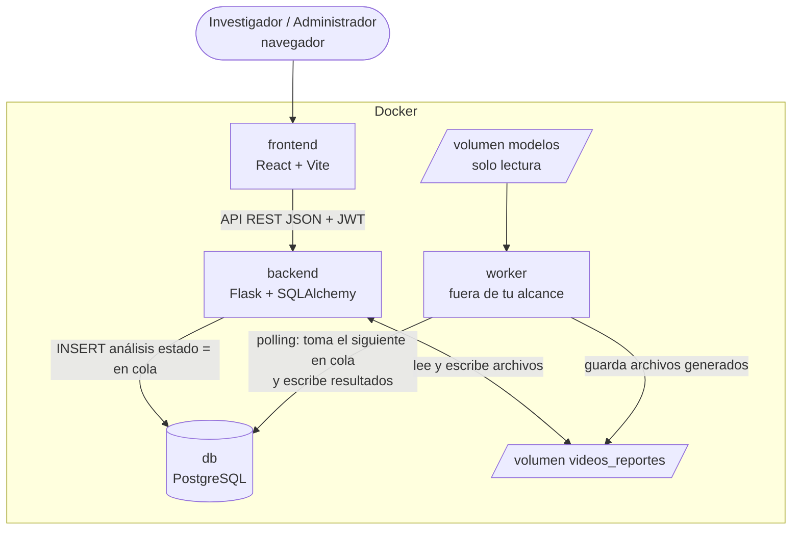

## 3. Estructura de repositorio sugerida [PROPUESTA]

```
web/
  docker-compose.yml
  .env.example
  backend/        app Flask, modelos SQLAlchemy, rutas
  frontend/       app React + Vite
  worker_fake/    simulador del worker (contrato de la sección 4) con las tareas programadas
                  (sección 8) en un módulo propio, para que el worker real las reutilice
  db/init/        SQL de creación (dominios, tablas, restricciones, semillas)
```

## 4. Contrato con el worker

El backend y el worker no se llaman entre sí. Se comunican **solo a través de la base de
datos y del volumen** (disposición del volumen en la sección 2). Esta sección es la
especificación de lo que hace el worker real y de lo que debe imitar tu `worker_fake`.

### 4.1 Lo que hace el backend al subir un video válido
1. Guarda el archivo en el volumen (`videos/{idVideo}.{extensión}`).
2. Guarda grupo (si es nuevo), tanda (nueva o existente) y video.
3. **Solo si la sesión es el Día 2** (D-71), crea una fila en `ANALISIS` con
   `estado = 'en cola'`, el `idVideo` del video y estos **valores de arranque** (D-79):
   `etapa = 'preprocesamiento'`, `nivelClasif = 'preciso'` y `fechaAnalisis` = la fecha de
   encolado. Las tres columnas son NOT NULL; el worker las reemplaza. El video del **Día 1 se
   guarda y no se analiza**: no tiene `ANALISIS` ni `OBSERVACION`.
4. Responde al frontend. Con un video del Día 2, el frontend redirige a la pantalla de
   progreso; con uno del Día 1, muestra que el video quedó guardado y que no se analiza.

### 4.2 Lo que hace el worker (tú lo simulas con `worker_fake`)
1. **Al arrancar (D-84)** reencola los análisis que quedaron en `procesando` sin nadie
   trabajando en ellos (el worker se apagó a media análisis): los pasa a `en cola` con
   `etapa = 'preprocesamiento'` y empiezan de cero. También revisa que cada análisis
   `en pausa` tenga su archivo de pausa (sección 4.3); si no lo tiene, lo cancela.
2. **Toma un análisis a la vez** (D-85). Cada cierto tiempo (`WORKER_POLL_SECONDS`) busca el
   análisis `en cola` **más antiguo** (menor `fechaAnalisis`; si empatan, menor `idAnalisis`).
   Los demás esperan en `en cola`. **Antes de empezar cada análisis revisa el disco**
   (sección 8, D-86).
3. Lo pasa a `procesando` y va actualizando `etapa` en este orden: `preprocesamiento`,
   `cilindros`, `clasificacion`. En `preprocesamiento` solo se comprueba el archivo, los especímenes y el modelo, y se leen dimensiones y duración; la alineación de la cámara y el modelo de fondo son de `cilindros`, y la pausa también se registra en `cilindros`.
4. **Camino de error.** Si no puede abrir el video o no encuentra los cilindros: genera el
   PDF de diagnóstico, llena `rutaDiagnostico`, pasa a `error` y crea una `NOTIFICACION` de
   tipo `error del pipeline`. No hay reintento: el investigador no puede reiniciar un
   análisis en `error` (R-04). Lo mismo vale para cualquier **fallo imprevisto** del pipeline
   (D-88): el worker lo atrapa, pasa el análisis a `error` con el PDF de diagnóstico (con el
   mensaje técnico) y la notificación `error del pipeline`, y sigue con el siguiente análisis
   sin apagarse. Ya no existe un umbral de confianza de detección.
5. Si todo sale bien, escribe los resultados (sección 4.4) y pasa a `completado`.

Diagrama de secuencia: `C:\Users\Samsung\Desktop\proyectos\fst-ai-system-latex\diagramas\guia_web\seq_analisis_automatico.puml` (Anexo A.9).

### 4.3 Pausa, ajuste y cancelación (RN-17, D-59, D-67, D-89)
Durante la clasificación, si en un segundo no se ve al espécimen, ese segundo queda como
"no se ve" (conducta nula). Quien lo nota es el **pipeline** (la segmentación contra el
fondo), no la red neuronal, que solo entrega la conducta. Si pasan **tres segundos seguidos**
así en un cilindro:

1. El pipeline guarda una **imagen fija** del video original en el **segundo central** de
   esos tres (el segundo 2 de 3), con el recuadro actual de cada cilindro, y escribe el
   archivo de pausa (abajo).
2. El worker pasa el análisis a `en pausa` (**primero el archivo, después el estado**) y crea
   la `NOTIFICACION` `analisis en pausa`. Luego **suelta el video** y atiende el siguiente de
   la cola: la pausa no bloquea a los demás.
3. El usuario ve esa imagen y tiene tres botones: **Ajustar y continuar**, **El recuadro está bien, continuar** y **Cancelar
   análisis** (sección 9.4). Pueden usarlos quien subió el video y el Administrador.
4. Si ajusta, el backend agrega el recuadro nuevo al archivo de pausa (coordenadas del video
   original) y pasa el análisis de `en pausa` a `en cola`, **solo si todavía está `en pausa`**.
   Conserva su `fechaAnalisis`, así que queda **por delante** de los análisis que llegaron
   después.
4b. Si el recuadro está bien, el usuario pulsa «El recuadro está bien, continuar» (`POST .../pause/continue`): el análisis pasa de `en pausa` a `en cola` sin cambiar el recuadro, con la misma condición de «solo si sigue `en pausa`» y conservando su `fechaAnalisis`.
5. Cuando el worker lo retoma, el pipeline convierte el recuadro a las coordenadas del video
   estabilizado, reemplaza la geometría de **ese cilindro** y continúa **desde el primero de
   esos tres segundos**, revisándolos de nuevo. Los segundos anteriores de ese cilindro
   quedan medidos con el recuadro original.
6. Si el usuario cancela, el análisis pasa a `cancelado` sin notificación y sin motivo guardado. Si pasan **72 horas** (`PAUSE_TIMEOUT_HOURS`) sin respuesta, el worker lo cancela y crea la `NOTIFICACION` `analisis cancelado`. Ambos cambian el estado solo si sigue `en pausa`; el segundo que llegue no hace nada. El worker revisa las pausas vencidas en cada vuelta de la cola, así que la cancelación por vencimiento puede tardar un poco más de 72 horas.

Un mismo cilindro puede pausarse más de una vez en el mismo análisis.

**Archivo de pausa (D-89).** No hay tabla ni columna nueva: la pausa vive en el volumen
compartido, en `videos_reportes/analisis/{idAnalisis}/`, con dos archivos: `pausa.jpg` (la
imagen fija) y `pausa.json`:

```json
{
  "version": 1,
  "cilindro": 2,
  "desde_segundo": 142,
  "instante_imagen_s": 143.5,
  "imagen": "pausa.jpg",
  "hora_pausa": "2026-10-12T19:40:00-06:00",
  "recuadros": [{"cilindro": 1, "x0": 245, "y0": 483, "x1": 577, "y1": 927}],
  "ajuste": null
}
```

Al ajustar, el backend llena `"ajuste": {"cilindro": 2, "x0": .., "y0": .., "x1": .., "y1": ..,
"hora": ".."}`. Las coordenadas están en píxeles de la imagen fija, que es un fotograma del
video original. Cuatro reglas:
- **(a)** el worker escribe primero el archivo y después el estado;
- **(b)** el estado de la base es el árbitro: todo cambio se hace con la condición "solo si
  sigue `en pausa`";
- **(c)** las tareas programadas y el borrado de un experimento eliminan esta carpeta;
- **(d)** el backend lee este archivo para mostrar la imagen, el recuadro y el tiempo que
  queda (`hora_pausa` + 72 horas).

**En `worker_fake`:** para simular una pausa, escribe un `pausa.jpg` cualquiera (por ejemplo
una imagen gris de 1280×720) y un `pausa.json` con valores inventados; luego prueba las salidas: el usuario ajusta (el análisis vuelve a `en cola` y el worker lo termina), el usuario confirma que el recuadro está bien, el usuario cancela, o pasan las 72 horas. Dispara la pausa con un archivo cuyo nombre contenga `pausa`.

Diagrama de secuencia de la pausa: `C:\Users\Samsung\Desktop\proyectos\fst-ai-system-latex\diagramas\guia_web\seq_pausa_y_ajuste.puml` (Anexo A.9).

### 4.4 Lo que escribe el worker al terminar bien
La red neuronal analiza el **video completo**; después el worker se queda con los **últimos
300 segundos** de cada espécimen (de final a inicio) y descarta el principio, donde a veces
aparecen personas. Es un máximo, sin mínimo: si el video dura menos, se quedan todos los
segundos. Renumera las filas de 1 a 300 antes de guardarlas (D-54). Por cada espécimen:
- una `OBSERVACION` del video;
- **una fila en `SEGUNDO` por cada segundo analizado** (hasta 300), con `conducta` (nula si el
  worker no decidió ese segundo o "no se ve") y `origen = 'maquina'`;

Los totales por minuto no se guardan: se calculan desde `SEGUNDO` (D-52). Un mismo
análisis puede mezclar las cuatro conductas.

En cada instante un espécimen está en exactamente una conducta: nado activo, inmovilidad,
escalamiento o conducta activa. Por eso, en un intervalo de un minuto, la suma de segundos de
sus conductas no pasa de 60; los segundos sin conducta cuentan como «sin ver», así que las cuatro conductas más «sin ver» suman 60 s y los porcentajes suman 100 %.

Después guarda `nivelClasif` (sección 11, punto 15), genera la copia H.264 y el archivo de
recuadros (sección 11, puntos 16 y 17), pasa a `completado` y crea una `NOTIFICACION` de tipo
`analisis completado`. Al pasar a `completado` o a `error`, **reemplaza** `fechaAnalisis` por
`ahora` (al encolar valía la fecha de encolado, D-79): el borrado a los 30 días cuenta desde
esa fecha y solo mira análisis en estado `completado`.

Cada `NOTIFICACION` que el worker crea se envía **también por correo** al destinatario
(sección 11, punto 2). Si el envío falla, el aviso queda en el panel y el análisis no se detiene.

### 4.5 Tareas programadas (D-82, D-86)
Las ejecuta el worker, no el backend: **una vez al día, a una hora fija de madrugada**
(`WORKER_DAILY_HOUR`, por ejemplo las 3 a. m.), el borrado de videos vencidos, el aviso de
vencimiento y la vigilancia del disco (sección 8). Si hay un análisis en curso, esperan a que
termine. Si el worker estaba apagado a esa hora, las corre al arrancar; para no repetirlas el
mismo día, guarda la fecha de la última corrida en `worker/ultima_corrida_tareas.txt`. El disco
se revisa también antes de empezar cada análisis. Estas tareas son parte del worker.

Diagrama de secuencia: `C:\Users\Samsung\Desktop\proyectos\fst-ai-system-latex\diagramas\guia_web\seq_tareas_programadas.puml` (Anexo A.11).

### 4.6 Reiniciar un análisis (lo hace el backend, D-60, D-68)
El investigador que subió el video (o un Administrador) puede reiniciar un análisis
**`completado`** desde la pantalla de revisión (sección 9.7). El backend, en una sola
transacción: **borra el resultado anterior** (las `OBSERVACION` de ese video con sus
`SEGUNDO`) y **toda la revisión humana** *al confirmar* el aviso que muestra la pantalla, no al terminar; borra los reportes
guardados del experimento para que se regeneren; y deja el análisis en `en cola` con los
valores de arranque de `etapa`, `nivelClasif` y `fechaAnalisis` (D-79). El worker lo toma como
cualquier otro. No se puede reiniciar un análisis en `error`, `en pausa`, `cancelado` ni en
curso.

### 4.7 Quién escribe `estado`, `etapa` y `nivelClasif`
**El backend nunca escribe `estado`, `etapa` ni `nivelClasif` salvo al crear el análisis en
cola o al reiniciarlo, con sus valores de arranque (D-79, D-68), y en la pausa: pasar un
análisis de `en pausa` a `en cola` (ajustar) o a `cancelado` (cancelar), siempre con la
condición "solo si sigue `en pausa`" (D-89).** Todo lo demás lo escribe el worker.

### 4.8 Estados
Estados válidos de un análisis (`estado_analisis`): `en cola`, `procesando`, `en pausa`,
`completado`, `error` y `cancelado`. Hay tres transiciones de regreso a `en cola`: el reinicio
de un análisis `completado` (R-04), el ajuste del recuadro de uno `en pausa` (R-15, D-89) y el
reencolado de los `procesando` huérfanos al arrancar el worker (D-84). `error` y `cancelado`
son finales.

Versión completa en PlantUML (Anexo A.6): `C:\Users\Samsung\Desktop\proyectos\fst-ai-system-latex\diagramas\guia_web\estados_analisis.puml`

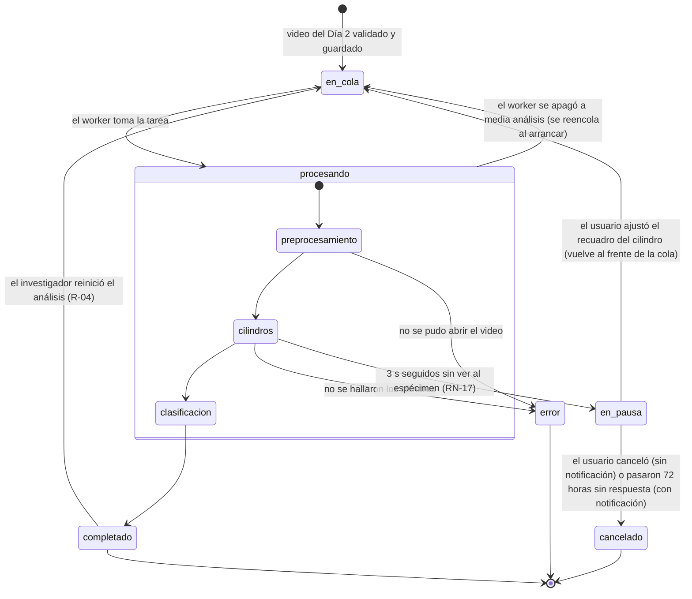

El estado de un **experimento** no se guarda: se calcula a partir de los análisis de
todas sus tandas, con precedencia `error` > `cancelado` > `en pausa` > `procesando` >
`en cola` > `completado`. Un experimento sin videos se muestra como "sin videos"; uno que solo
tiene videos del Día 1 (que no se analizan, D-71) se muestra como "en espera del Día 2" (D-83).

Versión completa en PlantUML (Anexo A.6): `C:\Users\Samsung\Desktop\proyectos\fst-ai-system-latex\diagramas\guia_web\estados_experimento.puml`

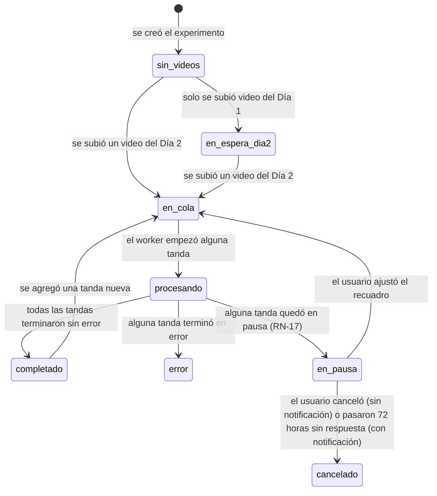

Mientras alguna tanda siga en error, el experimento sigue en `error`.

### 4.9 Notas para quien construya el worker real
- **Umbral de decisión.** El worker acepta una conducta para un segundo cuando su
  probabilidad llega a **0.80**. Es una **constante del worker**: no se guarda en la base de
  datos, no se configura desde la interfaz y el backend no la conoce. Lo mismo pasa con el
  archivo del modelo entrenado. Antes existían las tablas `MODELO` y `CONFIGURACION` para
  guardarlos; **ya no existen** (ningún requisito permite cambiar el modelo ni el umbral).
- **De dónde salen los segundos.** La red por segundo deja un `X_cnnseg.csv` con una fila por
  espécimen y segundo (`especimen` de 1 a 4, la posición en el cuadro; `segundo`; `clase`, que
  es la conducta; y columnas de probabilidad que la base **no** guarda) y un
  `X_cnnseg_resumen.csv` con los segundos por conducta de cada minuto. El worker convierte el primero
  en filas de `SEGUNDO` (solo `conducta`) y no guarda el resumen: los totales por minuto se
  calculan desde `SEGUNDO` (D-52). La conducta vale `nado`,
  `inmovilidad`, `escalamiento`, `activa` o vacío si no decidió; el worker traduce `nado` a
  `nado activo` y `activa` a `conducta activa`, y el vacío queda como `conducta` nula.
  `especimen` se enlaza con `ESPECIMEN.numeroCilindro`. El CSV trae un segundo por cada segundo
  del video completo: el worker toma las **últimas 300 filas** de cada espécimen (todas, si hay
  menos) y las renumera de 1 a 300 para que coincidan con el video recortado que ve el usuario
  (D-54). Las hojas manuales `X_seg.csv` solo entrenan la red y no entran a la base (D-53).
- **Código de referencia del pipeline** (otro repositorio, solo consulta): `C:\Users\Samsung\Desktop\proyectos\fst_auto\etiquetar.py` y `C:\Users\Samsung\Desktop\proyectos\fst_auto\lib.py` (preprocesamiento, localización de cilindros y medidas por fotograma), `C:\Users\Samsung\Desktop\proyectos\fst_auto\segundos.py` (regla de conducta por segundo) y `C:\Users\Samsung\Desktop\proyectos\fst_auto\cnn\probar_seg.py` (la red por segundo, que deja `X_cnnseg.csv`).

## 5. Modelo de datos (PostgreSQL)

12 tablas. Esta es la única versión vigente.

Fuentes del modelo (solo consulta; si difieren de esta guía, manda esta guía):
- Grafo relacional vigente: `C:\Users\Samsung\Desktop\proyectos\fst-ai-system-latex\diagramas\grafo_relacional_3_vigente.puml`
- Esquema físico del documento: `C:\Users\Samsung\Desktop\proyectos\fst-ai-system-latex\diagramas\esquema_fisico.puml`
- Estado del diseño de la base de datos: `C:\Users\Samsung\Desktop\proyectos\fst-ai-system-latex\DISENO-BD.md`
- Diccionario de datos: `C:\Users\Samsung\Desktop\proyectos\fst-ai-system-latex\back\apendice_D.tex`

**Jerarquía:** un experimento tiene grupos; un grupo tiene tandas; una tanda tiene
especímenes y hasta dos videos (Día 1 y Día 2); un video **del Día 2** tiene un análisis y, por
cada espécimen, una observación y una fila por cada segundo analizado. El video del
Día 1 no tiene análisis ni observaciones (D-71).

Versión completa en PlantUML (Anexo A.4): `C:\Users\Samsung\Desktop\proyectos\fst-ai-system-latex\diagramas\guia_web\esquema_fisico.puml`

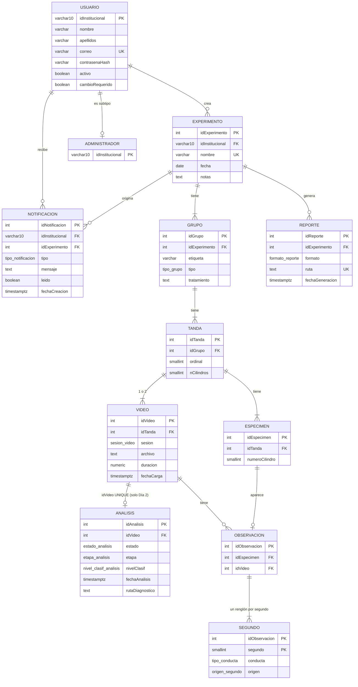

`VIDEO.archivo` admite nulo: queda vacío cuando el video ya se borró (a los 30 días o
antes, si el disco pasa del 90 %). La fila de `VIDEO` se conserva porque los resultados la
referencian. `SEGUNDO.conducta` también admite nulo: el worker no decidió ese segundo o el espécimen no se ve.

No se guarda el número con que el laboratorio identifica a cada espécimen (D-55): un
espécimen se distingue por su posición en el cuadro, `ESPECIMEN.numeroCilindro`. Como ese número se repite en cada tanda de
un grupo, la interfaz, los resultados y los reportes lo muestran junto con la tanda, por
ejemplo «Tanda A · Espécimen 2».

### Tipos y convenciones
- Id sustituto: `integer GENERATED ALWAYS AS IDENTITY`.
- `USUARIO.idInstitucional`: `varchar(10)`, es la llave primaria (identificador institucional).
- Fechas sin hora: `date`. Marcas de tiempo: `timestamptz`. Duraciones y segundos: `numeric`, nunca `float`.
- **Todas** las llaves foráneas son `ON UPDATE NO ACTION ON DELETE NO ACTION`. La base
  rechaza el borrado en vez de propagarlo. Por eso `USUARIO.activo` existe: dar de baja
  sin borrar. Para borrar un experimento, la aplicación debe borrar de las hojas hacia
  arriba: `SEGUNDO`, `OBSERVACION`, `ANALISIS`, `VIDEO`, `ESPECIMEN`,
  `TANDA`, `GRUPO`, `REPORTE`, `NOTIFICACION`, `EXPERIMENTO`.
- Contraseñas con **bcrypt + sal**. Nunca texto plano.

### Dominios cerrados (`CREATE DOMAIN ... CHECK`)
| Dominio | Valores |
|---|---|
| `tipo_grupo` | `control`, `referencia`, `tratamiento experimental` |
| `sesion_video` | `Dia 1`, `Dia 2` |
| `formato_reporte` | `CSV`, `XLSX`, `PDF` |
| `tipo_notificacion` | `analisis completado`, `error del pipeline`, `analisis en pausa`, `analisis cancelado`, `alerta de disco`, `video borrado` |
| `estado_analisis` | `en cola`, `procesando`, `en pausa`, `completado`, `error`, `cancelado` |
| `etapa_analisis` | `preprocesamiento`, `cilindros`, `clasificacion` |
| `nivel_clasif_analisis` | `preciso`, `agrupado` |
| `origen_segundo` | `maquina`, `confirmada`, `corregida`, `dudosa` |
| `tipo_conducta` | `nado activo`, `inmovilidad`, `escalamiento`, `conducta activa` |

`CONDUCTA` no es tabla sino el dominio cerrado `tipo_conducta` (D-102): `nado activo`,
`inmovilidad`, `escalamiento` y `conducta activa`; no hay tabla ni datos semilla de conductas.
Los totales por minuto no tienen tabla: se calculan desde `SEGUNDO`
(el minuto sale del número de segundo; D-52).

`SEGUNDO` guarda la conducta de cada espécimen en cada segundo analizado (hasta 300 por
observación). Es la fuente de la pantalla de revisión; de él salen también los totales y el
desglose por minuto, que no se guardan (D-52). Valores de `origen` (cuatro,
D-80): `maquina` (la puso el sistema, sin revisar), `confirmada` (el usuario vio el segundo y dejó la
conducta del sistema), `corregida` (la cambió) y `dudosa` (el segundo queda vacío porque el
usuario lo marcó como dudoso). `conducta` nula significa que el segundo no tiene conducta: el
pipeline no pudo decidir o no vio al espécimen, o el usuario lo marcó como dudoso (`origen = 'dudosa'`). La conducta del
sistema no se conserva aparte: al corregir se reemplaza, y `origen` dice que el segundo fue revisado.

### Restricciones que la base debe hacer cumplir
- `ANALISIS.idVideo` es `UNIQUE`: un video, un análisis. Reanalizar **reemplaza** el
  resultado anterior, no hay historial.
- `GRUPO`: `UNIQUE (idExperimento, etiqueta)`. `TANDA`: `UNIQUE (idGrupo, ordinal)`.
- `VIDEO`: `UNIQUE (idTanda, sesion)`. `OBSERVACION`: `UNIQUE (idEspecimen, idVideo)`.
- `ESPECIMEN`: `UNIQUE (idTanda, numeroCilindro)`.
- `EXPERIMENTO.nombre` es `UNIQUE` en todo el sistema.
- `ANALISIS.rutaDiagnostico` solo se llena cuando `estado = 'error'`.
- `ADMINISTRADOR` es subtipo: su llave primaria es la misma llave foránea a `USUARIO`.

### Cardinalidades
- `EXPERIMENTO` tiene 3 o más grupos.
- `GRUPO` tiene **1 o más tandas** (la tanda B y siguientes son opcionales).
- `TANDA` tiene de **2 a 4 especímenes** (ese es el rango de `nCilindros`) y de 1 a 2 videos.
- `GRUPO` tiene **2 o más especímenes**, sin tope.
- Un `VIDEO` del **Día 2** tiene de 2 a 4 observaciones (una por espécimen) y un análisis; uno
  del **Día 1** no tiene ninguno de los dos (D-71). Un `ESPECIMEN` tiene 0 o 1 observación.

El mínimo de 2 por grupo se da cuando el grupo tiene una sola tanda (la A) con 2
especímenes. Cualquier total de 2 en adelante se puede repartir en tandas de 2 a 4 (por
ejemplo, 5 = 3 + 2), así que las reglas son compatibles. El laboratorio mencionó que 6
especímenes por grupo es lo habitual como mínimo útil, pero el equipo decidió modelar el
mínimo estructural en 2: no obligues a 6.

Las cardinalidades mínimas no se pueden forzar con `FOREIGN KEY`: valídalas en la
aplicación al guardar y no pongas `CHECK` de conteo en la base. Tampoco puede la base
impedir un `ANALISIS` para un video del Día 1: el backend simplemente no lo crea.

## 6. API REST

Reglas generales:
- Todo requiere JWT, salvo `POST /auth/login` y `POST /auth/recover`.
- Respuesta JSON con tres campos: `data` (resultado), `error` (mensaje) y `status` (código HTTP).
  Las rutas que devuelven un archivo (reportes, PDF de diagnóstico, imagen de la pausa, video de
  revisión) devuelven el archivo tal cual, sin ese envoltorio.
- Errores de login con mensaje **genérico**, sin decir si falló el correo o la contraseña (R-01).

| Método | Ruta | Descripción | Acceso |
|---|---|---|---|
| POST | `/auth/login` | Inicia sesión, devuelve JWT | Público |
| POST | `/auth/logout` | Cierra sesión. El cliente descarta el token; no hay lista de bloqueo (sección 11, punto 1) | Autenticado |
| POST | `/auth/recover` | Envía enlace de recuperación por correo | Público |
| PATCH | `/auth/password` | Cambia la contraseña del usuario autenticado | Autenticado |
| GET | `/experiments` | Lista todos los experimentos del laboratorio | Investigador |
| POST | `/experiments` | Crea experimento (nombre único, fecha, notas opcionales) | Investigador |
| GET | `/experiments/{id}` | Detalle y estado del experimento | Investigador |
| POST | `/experiments/{id}/groups/{grupo}/videos` | Sube un video (Día 1 o Día 2) a una tanda del grupo; crea la tanda si no existe y, si es el Día 2, encola el análisis | Investigador |
| GET | `/experiments/{id}/status` | Progreso de los análisis en porcentaje | Investigador |
| GET | `/experiments/{id}/results` | Resultados por espécimen y conducta | Investigador |
| GET | `/experiments/{id}/results/byminute` | Desglose por minuto | Investigador |
| GET | `/experiments/{id}/results/groups` | Comparación entre grupos con el Día 2: promedio por espécimen de cada grupo (RF-21) **[PROPUESTA]** | Investigador |
| GET | `/experiments/{id}/report/pdf` | Descarga reporte PDF | Investigador |
| GET | `/experiments/{id}/report/csv` | Descarga CSV | Investigador |
| GET | `/experiments/{id}/report/xlsx` | Descarga XLSX | Investigador |
| GET | `/admin/users` | Lista usuarios (filtros: rol, estado) | Admin |
| POST | `/admin/users` | Crea cuenta con contraseña temporal | Admin |
| PATCH | `/admin/users/{id}` con `{nombre, apellidos, correo}` | Modifica los datos de la cuenta. | Admin |
| PATCH | `/admin/users/{id}` con `{rol}` | Da o quita el rol de Administrador. Rechaza con 409 la propia cuenta («Para cambiar tu propia cuenta usa Mi perfil.») y la última cuenta de Administrador activa (R-16) | Admin |
| PATCH | `/admin/users/{id}` con `{activo: false}` | Desactiva la cuenta y corta sus sesiones. Rechaza con 409 la propia cuenta y la última cuenta de Administrador activa (R-16) | Admin |
| PATCH | `/admin/users/{id}` con `{activo: true}` | Reactiva la cuenta. No cambia la contraseña anterior ni el cambio obligatorio, y no envía correo. | Admin |
| POST | `/admin/users/{id}/reset-temporal` | Genera una contraseña temporal nueva de 12 caracteres, obliga a cambiarla en el siguiente acceso, la envía por correo y deja registro sin la contraseña. Solo para cuentas activas y no la propia; si la cuenta está inactiva, la interfaz pide reactivar primero. | Admin |
| GET | `/admin/system` | Métricas: disco y cola | Admin |

**Importante:** el rol Administrador es un permiso de **backend**. Ocultar la sección en
la interfaz no basta. Cada ruta `/admin/*` debe verificar en la base que el
`idInstitucional` de la sesión esté en `ADMINISTRADOR` y responder 403 si no.

### Rutas que faltan en la tabla pero la funcionalidad necesita [PROPUESTA]
Estos nombres los propone este documento; confírmalos con el usuario:

| Necesidad | Ruta propuesta |
|---|---|
| Completar la recuperación de contraseña con el enlace | `POST /auth/reset` |
| Actualizar nombre y correo del perfil propio | `PATCH /users/me` |
| Eliminar un experimento (rechaza con 409 si algún análisis está `procesando` o `en pausa`; los `en cola` salen de la cola) | `DELETE /experiments/{id}` |
| Ver la pausa de un análisis (imagen fija, recuadro actual y tiempo que queda) | `GET /experiments/{id}/analyses/{idAnalisis}/pause` y `GET .../pause/image` |
| Ajustar el recuadro de un cilindro y continuar (quien subió el video o un Administrador; 409 si ya no está `en pausa`) | `POST /experiments/{id}/analyses/{idAnalisis}/pause/adjust` |
| El recuadro está bien: continuar sin cambiarlo (mismo permiso; 409 si ya no está `en pausa`) | `POST /experiments/{id}/analyses/{idAnalisis}/pause/continue` |
| Cancelar un análisis en pausa, sin notificación ni motivo (quien subió el video o un Administrador; 409 si ya no está `en pausa`) | `POST /experiments/{id}/analyses/{idAnalisis}/cancel` |
| Listar y marcar notificaciones como leídas | `GET /notifications`, `PATCH /notifications/{id}` |
| Descargar el PDF de diagnóstico de un análisis | `GET /experiments/{id}/analyses/{idAnalisis}/diagnostic` |
| Sugerir grupos con nombre parecido y la siguiente tanda | `GET /experiments/{id}/groups?q=` |
| Bloques de 5 s de los especímenes (se calculan al pedirlos, no se guardan) | `GET /experiments/{id}/results/blocks` |
| Datos de la pantalla de revisión: especímenes, etiquetas por segundo y recuadros de los tubos | `GET /experiments/{id}/analyses/{idAnalisis}/review` |
| Video para la pantalla de revisión (con soporte de `Range`, para poder adelantar y retroceder) | `GET /experiments/{id}/analyses/{idAnalisis}/video` |
| Guardar las correcciones por segundo (solo quien subió el video o un Administrador, D-57) | `PUT /experiments/{id}/analyses/{idAnalisis}/segundos` |
| Reiniciar un análisis `completado`: borra el resultado anterior y toda la revisión humana (la pantalla avisa antes) y lo vuelve a encolar (solo quien subió el video o un Administrador; D-60, D-68) | `POST /experiments/{id}/analyses/{idAnalisis}/restart` |

### 6.1 Formas de las peticiones y respuestas [PROPUESTA]
Si el backend y el frontend los construyen sesiones distintas, **esta sección es el contrato
entre ambos**: no cambies un nombre de campo sin avisar. Todos los ejemplos van dentro del
envoltorio `data` de la sección 6. Los nombres de campo van en `camelCase` y los de las
conductas, tal como se guardan en la base.

**Iniciar sesión.** `POST /auth/login`, cuerpo `{"correo": "...", "contrasena": "..."}`.
`data`: `{"token": "...", "rol": "Investigador" | "Administrador", "nombre": "...",
"cambioRequerido": false}`. Credenciales malas: 401 con mensaje genérico.

**Lista de experimentos.** `GET /experiments?estado=&fecha=&tratamiento=&pagina=1`. `data`:
```json
{"pagina": 1, "total": 12, "items": [
  {"idExperimento": 7, "nombre": "Exp. A", "fecha": "2026-10-01", "nGrupos": 3,
   "estado": "completado", "avisoVencimiento": {"fechaBorrado": "2026-11-12"}}]}
```
`estado` vale `sin videos`, `en espera del Día 2`, `en cola`, `procesando`, `en pausa`,
`completado`, `error` o `cancelado`; `avisoVencimiento` es `null` si ningún video vence en
menos de 7 días.

**Detalle de un experimento.** `GET /experiments/{id}`. `data`:
```json
{"idExperimento": 7, "nombre": "Exp. A", "fecha": "2026-10-01", "notas": "", "estado": "completado",
 "grupos": [{"idGrupo": 1, "etiqueta": "Control", "tipo": "control", "tratamiento": "Salina",
   "tandas": [{"idTanda": 1, "ordinal": 1, "letra": "A", "nCilindros": 4,
     "videos": [{"idVideo": 1, "sesion": "Dia 2", "duracion": 300.0,
                 "videoDisponible": true, "idAnalisis": 1}]}]}]}
```

**Subir un video.** `POST /experiments/{id}/groups/{grupo}/videos`, `multipart/form-data` con
`archivo`, `sesion` (`Dia 1` o `Dia 2`), `tipo` y `tratamiento` (solo si el grupo es nuevo),
`nCilindros` (solo si la tanda es nueva) y `ordinal` (la tanda confirmada; si falta se usa la
siguiente). Respuesta 201: `{"idVideo": 1, "idAnalisis": 1, "estadoAnalisis": "en cola"}`; con un
video del Día 1, `idAnalisis` y `estadoAnalisis` son `null`. Rechazos: 422 con
`{"error": "mensaje claro"}` (formato, orientación vertical, no reproducible) y 409 si la tanda
ya tiene un video de esa sesión.

**Progreso.** `GET /experiments/{id}/status`. `data`:
```json
{"analisis": [{"idAnalisis": 1, "tanda": "Control · A", "sesion": "Dia 2",
   "estado": "procesando", "etapa": "cilindros", "porcentaje": 67,
   "pausa": null, "diagnosticoDisponible": false}]}
```
`porcentaje` sale de `analisis/{idAnalisis}/progreso.json`, que escribe el worker: 0 en cola, pesos preprocesamiento 1, cilindros 9 y clasificación 90, con tope 99 mientras corre y 100 al completarse; si falta el archivo, usa 33, 67 o 100 según la etapa. Con el análisis en pausa,
`pausa` es `{"cilindro": 2, "segundosRestantes": 221}`.

**Resultados.** `GET /experiments/{id}/results`. `data`:
```json
{"especimenes": [{"tanda": "Control · A", "ordinal": 1, "numeroCilindro": 2,
   "nivelClasif": "preciso", "revisado": false,
   "totales": {"nado activo": {"segundos": 60, "porcentaje": 20.0},
               "inmovilidad": {"segundos": 180, "porcentaje": 60.0},
               "escalamiento": {"segundos": 60, "porcentaje": 20.0},
               "conducta activa": {"segundos": 0, "porcentaje": 0.0},
               "sin ver": {"segundos": 0, "porcentaje": 0.0}}}]}
```
`results/byminute` devuelve lo mismo con una lista `minutos` (`minuto` 1 a 5 y los segundos de cada
conducta) por espécimen; `results/groups`, el promedio por conducta de cada grupo, los
especímenes con dato faltante y un aviso si el grupo mezcla niveles `preciso` y `agrupado`;
`results/blocks`, para cada espécimen su lista de bloques con la conducta mayoritaria y sus cinco
segundos. `revisado` es verdadero si algún `origen` del espécimen no es `maquina`.

**Pausa.** `GET /experiments/{id}/analyses/{idAnalisis}/pause`. `data`:
```json
{"cilindro": 2, "desdeSegundo": 142, "segundosRestantes": 221, "ancho": 1920, "alto": 1080,
 "recuadros": [{"cilindro": 1, "x0": 245, "y0": 483, "x1": 577, "y1": 927}]}
```
`.../pause/image` devuelve el JPG. `POST .../pause/adjust` recibe
`{"cilindro": 2, "x0": 250, "y0": 480, "x1": 580, "y1": 930}` en píxeles de la imagen;
`POST .../cancel` y `POST .../pause/continue` no llevan cuerpo. Los tres responden 200, o 409 si el análisis ya no está `en pausa`.

**Revisión.** `GET /experiments/{id}/analyses/{idAnalisis}/review`. `data`:
```json
{"puedeCorregir": true, "videoUrl": "/experiments/7/analyses/1/video",
 "especimenes": [{"numeroCilindro": 1, "tanda": "Control · A",
   "recuadro": {"x0": 245, "y0": 483, "x1": 577, "y1": 927},
   "segundos": [{"segundo": 1, "conducta": "nado activo", "origen": "maquina"},
                {"segundo": 2, "conducta": null, "origen": "dudosa"}]}]}
```
`PUT .../segundos` recibe solo los segundos que cambiaron:
`{"especimenes": [{"numeroCilindro": 1, "segundos": [{"segundo": 12, "conducta": "inmovilidad",
"origen": "corregida"}]}]}`. Responde 200; los totales por minuto no se guardan, se calculan desde `SEGUNDO`.

**Usuarios (administración).** `GET /admin/users?rol=&estado=` devuelve una lista de
`{"idInstitucional", "nombre", "apellidos", "correo", "rol", "activo", "nExperimentos"}`;
`POST /admin/users` recibe `{"idInstitucional", "nombre", "apellidos", "correo"}` y devuelve la
contraseña temporal **una sola vez**: `{"passwordTemporal": "..."}`.

## 7. Reglas de negocio que el backend debe cumplir

| ID | Regla |
|---|---|
| R-01 | Credenciales incorrectas: el mensaje es «Correo o contraseña incorrectos», sin decir si falló el correo o la contraseña. |
| R-02 | Un video pertenece a exactamente una tanda. No se reutiliza en otra. |
| R-03 | Una tanda tiene como máximo 2 videos: Día 1 (20 min) y Día 2 (5 min). Ambos son opcionales individualmente. Solo el Día 2 se analiza; el Día 1 solo confirma que existe el video de habituación (D-54). |
| R-04 | El análisis lo inicia el sistema solo. El investigador **no puede** iniciar ni pausar un análisis; solo el sistema lo pausa (R-15). Sí puede **cancelarlo únicamente cuando está `en pausa`**, con el botón «Cancelar análisis» de la pantalla de pausa (D-89); no pongas botón de cancelar ni de pausar en ningún otro lugar. Lo que sí puede hacer, **cuando el análisis termina**, es corregir las etiquetas por segundo (R-14) y **reiniciar el análisis** desde la pantalla de revisión (D-60): el resultado anterior y toda la revisión humana se borran al confirmar el aviso que la pantalla muestra antes (D-68). |
| R-05 | Los videos se borran 30 días después de un análisis exitoso. Irreversible. Aviso con 7 días o más de anticipación. Excepción: si el disco pasa del 90 %, se borran antes los más antiguos (sección 8). |
| R-06 | Resultados y reportes se conservan para siempre, aunque el video ya no exista. |
| R-07 | Todos los investigadores activos pueden ver los experimentos de cualquier otro. El administrador además modifica, desactiva y reactiva cuentas, y genera contraseñas temporales nuevas. |
| R-08 | Borrar un experimento es permanente (se van video, resultados y reportes). Pide confirmación explícita. Solo lo borra quien lo creó o un Administrador (los demás reciben 403). Se rechaza con 409 si algún análisis está `procesando` o `en pausa`; los que están `en cola` salen de la cola al borrarlo (D-87). |
| R-09 | Solo se aceptan archivos `.mp4` y `.mov`. La **extensión** se comprueba **en la interfaz** antes de subir, y el backend la repite. La **orientación** y la **reproducibilidad** las valida **el servidor** al recibir el video (D-64): debe ser reproducible y estar **en horizontal** (ancho mayor que alto); un video girado (vertical) **no se puede procesar** y se rechaza con un mensaje claro. No hay opción de rotar. |
| R-10 | **Eliminada.** Ya no hay umbral de confianza de detección de cilindros, y nada la sustituye en esta versión. |
| R-11 | **Eliminada (D-44).** No hay comparación Día 1 vs Día 2. Se comparan los grupos entre sí con el Día 2; el Día 1 solo sirve para verificar que los especímenes llegaron igual de estresados. |
| R-12 | Cuando el clasificador sabe que el espécimen no está inmóvil pero no decide entre nado y escalamiento, esos segundos se guardan como "conducta activa", una cuarta conducta. Un mismo análisis puede mezclar las cuatro. Los reportes deben mostrarla como una columna más. En los bloques de 5 s, cualquier empate en el primer lugar también es conducta activa (sección 9.5). |
| R-13 | De cada video se guardan y se muestran como máximo los **últimos 300 s** (de final a inicio), sin mínimo. La CNN analiza el video completo y el worker descarta el principio, donde a veces aparecen personas, y renumera de 1 a 300 (D-54). |
| R-14 | Solo se puede revisar un análisis en estado `completado`. Al revisar, el usuario corrige las etiquetas segundo a segundo; cada corrección queda en `SEGUNDO` con `origen` `confirmada`, `corregida` o `dudosa`, y al guardar el backend solo actualiza `SEGUNDO`: los totales por minuto no se guardan, se calculan desde `SEGUNDO` (D-52). Al guardar, el nivel de clasificación se recalcula: `agrupado` si queda algún segundo como conducta activa, `preciso` si no. La conducta que puso el sistema se reemplaza al corregir; `origen` conserva que el segundo fue revisado. **Solo corrigen el investigador que subió el video y el Administrador** (D-57). Corregir etiquetas no cambia el modelo ni el video: si lo que cambia es el video o el modelo, es un análisis nuevo (reinicio, R-04). El video que se reproduce es la copia H.264 que el worker genera al terminar (D-58). |
| R-15 | Si en un segundo no se ve al espécimen, ese segundo se registra como "no se ve". Tres segundos seguidos así dejan el análisis `en pausa` (etapa `cilindros`), se guarda una imagen fija de ese instante, se avisa al usuario con una notificación `analisis en pausa` y se le pide ajustar el recuadro del cilindro. El worker atiende mientras tanto el siguiente análisis. Con el ajuste, el análisis vuelve al frente de la cola y continúa desde el segundo de la pausa. Si el usuario cancela, el análisis pasa a `cancelado` sin notificación ni motivo; si pasan 72 horas sin respuesta, pasa a `cancelado` y se crea la notificación `analisis cancelado` (RN-17, D-59, D-67, D-89). |
| R-16 | Siempre debe existir al menos un Administrador activo: el backend rechaza desactivar la última cuenta de Administrador activa o quitarle el rol (RN-16, D-61, D-72). El Administrador sí puede cambiar el rol de otra cuenta desde el panel de administración. Un Administrador no puede desactivarse ni quitarse el rol a sí mismo: el backend lo rechaza con 409 y el mensaje «Para cambiar tu propia cuenta usa Mi perfil.». |

Otras decisiones tomadas:
- **Progreso:** el porcentaje por análisis sale de `progreso.json`, que escribe el worker (preprocesamiento 1, cilindros 9, clasificación 90; tope 99 mientras corre; 100 al completarse). Si falta el archivo, el backend usa 33 %, 67 % o 100 % por etapa. El backend lo lee; no se guarda en la base.
- **Comparación entre grupos (solo Día 2):** se **promedia** por grupo (no se suma), para
  que el tamaño del grupo no distorsione. «Sin ver» queda fuera de esa comparación. Los especímenes sin resultado se marcan como
  dato faltante. Si un grupo mezcla niveles `preciso` y `agrupado`, se separan los
  resultados por nivel y se avisa.
- **Reportes:** se guardan en `REPORTE`. Al pedir uno: si no existe, se genera; si existe, se devuelve; la caché se invalida al corregir segundos, reiniciar un análisis, editar el experimento, borrar una tanda o el experimento, cambiar el nombre del creador, y cuando el worker completa o falla un análisis. Borrar un video no la invalida.
- **Contenido de los reportes:** CSV y XLSX con datos por espécimen y desglose por minuto, con una columna «Sin ver» al final y su media, desviación estándar y varianza
  (columnas `Grupo`, `Tanda`, `Espécimen`, `Tiempo (min:seg)`, `Nado`, `Escalamiento`, `Inmovilidad`,
  `Conducta activa`, una fila por espécimen y por minuto) más estadísticas por grupo: media, desviación estándar y varianza del tiempo de
  cada conducta entre los especímenes de cada grupo (agregando todas sus tandas). El PDF
  es el **reporte de resultados** (D-76), distinto del **reporte de diagnóstico** (el que se
  genera cuando un análisis termina en error).
- **Cuentas:** no existe autorregistro ni formulario público. Solo el administrador crea
  cuentas con identificador institucional (propuesta, sección 11 punto 12), nombre,
  apellidos y correo (de cualquier dominio, D-46); el sistema genera la contraseña temporal. Se pone
  `cambioRequerido = true` y el sistema obliga a cambiarla en el primer ingreso.
- **Recuperación de contraseña:** el enlace lleva su vencimiento **firmado dentro**
  (JWT). No se agregan columnas a `USUARIO`.
- **Desactivar usuario:** `activo = false`. **Reactivar:** `activo = true`; no cambia la contraseña ni el cambio obligatorio. **Contraseña temporal nueva:** ruta aparte (`POST .../reset-temporal`), no reactiva. Nunca `DELETE`.
- **Perfil:** el investigador puede actualizar su nombre, correo y contraseña.
- **Crear experimento:** solo pide nombre único, fecha y notas opcionales. El grupo, el
  tratamiento y el número de especímenes de cada tanda (de 2 a 4) se capturan después, al
  subir el primer video de cada grupo.

## 8. Tareas programadas (cron)

Las ejecuta el **worker** (D-82), no el backend, **una vez al día a una hora fija de madrugada**
(D-86). Si el worker estaba apagado a esa hora, las corre al arrancar.

| Tarea | Frecuencia | Qué hace |
|---|---|---|
| Borrar videos vencidos | Diaria | Elimina el archivo del video (y su copia `web.mp4`) 30 días después de `ANALISIS.fechaAnalisis` si `estado = completado`. La fila de `VIDEO` se conserva y su `archivo` queda en nulo. También borra las carpetas de pausa (`pausa.json`, `pausa.jpg`) que hayan quedado huérfanas. |
| Aviso de vencimiento | Diaria | Marca los videos a menos de 7 días del borrado para que la lista de experimentos los muestre con nombre del experimento y fecha exacta. |
| Vigilar disco | Diaria y antes de cada análisis | Al superar **80 %**, crea `NOTIFICACION` tipo `alerta de disco` para el administrador. Al superar **90 %**, borra los videos más antiguos (deja `VIDEO.archivo` en nulo) y crea una `NOTIFICACION` tipo `video borrado` para el investigador de cada experimento afectado. |

La fecha de borrado se **deriva** (`fechaAnalisis + 30 días`). No hay columna para ella y
no se debe crear. En `worker_fake`, estas tres tareas viven en un módulo aparte y se pueden
disparar a mano para probarlas sin esperar a la madrugada.

## 9. Frontend

Siete pantallas (la de progreso incluye la vista de pausa). Estilo sobrio, para escritorio, todo en español. El objetivo es que una
persona sin conocimientos de programación cree un experimento, suba un video, espere y
descargue el reporte sin ayuda. La meta es que 9 de cada 10 personas lo logren sin
asistencia. Cada pantalla cita su **maqueta v2** (HTML e imagen). Las maquetas son anteriores a algunas
decisiones del 11 y 12 de octubre: no muestran la pantalla de pausa, el rol editable de las cuentas,
las notificaciones nuevas ni los cambios de la revisión. **Si difieren de esta guía, mandan los
esquemas y las reglas de esta guía**; la maqueta sirve para el estilo visual y la disposición.
Cada pantalla tiene varios estados; impleméntalos todos. Capturas de los estados: `C:\Users\Samsung\Desktop\proyectos\fst-ai-system-latex\figures\mockups\estados`.

Estructura común: barra superior con el nombre del sistema, notificaciones (campana) y
menú de usuario con "Cerrar sesión" accesible desde cualquier pantalla.

### 9.1 Inicio de sesión
Maqueta v2: `C:\Users\Samsung\Desktop\proyectos\fst-ai-system-latex\mockups\v2\login.html` (imagen: `C:\Users\Samsung\Desktop\proyectos\fst-ai-system-latex\figures\mockups\login.png`). Cambio de contraseña obligatorio: `C:\Users\Samsung\Desktop\proyectos\fst-ai-system-latex\mockups\v2\primer-acceso.html`.
Estados: normal; error genérico de credenciales. Incluye enlace "Recuperar contraseña".

```
+----------------------------------+
|   Sistema de análisis FST        |
|                                  |
|  Correo electrónico              |
|  [ nombre@ejemplo.com        ]   |
|  Contraseña                      |
|  [ ••••••••                  ]   |
|  (!) Correo o contraseña incorrectos    |  <- solo en el estado de error
|  [        Iniciar sesión     ]   |
|  ¿Olvidaste tu contraseña?       |
+----------------------------------+
```

Si la cuenta tiene `cambioRequerido = true`, tras entrar obliga a cambiar la contraseña
antes de continuar.

Diagramas de secuencia: `C:\Users\Samsung\Desktop\proyectos\fst-ai-system-latex\diagramas\guia_web\seq_login.puml` y `C:\Users\Samsung\Desktop\proyectos\fst-ai-system-latex\diagramas\guia_web\seq_logout.puml` (Anexo A.8).

### 9.2 Lista de experimentos
Maqueta v2: `C:\Users\Samsung\Desktop\proyectos\fst-ai-system-latex\mockups\v2\experimentos.html` (imagen: `C:\Users\Samsung\Desktop\proyectos\fst-ai-system-latex\figures\mockups\experimentos.png`). Detalle de un experimento: `C:\Users\Samsung\Desktop\proyectos\fst-ai-system-latex\mockups\v2\experimento.html`.
Estados: con experimentos; vacío ("Aún no hay experimentos" y botón de crear); con aviso de
video por vencer.

```
+-------------------------------------------------------------+
| [+ Nuevo experimento]    Filtros: [Estado v][Fecha v][Trat. v]|
| (!) El video del experimento "X" se borra el 12/11/2026      |  <- aviso (menos de 7 días)
|-------------------------------------------------------------|
| Nombre      | Fecha      | Grupos | Estado      | Acciones   |
| Exp. A      | 01/10/2026 | 3      | Completado  | Ver | CSV  |
| Exp. B      | 28/09/2026 | 3      | Procesando  | Ver        |
| Exp. C      | 20/09/2026 | 4      | Con error   | Ver | Elim.|
|-------------------------------------------------------------|
| < 1 2 3 >                                                    |
+-------------------------------------------------------------+
```

Lista **todos** los experimentos del laboratorio (de cualquier investigador). El estado se
calcula (sección 4.8) y se muestra como «Sin videos», «En espera del Día 2», «En cola»,
«Procesando», «En pausa», «Completado», «Con error» o «Cancelado». El filtro por tratamiento muestra los experimentos que tengan al
menos un grupo con ese tratamiento. "Eliminar" pide confirmación explícita (R-08).

### 9.3 Crear experimento
Maqueta v2: `C:\Users\Samsung\Desktop\proyectos\fst-ai-system-latex\mockups\v2\cargar-video.html` (imagen: `C:\Users\Samsung\Desktop\proyectos\fst-ai-system-latex\figures\mockups\cargar-video.png`). Grupo: `C:\Users\Samsung\Desktop\proyectos\fst-ai-system-latex\mockups\v2\grupo.html`.
Se hace en pasos, porque subir un video puede tardar varios minutos y así se puede corregir
el nombre o la fecha sin volver a subir nada, y agregar tandas después.

```
Paso 1: Datos del experimento
  Nombre* [__________]   Fecha* [__/__/____]   Notas [__________]
  [Continuar]

Paso 2: Grupo, tanda y video   (se repite por cada tanda)
  Grupo* [ Control        v]   Tratamiento* [____________]
  Tanda sugerida: [ B ]  (editable)  -> "¿Esta es la tanda B de Control?" [Confirmar]
  Especímenes en esta tanda: [ 2 a 4 ]
  Sesión*  (o) Día 1   ( ) Día 2
  Archivo*  [Elegir .mp4 o .mov] [=======>      ] 45 %   <- progreso de subida
  [Subir]                       [+ Agregar otra tanda]   [Terminar]

Paso 3: Confirmación
  Día 2: "Video almacenado. El análisis está en cola." -> redirige a Progreso
  Día 1: "Video del Día 1 almacenado. No se analiza." -> vuelve al experimento
```

Reglas del paso 2:
- Al escribir el nombre del grupo, si coincide con uno **del mismo experimento**, el
  sistema sugiere la siguiente tanda (letra A, B, C...; en la base es `TANDA.ordinal`
  entero) en un campo editable y **pide confirmación explícita**. Si es grupo nuevo, la
  primera tanda es la "A" y se piden tipo (control, referencia o tratamiento
  experimental) y tratamiento.
- Rechaza en el cliente cualquier archivo que no sea `.mp4` o `.mov`, con un mensaje
  específico, antes de subir. La orientación (un video en vertical, con alto mayor que ancho) y
  la reproducibilidad **no se validan en el navegador**: las valida el servidor al recibir el
  archivo (D-64) y la interfaz muestra su mensaje de rechazo.
- El video del **Día 1** se sube y se guarda, pero no se analiza (D-71): no hay redirección a
  Progreso; el experimento queda «En espera del Día 2» hasta que se suba uno del Día 2.
- Muestra errores de validación por campo (campos obligatorios vacíos).
- Estados: vacío, lleno, subiendo, error de formato, errores de campo, éxito.

Diagramas de secuencia: `C:\Users\Samsung\Desktop\proyectos\fst-ai-system-latex\diagramas\guia_web\seq_crear_experimento.puml` y `C:\Users\Samsung\Desktop\proyectos\fst-ai-system-latex\diagramas\guia_web\seq_carga_video.puml` (Anexo A.9).

### 9.4 Progreso del análisis
Maqueta v2: `C:\Users\Samsung\Desktop\proyectos\fst-ai-system-latex\mockups\v2\progreso.html` (imagen: `C:\Users\Samsung\Desktop\proyectos\fst-ai-system-latex\figures\mockups\progreso.png`).
Estados: analizando; en pausa (el sistema no vio al espécimen y espera al usuario); completado;
error ("No se pudo abrir el video." o "No se encontraron los tubos en el video.", o "El análisis se detuvo en la etapa «X»."); cancelado (el usuario canceló, sin notificación, o pasaron 72 horas sin respuesta). En pausa se muestra la **pantalla de pausa** (RN-17, D-59, D-89; maqueta `mockups/v2/pausa.html`, imagen `figures/mockups/pausa.png`):

```
+-------------------------------------------------------------+
| No se ve al espécimen del cilindro 2 (segundo 142)           |
| Tiempo que queda para responder: 71 h 42 min                        |
| +-------------------------------+                            |
| |  imagen fija del instante;    |                            |
| |  recuadro que se arrastra     |                            |
| +-------------------------------+                            |
| [Ajustar y continuar]  [El recuadro está bien, continuar]  [Cancelar análisis] |
+-------------------------------------------------------------+
```

El recuadro se arrastra y se redimensiona sobre la imagen; «Ajustar y continuar» envía sus
coordenadas en píxeles de la imagen; «El recuadro está bien, continuar» no envía coordenadas. Si el plazo ya venció, el backend responde 409 y la
pantalla avisa que el análisis ya se canceló.

A la pantalla de pausa se llega desde la notificación «análisis en pausa» o desde la
pantalla de progreso. Pide sus datos a `GET .../pause` (sección 6.1) y los vuelve a pedir cada
pocos segundos para actualizar el tiempo que queda.

```
+-------------------------------------------------------------+
| Experimento A / Control / Tanda A / Día 2                    |
| Etapas:  [x] Preprocesamiento  [>] Cilindros                 |
|          [ ] Clasificación                                   |
| [===================>         ] 67 %                          |
|-------------------------------------------------------------|
| (si hay error)                                                |
| No se encontraron los tubos en el video.                      |
| [Descargar reporte de diagnóstico (PDF)]                      |
+-------------------------------------------------------------+
```

- Consulta el backend cada **3 a 5 segundos** mientras haya análisis en cola, procesando o en pausa. El sondeo se suspende mientras la pestaña esté oculta.
- Una barra por video. El porcentaje sale de `progreso.json` (ver §6.1).
- **Sin botón de cancelar ni de reiniciar** en la pantalla de progreso (R-04); «Cancelar
  análisis» existe solo en la pantalla de pausa. El reinicio está solo
  en la pantalla de revisión (9.7). El análisis sigue aunque se cierre la pestaña.
- **En pausa:** muestra la pantalla de pausa de arriba. **Cancelado:** muestra que se canceló,
  por falta de respuesta o porque el usuario lo canceló.
- En error: el mensaje se **arma a partir de `etapa`** del análisis (no hay columna de
  código ni de descripción de error). Los errores definidos son: «No se pudo abrir el video.»,
  «No se encontraron los tubos en el video.» y «El análisis se detuvo en la etapa «X».». Debajo, el botón del PDF de diagnóstico. Si el PDF aún no
  existe, muestra "preparando…" y reintenta solo tras unos segundos.
- No hay "log de ejecución": ninguna tabla lo guarda (sección 11, punto 10).
- Al completarse, habilita "Ver resultados" y "Revisar segundo a segundo" (sección 9.7).

Diagramas de secuencia: `C:\Users\Samsung\Desktop\proyectos\fst-ai-system-latex\diagramas\guia_web\seq_consulta_progreso.puml` y `C:\Users\Samsung\Desktop\proyectos\fst-ai-system-latex\diagramas\guia_web\seq_pausa_y_ajuste.puml` (Anexo A.9).

### 9.5 Resultados
Maqueta v2: `C:\Users\Samsung\Desktop\proyectos\fst-ai-system-latex\mockups\v2\resultados.html` (imagen: `C:\Users\Samsung\Desktop\proyectos\fst-ai-system-latex\figures\mockups\resultados.png`).
Cuatro pestañas: por espécimen, comparación entre grupos (Día 2), línea de tiempo por
minuto y bloques de 5 s. En la de bloques, cada bloque muestra la conducta con más segundos
y, al abrirlo, sus cinco segundos, para notar las conductas breves.

**Grupo completo o una tanda (RF-19, D-93).** Arriba de las pestañas hay un selector «Ver»: el investigador elige los resultados del **grupo completo**, con todas sus tandas, o los de **una sola tanda**. No hace falta un endpoint nuevo: `GET /experiments/{id}/results` ya devuelve cada espécimen con su `tanda`, y el frontend filtra por grupo o por tanda. En el grupo completo cada espécimen se rotula con su tanda («Tanda A · Espécimen 2»), la tabla suma sus especímenes y los renglones de media, desviación estándar y varianza (RF-31) se calculan sobre los especímenes que se ven: en el grupo completo son las del grupo y en una tanda, las de esa tanda. El reporte descargable (`report/csv` y `report/xlsx`) las incluye para esa misma vista: recibe como parámetro el grupo (`?grupo={idGrupo}`) o la tanda (`?tanda={idTanda}`), y el nombre del archivo dice cuál es. `results/groups` devuelve, además del promedio, la desviación estándar y la varianza por conducta de cada grupo, con todas sus tandas. El nombre del archivo exportado dice si es del grupo o de la tanda. Se llega desde el detalle del grupo (`mockups/v2/grupo.html`), que tiene el botón «Ver resultados del grupo completo» y, en cada tanda, «Ver resultados de esta tanda». El grupo completo reúne solo las tandas con análisis completado; las demás se señalan como faltantes (RN-12).

Los bloques **no usan la CNN**: la CNN solo clasifica cada segundo, y el bloque se calcula por mayoría sobre esos cinco segundos (3 de nado activo y 2 de inmovilidad dan nado activo). Reglas del bloque (D-53):
- Gana la conducta con más segundos. Si hay empate en el primer lugar (por ejemplo nado activo y escalamiento con 2 cada uno), el bloque es **conducta activa**. El último bloque puede quedar incompleto; los segundos que le faltan no cuentan como no vistos.
- Con 2 de inmovilidad y 2 de nado activo, el quinto segundo decide: si es inmovilidad, gana inmovilidad; si es escalamiento o no se ve, hay empate en el primer lugar y el bloque es **conducta activa**.
- Si algún segundo del bloque no se vio bien, el bloque lleva un **matiz** (se ve rayado). Si ninguno se vio, el bloque es **conducta activa con matiz**.
- Los fragmentos "no se ve" también se marcan en el **reporte de resultados** en PDF que se entrega al terminar.

```
+-------------------------------------------------------------+
| Exp. A  [Por espécimen][Entre grupos][Por minuto][Bloques]  |
|                         [PDF] [CSV] [XLSX]                    |
|-------------------------------------------------------------|
| Resumen (Día 2)                                              |
| Tanda · Espécimen | Nado activo | Inmovilidad | Escalamiento    |
| A · 1             | 60 s (20 %) | 180 s (60 %)| 60 s (20 %)     |
| A · 2             | ...                                           |
|-------------------------------------------------------------|
| Por minuto: minuto 1..5 por espécimen y conducta             |
| Entre grupos: promedio por conducta de cada grupo (Día 2)   |
| Bloques de 5 s: conducta mayoritaria y sus cinco segundos   |
+-------------------------------------------------------------+
```

- Totales en segundos y porcentaje por conducta, por espécimen y por sesión.
- La comparación entre los tres grupos (solo Día 2) muestra el promedio por conducta de
  cada grupo (sección 7) y señala los especímenes con dato faltante.
- "Conducta activa" se muestra como una cuarta columna (segundos en los que el espécimen
  no estaba inmóvil pero el sistema no decidió entre nado y escalamiento), con una nota
  breve que lo explique.
- Descargas en PDF, CSV y XLSX.

Diagramas de secuencia: `C:\Users\Samsung\Desktop\proyectos\fst-ai-system-latex\diagramas\guia_web\seq_consulta_resultados.puml` y `C:\Users\Samsung\Desktop\proyectos\fst-ai-system-latex\diagramas\guia_web\seq_descarga_reportes.puml` (Anexo A.10).

### 9.6 Panel de administración (solo administrador)
Maqueta v2: `C:\Users\Samsung\Desktop\proyectos\fst-ai-system-latex\mockups\v2\admin.html` (imagen: `C:\Users\Samsung\Desktop\proyectos\fst-ai-system-latex\figures\mockups\admin.png`). Perfil propio (menú de usuario): `C:\Users\Samsung\Desktop\proyectos\fst-ai-system-latex\mockups\v2\perfil.html`.
Estados: vista de métricas; alerta de disco elevado; cola de análisis activa; modal de
crear usuario; modal de editar usuario.

```
+-------------------------------------------------------------+
| Sistema:  Disco [########    ] 82 %  (!) por encima de 80 %  |
|           Libres: 90 GB   Cola: 3   Activos: 1   ETA: 25 min |
|-------------------------------------------------------------|
| Usuarios        Filtros: [Rol v] [Estado v]  [+ Crear cuenta] |
| Correo        | Rol           | Estado  | Experimentos          |
| a@ipn.mx      | Investigador  | Activo  | 5                     |
| b@ipn.mx      | Administrador | Activo  | 2                     |
|-------------------------------------------------------------|
| Experimentos de todos los investigadores (lista y gestión)    |
+-------------------------------------------------------------+
Modal "Crear cuenta":  Identificador institucional*, Nombre*, Apellidos*, Correo*  [Crear]
   (el identificador institucional en el formulario quedó decidido, sección 11, punto 12)
Modal "Editar cuenta": nombre, apellidos y correo + interruptor Activo/Inactivo [Guardar]. El rol se cambia desde «Dar o quitar rol de Administrador» (confirmación aparte). Acción «Generar contraseña temporal nueva» (solo cuentas activas y no la propia).
  Si es la última cuenta de Administrador activa, desactivarla o quitarle el rol se rechaza
  con el aviso "debe existir al menos un Administrador activo" (R-16). Si el Administrador intenta desactivarse o quitarse el rol a sí mismo, se rechaza con 409: «Para cambiar tu propia cuenta usa Mi perfil.».
```

Al crear una cuenta, el sistema envía la contraseña temporal por correo y **además** la
muestra una sola vez en pantalla al administrador, como respaldo (D-45, sección 11, punto 2).

Diagramas de secuencia: `C:\Users\Samsung\Desktop\proyectos\fst-ai-system-latex\diagramas\guia_web\seq_crear_cuenta.puml` y `C:\Users\Samsung\Desktop\proyectos\fst-ai-system-latex\diagramas\guia_web\seq_gestion_usuarios.puml` (Anexo A.8).

### 9.7 Revisión segundo a segundo
Maqueta v2: `C:\Users\Samsung\Desktop\proyectos\fst-ai-system-latex\mockups\v2\revision.html` (imagen: `C:\Users\Samsung\Desktop\proyectos\fst-ai-system-latex\figures\mockups\revision.png`). Prototipo de la herramienta de revisión de la que sale esta pantalla (otro repositorio, solo consulta): `C:\Users\Samsung\Desktop\proyectos\fst_auto\revisor_segundos.html`.
Se abre **solo cuando el análisis está `completado`**, desde Progreso o Resultados
(regla R-14), y **solo para el investigador que subió el video y el Administrador**
(D-57); cualquier otro usuario recibe 403. Lee y guarda en el servidor. Tema oscuro,
pantalla completa. Se revisa **un espécimen a la vez**, con el video corriendo.

```
+-------------------------------------------------------------------------+
| Revisión · Exp. A / Control / Tanda A    [Tubo 1][Tubo 2][Tubo 3]        |
| Visto [=======>        ] 60 %   (nado 214 s)(inmov. 70 s)(escal. 29 s)   |
|                                                [Resumen] [Guardar]        |
|-------------------------------------------------------------------------|
|   +-----------------------------------------------------------------+   |
|   |  video, oscurecido salvo un recuadro alrededor del tubo actual  |   |
|   |  [0:42]                                          Ahora: NADO    |   |
|   |                                        (conducta del sistema)|   |
|   |  (si está en pausa) En pausa: una tecla cambia solo este segundo|   |
|   +-----------------------------------------------------------------+   |
|  Lupa (40 s)  ▓▓▓▓▓░░░░▓▓▓▓▓▓▓▓░░░▓▓▓▓      <- colores por conducta       |
|  Tubo 1 (300 s)  ▓▓▓▓▓▓▓▓░░░░▓▓▓▓▓▓▓▓▓▓▓▓▓▓▓▓░░░▓▓▓▓▓▓▓▓▓▓▓▓▓▓▓▓      |
|-------------------------------------------------------------------------|
| [1 Nado][2 Inmovilidad][3 Escalamiento][4 Activa][0 Dudosa]              |
| Velocidad: 0.5x 0.75x [1x] 1.5x 2x                                       |
| Espacio pausa · ← → 1 s · Shift+flecha 5 s · R vuelve 3 s · Tab sig. tubo|
| Ctrl+Z deshacer · Ctrl+S guardar · clic en la línea = ir a ese segundo   |
+-------------------------------------------------------------------------+
```

Cómo funciona:
- **Cada segundo ya trae la conducta que puso el sistema.** Cuando lo que ves no
  coincide con el cartel "Ahora", pulsas la conducta correcta.
- **Con el video corriendo**, la tecla cambia la etiqueta **desde 0.4 s antes** (lo que
  tarda una persona en reaccionar) hasta el siguiente cambio de color. **En pausa**, la
  tecla cambia **solo el segundo donde estás**, para corregir con precisión.
- **Teclas:** `1` nado, `2` inmovilidad, `3` escalamiento, `4` conducta activa, `0` dudosa
  (deja el segundo sin conducta). `Espacio` pausa. `←` `→` un segundo, `Shift` + flecha cinco. `R` vuelve 3 s.
  `Tab` cambia de tubo. `Ctrl+Z` deshace. `Ctrl+S` guarda.
- **"Visto"** son los segundos que el cabezal ya dejó atrás a velocidad 2x o menos. Solo lo
  visto se guarda como `confirmada` (coincide con la conducta del sistema) o `corregida`
  (la cambiaste). Lo pintado hacia adelante sin verlo no se guarda como revisado: se
  descarta al guardar y esos segundos conservan la conducta y el origen `maquina` que puso
  el sistema (D-80: ya no existe `sin_revisar`). Un segundo que dejas vacío a propósito
  queda `dudosa`.
- No hay modo de revisión "desde cero" que oculte la conducta del sistema: se quitó con
  el valor `humano_ciego` (D-80).
- **Recuadro del tubo:** viene del archivo `analisis/{idAnalisis}/cajas.json` (secciones 2 y 11,
  punto 17). Aquí es solo para destacar visualmente al espécimen; no se mueve. Ajustar un
  recuadro solo ocurre en la pantalla de pausa (sección 9.4).
- **Reiniciar el análisis (D-60, D-68):** botón "Reiniciar el análisis" con confirmación
  ("se borrará el resultado actual y toda la revisión hecha; no se puede deshacer"). Llama a `POST .../restart` (sección 6); al confirmar se
  borra el resultado anterior y toda la revisión humana, y el análisis vuelve a "en cola". Solo aparece si el análisis
  está `completado`.
- **Borrador:** mientras revisas, el avance se guarda en el navegador; al pulsar "Guardar"
  se manda al servidor (`PUT .../segundos`), que actualiza `SEGUNDO` y recalcula el nivel de clasificación; los totales por
  minuto se calculan desde `SEGUNDO`.
- **Resumen:** una tabla con los segundos por conducta de cada espécimen antes de guardar.
- Nombres en pantalla: "Nado", "Inmovilidad", "Escalamiento", "Activa", "Dudosa". En la
  base: `nado activo`, `inmovilidad`, `escalamiento`, `conducta activa` y nulo. "Dudosa"
  guarda `conducta` nula con `origen = 'dudosa'`; no existe un botón aparte de "No se
  ve".
- En la base los reportes dicen si el análisis tuvo revisión humana (algún `origen`
  distinto de `maquina`).

Diagrama de secuencia: `C:\Users\Samsung\Desktop\proyectos\fst-ai-system-latex\diagramas\guia_web\seq_revision_segundos.puml` (Anexo A.9).

### 9.8 Textos de la interfaz (reglas)
- Di **"espécimen"**. Nunca "rata" ni "animal" en ningún texto visible.
- Nunca "inteligencia artificial" ni "IA" en la interfaz.
- Nombre de la institución cuando haga falta: **Laboratorio de Bioquímica Estructural,
  Sección de Posgrado, ENMyH-IPN**.
- Conductas: "Nado activo", "Inmovilidad", "Escalamiento".
- Todo el texto en español.

## 10. Secuencias clave

**Carga de video:**

Versión completa en PlantUML (Anexo A.9): `C:\Users\Samsung\Desktop\proyectos\fst-ai-system-latex\diagramas\guia_web\seq_carga_video.puml`

```mermaid
sequenceDiagram
  actor I as Investigador
  participant UI as Interfaz web
  participant API as Backend
  participant DB as Base de datos
  participant FS as Archivos
  I->>UI: escribe nombre de grupo o tratamiento
  UI->>API: busca grupos con nombre parecido
  API->>DB: grupos del experimento
  DB-->>API: coincidencias
  API-->>UI: sugerencias y siguiente tanda
  UI-->>I: pide confirmar la tanda (campo editable)
  I->>UI: elige sesión y archivo .mp4 o .mov
  UI->>API: envía el video
  API->>API: valida formato y que sea reproducible
  alt archivo inválido
    API-->>UI: error de validación
  else archivo válido
    API->>FS: guarda el archivo
    API->>DB: guarda grupo si es nuevo, tanda y video
    alt la sesión es el Día 2
      API->>DB: crea análisis con estado en cola
      API-->>UI: video almacenado, análisis en cola
      UI-->>I: redirige a la pantalla de progreso
    else la sesión es el Día 1
      API-->>UI: video almacenado; el Día 1 no se analiza
      UI-->>I: avisa que el video quedó guardado
    end
  end
```

**Consulta de progreso (polling cada 3 a 5 s):**

Versión completa en PlantUML (Anexo A.9): `C:\Users\Samsung\Desktop\proyectos\fst-ai-system-latex\diagramas\guia_web\seq_consulta_progreso.puml`

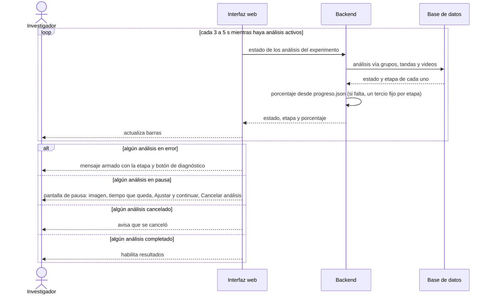

**Descarga de reporte:**

Versión completa en PlantUML (Anexo A.10): `C:\Users\Samsung\Desktop\proyectos\fst-ai-system-latex\diagramas\guia_web\seq_descarga_reportes.puml`

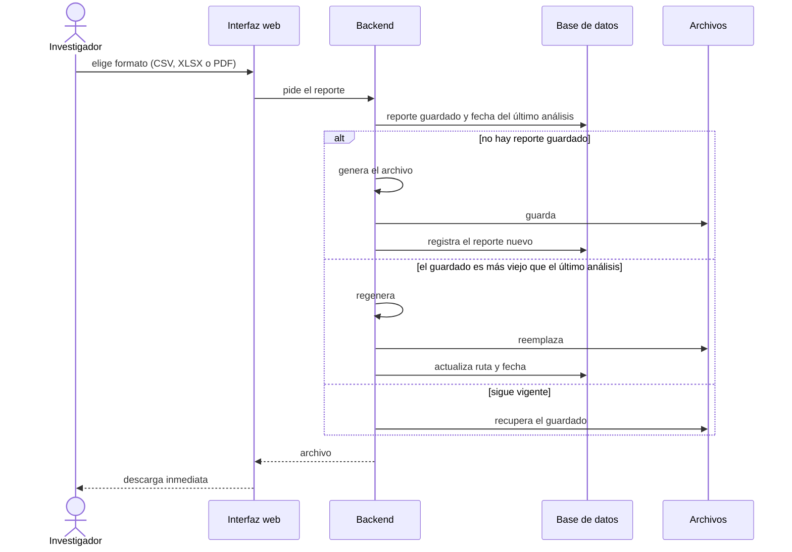

**Crear cuenta (solo administrador):**

Versión completa en PlantUML (Anexo A.8): `C:\Users\Samsung\Desktop\proyectos\fst-ai-system-latex\diagramas\guia_web\seq_crear_cuenta.puml`

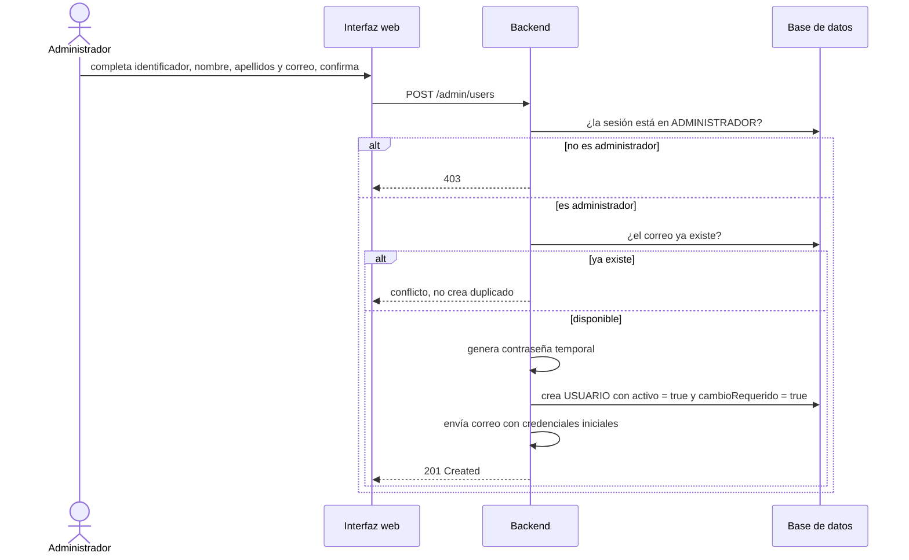

Las demás secuencias (inicio y cierre de sesión, cambio y recuperación de contraseña, gestión
de usuarios, perfil, crear y eliminar experimento, pausa y ajuste del recuadro, revisión segundo
a segundo, resultados, notificaciones y tareas programadas) están en el Anexo A, A.8 a A.11.

## 11. Decisiones abiertas y resueltas

1. ~~Cierre de sesión~~ **Resuelto (usuario, 3-oct-2026).** El sistema no maneja datos
   sensibles y un investigador puede trabajar mucho tiempo seguido, así que **no se usan
   tokens de vida corta**. El JWT dura mucho y es configurable (variable
   `JWT_EXPIRES_HOURS`, valor por defecto 168 h, una semana). "Cerrar sesión" borra el
   token en el navegador. **No se agrega ninguna tabla ni lista de bloqueo.**
2. ~~Envío de correo~~ **Resuelto (usuario, 4-oct-2026, D-45).** El sistema **sí envía
   correos**, desde una **cuenta de correo normal** (por ejemplo, Gmail con contraseña de
   aplicación); no depende de un servidor del IPN. Se configura con las variables `SMTP_*`
   (servidor, puerto, usuario, contraseña, remitente). Se envían:
   - **Notificaciones:** cada `NOTIFICACION` que el sistema crea (`analisis completado`,
     `error del pipeline`, `analisis en pausa`, `analisis cancelado`, `alerta de disco`,
     `video borrado`) se manda también por correo a su
     destinatario, como copia del aviso. La campanita no cambia. No se agregan tablas ni
     columnas: el correo sale de `USUARIO.correo`.
   - **Contraseña temporal:** al crear una cuenta se envía por correo **y** se muestra una
     sola vez en pantalla al administrador, como respaldo.
   - **Recuperación de contraseña:** el enlace firmado (`/auth/recover`) se envía por correo.

   Si el envío falla, la operación **no** se detiene: el aviso queda en la campanita y la
   contraseña temporal ya se mostró en pantalla. En desarrollo usa MailHog para ver los
   mensajes sin enviar nada. El correo de una cuenta puede ser de **cualquier dominio**
   (D-46). **[ABIERTO]** Qué otras notificaciones agregar: el usuario las definirá después.
   **Por defecto:** implementa solo las seis de la lista; no agregues otras.
3. ~~Quién crea las filas de `MODELO` y `CONFIGURACION`~~ **Sin objeto (usuario,
   5-oct-2026).** Las dos tablas y la columna `ANALISIS.idConfig` se eliminaron: ningún
   requisito permite cambiar el modelo ni el umbral. El modelo entrenado y el umbral de
   decisión (0.80) son constantes del worker (sección 4). Al encolar, el backend solo
   necesita el `idVideo`.
4. ~~Valor de `etapa` mientras el análisis está `en cola`~~ **Resuelto (usuario,
   12-oct-2026, D-79).** `etapa`, `nivelClasif` y `fechaAnalisis` siguen NOT NULL y el
   backend les pone un valor de arranque al encolar (`preprocesamiento`, `preciso` y la
   fecha de encolado); el worker los reemplaza.
5. **[ABIERTO] Tamaño máximo de video.** No está definido. Dejar el límite configurable
   (`MAX_UPLOAD_MB`). **Por defecto:** `MAX_UPLOAD_MB=2048` en `.env.example`, el mismo valor
   en `client_max_body_size` de nginx, y el backend rechaza con 413 lo que lo exceda.
6. ~~Cardinalidades de especímenes~~ **Resuelto** (sección 5): 2 a 4 por tanda, 2 o más
   por grupo, 1 o más tandas por grupo.
7. **[ABIERTO] Usuario administrador inicial:** hace falta crearlo, porque no hay
   autorregistro. **Por defecto:** un comando `flask crear-admin` que lee `ADMIN_ID`,
   `ADMIN_NOMBRE`, `ADMIN_APELLIDOS`, `ADMIN_CORREO` y `ADMIN_PASSWORD` del `.env`, guarda el
   hash bcrypt, pone `cambioRequerido = true` e inserta la fila en `ADMINISTRADOR`. Los valores
   reales los pone el usuario: no inventes ninguno ni los escribas en el SQL.
8. ~~Conteo de conductas~~ **Resuelto (RF-18).** No hay duración mínima: cada segundo
   recibe una conducta y ninguna se descarta por durar poco. Los totales por minuto
   se calculan contando los segundos de cada conducta en `SEGUNDO`.
9. ~~"Último acceso" de cada usuario~~ **Resuelto (usuario, 3-oct-2026).** Se quita:
   la lista de administración no muestra último acceso y `USUARIO` no lleva esa columna.
10. **[ABIERTO] Log de ejecución del análisis.** Se quería un registro expandible en la
    pantalla de progreso, pero ninguna tabla guarda mensajes del worker. Por ahora la
    interfaz solo muestra la etapa actual. Lo mismo aplica a un código de error: se arma
    a partir de `etapa`. **Por defecto:** no implementes el log.
11. ~~Quién puede eliminar un experimento~~ **Resuelto (usuario, 3-oct-2026).** Solo quien
    lo creó o un administrador; cualquier otro investigador recibe 403. Se rechaza con 409
    si algún análisis del experimento está `procesando` o `en pausa` (D-87); los que están
    `en cola` salen de la cola al eliminarlo.
12. ~~De dónde sale el identificador institucional de una cuenta nueva~~ **Resuelto
    (usuario, 3-oct-2026).** El administrador lo escribe en el formulario de crear cuenta,
    junto con nombre, apellidos y correo. La contraseña temporal la genera el sistema
    (corregido por el usuario, 4-oct-2026). El backend rechaza el alta si el
    identificador o el correo ya existen.
13. ~~Qué pasa con `VIDEO.archivo` cuando el video se borra~~ **Resuelto (usuario,
    5-oct-2026).** `VIDEO.archivo` admite nulo: al borrar el video, la tarea programada lo
    deja en nulo. Nulo significa "el video ya se borró"; la interfaz lo usa para saber que
    ya no se puede reproducir. La fila de `VIDEO` se conserva.
14. ~~Análisis en pantalla con intervención humana~~ **Resuelto (usuario, 3-oct-2026,
    actualizado el 11-oct con D-59, D-60, D-67 y D-68).** Sigue sin haber vista en vivo ni
    procesamiento a la velocidad del video: el análisis corre en segundo plano a su propio
    ritmo (cada video de 5 min tarda unos 10 min). **Lo único que interrumpe el análisis es la
    pausa por espécimen que no se ve (R-15):** a los 3 s seguidos sin verlo, el análisis pasa a
    `en pausa`, se avisa al usuario y se espera 72 horas a que ajuste o confirme el recuadro del
    cilindro; sin respuesta, se cancela con notificación. Al final, el usuario abre la pantalla de revisión
    (sección 9.7), puede corregir las etiquetas y puede reiniciar el análisis. Sigue
    **diferido**, y no debes implementar, la vista en tiempo real. La pantalla de pausa, el
    archivo donde se guarda el ajuste y el flujo completo quedaron definidos en D-89 (sección 4).
15. ~~Significado de `ANALISIS.nivelClasif`~~ **Resuelto (usuario, 3-oct-2026).** Se
    queda. `agrupado` si algún segundo quedó como conducta activa; `preciso` si ninguno. La
    interfaz solo lo usa para avisar. Se recalcula al guardar la revisión.
16. **Video para reproducir en el navegador. Resuelto (usuario, 3-oct-2026):** se queda
    la propuesta. Los `.mov` del iPhone suelen venir
    en un códec (HEVC) que Chrome y Firefox no reproducen. Al terminar el
    análisis, el worker genera con `ffmpeg`, recortando con recodificación para que el corte sea exacto, una copia en H.264 de los últimos 300 s (todo el video si dura menos)
    (`analisis/{idAnalisis}/web.mp4`, en el volumen `videos_reportes`) y la pantalla de
    revisión reproduce esa copia. En `worker_fake`, simplemente copia o enlaza el original.
    Esa copia también se borra con el video a los 30 días.
17. **Dónde se guardan los recuadros de los tubos. Resuelto (usuario, 3-oct-2026):** se
    queda la propuesta. La pantalla de revisión
    dibuja un recuadro sobre el video para destacar el tubo del espécimen que se revisa.
    Esos datos no tienen tabla. El worker los escribe en un archivo del volumen
    (`analisis/{idAnalisis}/cajas.json`) y el backend lo entrega a la pantalla. No se
    cambia la base de datos por esto.
18. ~~Quién puede corregir y cómo cuenta~~ **Resuelto (usuario, 11-oct-2026, D-57).**
    Corrige el investigador que subió el video y el Administrador. Corregir no mejora el
    modelo; si cambia el video o el modelo, es un análisis nuevo (reinicio, R-04). Al guardar
    los totales por minuto reflejan los cambios (se calculan desde `SEGUNDO`) y los reportes se regeneran. **[ABIERTO]** Si los
    reportes usan las correcciones y marcan que fueron revisadas (D-57 lo deja sin aclarar).
    **Por defecto:** los reportes usan los datos actuales de `SEGUNDO` (con las
    correcciones) e indican si el análisis tuvo revisión humana (algún `origen` distinto de
    `maquina`).

## 12. Orden de construcción sugerido [PROPUESTA]

Cada paso termina con algo que se puede probar.

1. **Docker Compose con `db` y `backend`** que arrancan (parte del Anexo C). Prueba:
   `docker compose up` y un endpoint de salud responde.
2. **Base de datos:** usa el SQL del Anexo B (dominios, 12 tablas y restricciones). El administrador inicial no va en el SQL: lo crea el
   comando `flask crear-admin` (sección 11, punto 7).
   Pruébalo contra un PostgreSQL real y corrige lo que falle.
3. **Autenticación:** login, logout, cambio de contraseña, cambio obligatorio en el primer
   ingreso, recuperación. Bcrypt. JWT de larga duración y configurable (sección 11,
   punto 1). Verificación de rol en `/admin/*`.
4. **Administración de usuarios** (crear, editar, desactivar, reactivar, generar contraseña temporal nueva, listar con filtros).
5. **Experimentos y carga de video:** crear experimento, sugerir tanda, subir `.mp4` o `.mov`,
   validar, guardar y, si la sesión es el Día 2, crear el análisis en cola (el Día 1 solo se guarda).
6. **`worker_fake`:** simula el contrato de la sección 4: toma un análisis a la vez, con un
   caso exitoso, uno de error (un archivo cuyo nombre contenga la palabra `falla`) y uno de
   pausa (nombre con `pausa`, con sus tres salidas: ajuste, cancelación y vencimiento); al
   arrancar reencola los análisis `procesando` huérfanos.
7. **Progreso y resultados:** endpoint de estado con porcentaje (lee `progreso.json`), resultados por espécimen,
   desglose por minuto, comparación entre grupos (Día 2) y bloques de 5 s.
8. **Reportes:** CSV, XLSX, PDF con regeneración por vigencia, y PDF de diagnóstico.
   **Revisión segundo a segundo:** las rutas de revisión, video, guardar y reiniciar de la
   sección 6, el cálculo de los totales por minuto y la pantalla 9.7 (después de tener resultados y reportes funcionando).
9. **Tareas programadas** (las ejecuta el worker, D-82; impleméntalas en `worker_fake`, en un
   módulo aparte, sección 8): borrado a 30 días, aviso a 7 días, vigilancia de disco.
10. **Frontend:** primero inicio de sesión y lista de experimentos, luego crear experimento, progreso (con
    la pantalla de pausa), resultados y administración.
11. **Pruebas:** 4 sesiones simultáneas con un análisis en cola sin pasar de 3 s; los tres
    navegadores; arranque limpio con solo Docker en una segunda máquina.

### Criterios de aceptación mínimos
- `docker compose up` en una máquina limpia deja todo funcionando.
- Un administrador puede crear una cuenta y esa cuenta debe cambiar la contraseña al entrar.
- Subir un `.mp4` o `.mov` en horizontal crea un análisis `en cola`; el `worker_fake` lo lleva a `completado`
  y la pantalla de progreso lo refleja sin recargar.
- Subir un archivo que no es `.mp4` ni `.mov` se rechaza en el cliente; un video en vertical o que
  no se puede reproducir lo rechaza el servidor (D-64).
- Un Administrador no puede desactivarse ni quitarse el rol a sí mismo (409: «Para cambiar tu propia cuenta usa Mi perfil.»), ni si es el último Administrador activo
  (R-16).
- Un investigador que no es administrador recibe 403 en `/admin/*` aunque conozca la URL.
- Un reporte vuelve a generarse cuando hay un análisis más nuevo que el guardado.
- Repetibilidad (RNF-14, D-74): analizar varias veces el mismo video debe dar el mismo resultado,
  con una variación máxima de entre el 5 y el 10 %. La prueba la hace quien construye el
  clasificador (TT-II); el backend solo debe conservar, sin alterarlos, los resultados que
  escribe el worker.
- «Cancelar análisis» solo existe en la pantalla de pausa, y el reinicio solo aparece en la
  pantalla de revisión de un análisis `completado`; ambos, para quien subió el video o un
  Administrador.
- Subir un video del Día 1 lo guarda sin crear análisis, y el experimento muestra «En espera del
  Día 2» hasta que se suba uno del Día 2.
- Con dos análisis en cola, el worker procesa uno a la vez y en orden de llegada.
- Si el `worker_fake` se apaga con un análisis `procesando`, al arrancar lo reencola y lo termina.
- Una pausa se puede ajustar (el análisis vuelve a la cola, por delante de los más nuevos, y
  termina), cancelar o dejar vencer a las 72 horas; ajustar, continuar o cancelar cuando ya no está `en
  pausa` responde 409.
- Eliminar un experimento con un análisis `procesando` o `en pausa` responde 409; con uno `en
  cola`, lo borra y lo saca de la cola.


## 13. Anexo A: diagramas en código PlantUML

Cada bloque empieza con `@startuml nombre` y termina con `@enduml`, y va precedido de la ruta
de su archivo `nombre.puml` (carpeta `C:\Users\Samsung\Desktop\proyectos\fst-ai-system-latex\diagramas\guia_web`; cambia la ruta, ver la nota del
inicio). Si no tienes los archivos, guarda cada bloque como `nombre.puml` y genéralo con:

```
java -jar plantuml.jar -tpng -o salida nombre.puml
```

Los de casos de uso usan `!pragma layout smetana` y no necesitan Graphviz. Los demás sí
lo necesitan (o instala PlantUML con Graphviz incluido). Los diagramas marcados
**[PROPUESTA]** los redacta este documento a partir de las reglas de las secciones 4 a 8;
los demás describen el diseño ya acordado.

Índice:
- A.1 Arquitectura de software
- A.2 Contenedores con Docker [PROPUESTA]
- A.3 Módulos del backend [PROPUESTA]
- A.4 Esquema físico de la base de datos
- A.5 Diagrama de clases
- A.6 Estados del análisis y del experimento
- A.7 Casos de uso (visión general y 5 paquetes)
- A.8 Secuencias: autenticación y cuentas
- A.9 Secuencias: experimentos, carga, análisis y revisión segundo a segundo
- A.10 Secuencias: resultados, reportes y notificaciones
- A.11 Tareas programadas [PROPUESTA]

### A.1 Arquitectura de software

Archivo: `C:\Users\Samsung\Desktop\proyectos\fst-ai-system-latex\diagramas\guia_web\arquitectura_software.puml`

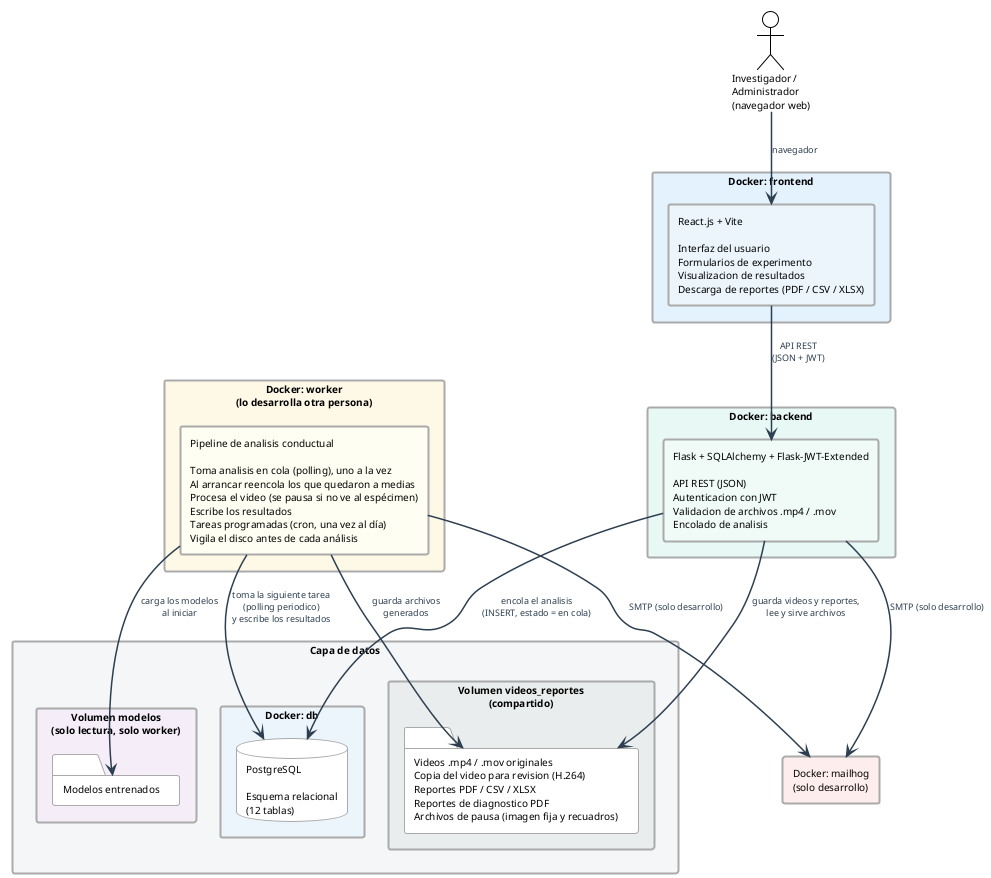

### A.2 Contenedores con Docker [PROPUESTA]

Archivo: `C:\Users\Samsung\Desktop\proyectos\fst-ai-system-latex\diagramas\guia_web\contenedores_docker.puml`

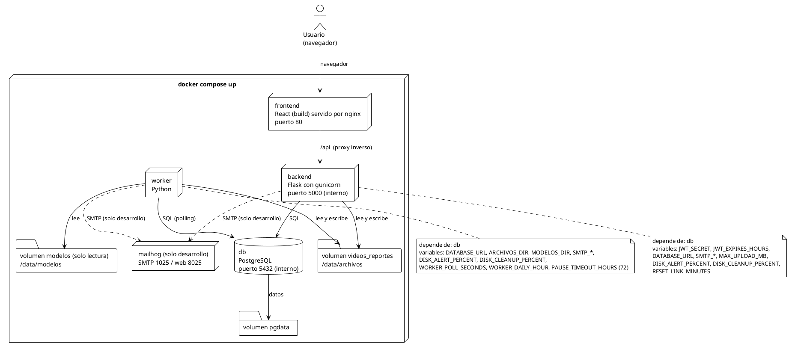

### A.3 Módulos del backend [PROPUESTA]

Archivo: `C:\Users\Samsung\Desktop\proyectos\fst-ai-system-latex\diagramas\guia_web\modulos_backend.puml`

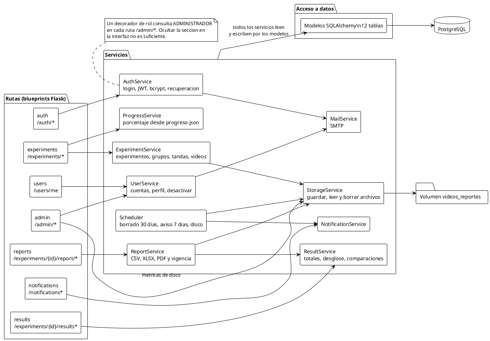

### A.4 Esquema físico de la base de datos

Archivo: `C:\Users\Samsung\Desktop\proyectos\fst-ai-system-latex\diagramas\guia_web\esquema_fisico.puml`

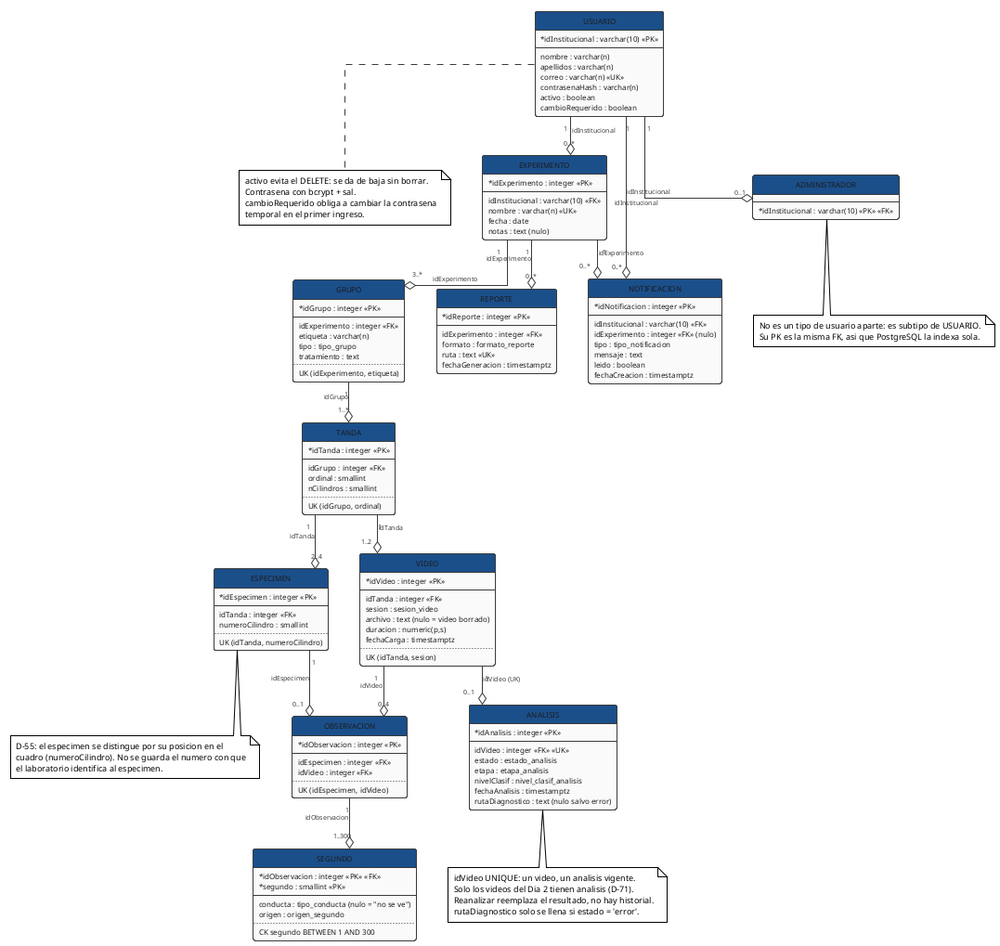

### A.5 Diagrama de clases

El paquete P3 (worker y pipeline) lo desarrolla otra persona; se incluye para ver cómo se
relaciona con el resto. El backend implementa los paquetes P1, P2, P4 y P5.

Archivo: `C:\Users\Samsung\Desktop\proyectos\fst-ai-system-latex\diagramas\guia_web\clases.puml`

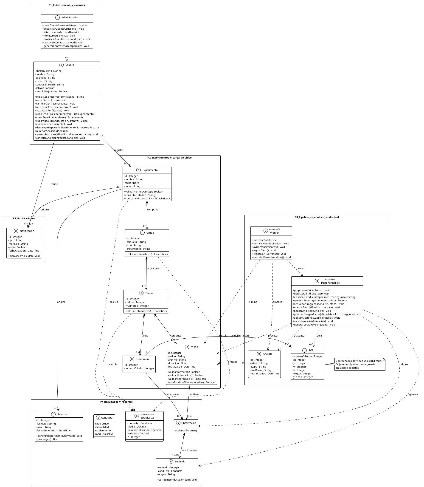

### A.6 Estados del análisis y del experimento

Archivo: `C:\Users\Samsung\Desktop\proyectos\fst-ai-system-latex\diagramas\guia_web\estados_analisis.puml`

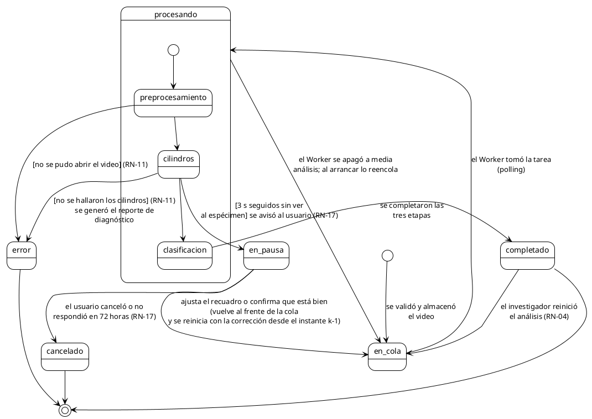

Archivo: `C:\Users\Samsung\Desktop\proyectos\fst-ai-system-latex\diagramas\guia_web\estados_experimento.puml`

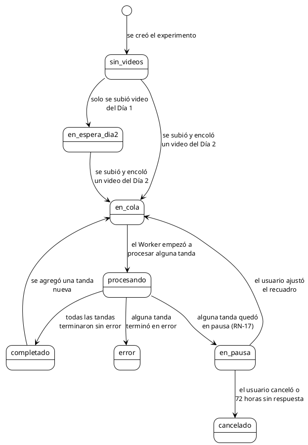

### A.7 Casos de uso

Archivo: `C:\Users\Samsung\Desktop\proyectos\fst-ai-system-latex\diagramas\guia_web\cu_vision_general.puml`

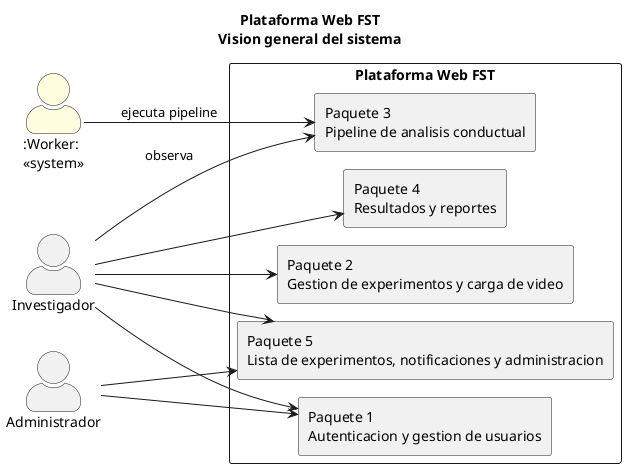

Archivo: `C:\Users\Samsung\Desktop\proyectos\fst-ai-system-latex\diagramas\guia_web\cu_paquete1.puml`

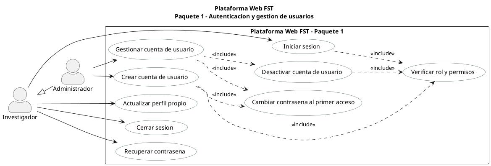

Archivo: `C:\Users\Samsung\Desktop\proyectos\fst-ai-system-latex\diagramas\guia_web\cu_paquete2.puml`

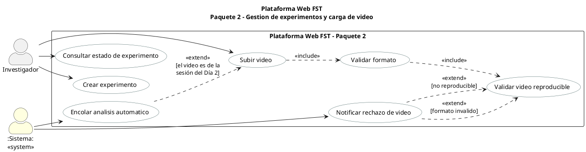

Archivo: `C:\Users\Samsung\Desktop\proyectos\fst-ai-system-latex\diagramas\guia_web\cu_paquete3.puml`

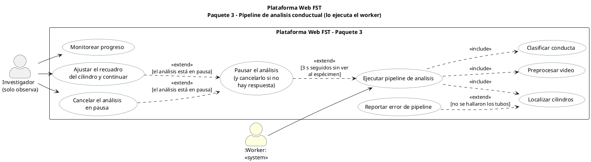

Archivo: `C:\Users\Samsung\Desktop\proyectos\fst-ai-system-latex\diagramas\guia_web\cu_paquete4.puml`

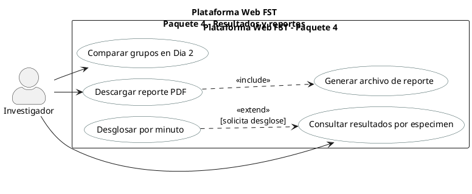

Archivo: `C:\Users\Samsung\Desktop\proyectos\fst-ai-system-latex\diagramas\guia_web\cu_paquete5.puml`

```plantuml
@startuml cu_paquete5
!pragma layout smetana
title Plataforma Web FST\nPaquete 5 - Lista de experimentos, notificaciones y administracion
left to right direction
skinparam packageStyle rectangle
skinparam actorStyle awesome
skinparam usecase {
  BackgroundColor White
  BorderColor DarkSlateGray
}
actor "Investigador" as INV
actor "Administrador" as ADMIN
actor ":Worker:\n<<system>>" as WRK #LightYellow
actor ":Sistema:\n<<system>>" as SYS #LightYellow
rectangle "Plataforma Web FST - Paquete 5" {
  usecase "Consultar lista de experimentos" as UC51
  usecase "Filtrar experimentos" as UC51a
  usecase "Avisar expiracion de video" as UC52
  usecase "Eliminar experimento" as UC53
  usecase "Confirmar eliminacion" as UC53a
  usecase "Borrar video automaticamente" as UC54
  usecase "Conservar resultados y reportes" as UC55
  usecase "Listar usuarios" as UC56
  usecase "Monitorear estado del sistema" as UC57
  usecase "Notificar uso de disco" as UC57a
  usecase "Gestionar experimentos globales" as UC58
}
INV --> UC51
INV --> UC53
ADMIN --> UC56
ADMIN --> UC57
ADMIN --> UC58
WRK --> UC54
SYS --> UC52
UC52 ..> UC51 : <<extend>>\n[video expira en < 7 dias]
UC51a ..> UC51 : <<extend>>\n[aplica filtro]
UC57a ..> UC57 : <<extend>>\n[disco > 80%]
UC53 ..> UC53a : <<include>>
UC54 ..> UC55 : <<include>>
@enduml
```

Nota: en estos diagramas el borrado automático de videos (UC54) aparece asignado al
Worker. En la implementación que se describe en este documento lo hace una **tarea
programada del backend** (sección 8 y A.11).

### A.8 Secuencias: autenticación y cuentas

Archivo: `C:\Users\Samsung\Desktop\proyectos\fst-ai-system-latex\diagramas\guia_web\seq_login.puml`

```plantuml
@startuml seq_login
!theme plain
skinparam defaultFontName Arial
skinparam defaultFontSize 11
skinparam shadowing false
skinparam sequenceMessageAlign center
actor Usuario as u
participant "Interfaz web" as ui
participant Backend as api
database "Base de datos" as db

u -> ui: escribe correo y contraseña
ui -> api: POST /auth/login {correo, contraseña}
api -> db: busca el USUARIO por correo
db --> api: usuario, o nada
alt no existe, está inactivo (activo = false)\no la contraseña no coincide (bcrypt)
  api --> ui: 401 con mensaje genérico\n"Correo o contraseña incorrectos"
  ui --> u: muestra el error, sin decir qué campo falló
else credenciales válidas
  api -> db: ¿el idInstitucional está en ADMINISTRADOR?
  db --> api: sí / no
  api -> api: genera el JWT con idInstitucional\ny vencimiento (JWT_EXPIRES_HOURS)
  api --> ui: 200 OK {token, rol, cambioRequerido}
  note right of ui
    el rol no va en el JWT;
    el backend lo vuelve a leer en cada petición
  end note
  alt cambioRequerido = true
    ui --> u: obliga a cambiar la contraseña\nantes de continuar
  else cambioRequerido = false
    ui --> u: muestra la lista de experimentos
  end
end
@enduml
```

Archivo: `C:\Users\Samsung\Desktop\proyectos\fst-ai-system-latex\diagramas\guia_web\seq_logout.puml`

```plantuml
@startuml seq_logout
!theme plain
skinparam defaultFontName Arial
skinparam defaultFontSize 11
skinparam shadowing false
skinparam sequenceMessageAlign center
actor Usuario as u
participant "Interfaz web" as ui
participant Backend as api

u -> ui: elige "Cerrar sesión"
ui -> api: POST /auth/logout
api --> ui: 200 OK\n(no guarda nada: no hay lista de bloqueo)
ui -> ui: borra el token del navegador
ui --> u: muestra la pantalla de inicio de sesión
note over api
  JWT_EXPIRES_HOURS = 168 (una semana, por defecto).
  Al vencer el token, el login se pide de nuevo.
end note
@enduml
```

Archivo: `C:\Users\Samsung\Desktop\proyectos\fst-ai-system-latex\diagramas\guia_web\seq_cambiar_contrasena.puml`

```plantuml
@startuml seq_cambiar_contrasena
!theme plain
skinparam defaultFontName Arial
skinparam defaultFontSize 11
skinparam shadowing false
skinparam sequenceMessageAlign center
actor Usuario as u
participant "Interfaz web" as ui
participant Backend as api
database "Base de datos" as db

note over u, ui
  Aplica tanto al cambio obligatorio del primer
  ingreso (cambioRequerido = true) como al
  cambio voluntario desde el perfil.
end note
u -> ui: escribe la contraseña actual\ny la nueva (dos veces)
ui -> api: PATCH /auth/password {actual, nueva}\ncon el JWT del usuario
api -> db: lee contrasenaHash del usuario
db --> api: hash actual
alt la contraseña actual no coincide
  api --> ui: 400, "La contraseña actual no es correcta"
  ui --> u: muestra el error, no cambia nada
else coincide
  alt la nueva no cumple algún criterio
    api --> ui: 400, solo el primer criterio incumplido, en este orden:\nmínimo 8 caracteres, máximo 72 bytes,\n"Elige una contraseña distinta"
    ui --> u: pide escribir otra contraseña
  else es válida
    api -> api: calcula el hash nuevo (bcrypt con sal)
    api -> db: actualiza contrasenaHash y\npone cambioRequerido = false
    db --> api: confirma
    note over api
      la sesión actual y las demás del usuario siguen activas;
      los enlaces de recuperación pendientes (seq_recuperar_contrasena) dejan de servir
    end note
    api --> ui: 200 OK
    alt primer acceso (CU-16)
      ui --> u: confirma el cambio y muestra la lista de experimentos
    else cambio voluntario (CU-18)
      ui --> u: confirma el cambio y se queda en Mi perfil
    end
  end
end
note over u, ui
  Con cambioRequerido = true solo se permite\ncambiar la contraseña o cerrar sesión.
end note
@enduml
```

Archivo: `C:\Users\Samsung\Desktop\proyectos\fst-ai-system-latex\diagramas\guia_web\seq_recuperar_contrasena.puml`

```plantuml
@startuml seq_recuperar_contrasena
!theme plain
skinparam defaultFontName Arial
skinparam defaultFontSize 11
skinparam shadowing false
skinparam sequenceMessageAlign center
actor Usuario as u
participant "Interfaz web" as ui
participant Backend as api
database "Base de datos" as db

u -> ui: elige "Recuperar contraseña" y escribe su correo
ui -> api: POST /auth/recover {correo}
api -> db: ¿existe un USUARIO activo con ese correo?
db --> api: sí / no
opt existe
  api -> api: firma un enlace (JWT) con el idInstitucional\ny un vencimiento (RESET_LINK_MINUTES)
  api -> api: envía el correo con el enlace
end
api --> ui: 200 OK, siempre la misma respuesta\n(exista o no el correo)
ui --> u: "Si el correo está registrado,\nrecibirás un enlace"

u -> ui: abre el enlace y escribe la contraseña nueva
ui -> api: POST /auth/reset {token, nueva}
api -> api: verifica firma y vencimiento del enlace
alt enlace inválido o vencido
  api --> ui: 400, "El enlace no es válido o venció"
else enlace válido
  api -> db: actualiza contrasenaHash (bcrypt con sal)\ny pone cambioRequerido = false
  db --> api: confirma
  api --> ui: 200 OK
  ui --> u: "Contraseña actualizada", va al inicio de sesión
end
@enduml
```

Archivo: `C:\Users\Samsung\Desktop\proyectos\fst-ai-system-latex\diagramas\guia_web\seq_crear_cuenta.puml`

```plantuml
@startuml seq_crear_cuenta
!theme plain
skinparam defaultFontName Arial
skinparam defaultFontSize 11
skinparam shadowing false
skinparam sequenceMessageAlign center
actor Administrador as admin
participant "Interfaz web" as ui
participant Backend as api
database "Base de datos" as db

admin -> ui: entra al panel de administración
note right of ui
  La sección de administración solo aparece si
  el usuario es Administrador. Ocultarla en la
  interfaz no evita por sí sola el siguiente paso.
end note
admin -> ui: selecciona "Crear cuenta"
ui -> admin: muestra el formulario\n(identificador institucional, nombre, apellidos, correo electrónico)
admin -> ui: completa los datos y confirma
ui -> api: POST /admin/users {idInstitucional, nombre, apellidos, correo}\ncon la sesión activa del Administrador
note over api
  filtro de rol en cada petición (D-12), no solo en esta ruta
end note
api -> db: ¿el idInstitucional de la sesión está en ADMINISTRADOR?
db --> api: sí / no
alt no está en ADMINISTRADOR
  api --> ui: 403, "No tienes permiso para esta acción"
  ui --> admin: lleva a la lista de experimentos
else sí está en ADMINISTRADOR
  api -> db: ¿el idInstitucional ya está registrado?
  db --> api: sí / no
  alt el idInstitucional ya está registrado
    api --> ui: 409, "Ya existe una cuenta con ese identificador."
    ui --> admin: muestra el error, no crea el duplicado
  else el idInstitucional está libre
    api -> db: ¿el correo ya está registrado?
    db --> api: sí / no
    alt el correo ya está registrado
      api --> ui: 409, "Ya existe una cuenta con ese correo."
      ui --> admin: muestra el error, no crea el duplicado
    else el correo está disponible
      api -> api: genera la contraseña temporal
      api -> db: crea USUARIO\n(idInstitucional, nombre, apellidos, correo, contrasenaHash,\nactivo = true, cambioRequerido = true)
      note over api
        sin campo rol: la cuenta nace como Investigador (D-08)
      end note
      db --> api: confirma la creación
      api -> api: después de confirmar, envía correo al nuevo usuario\ncon su correo y la contraseña temporal en texto plano
      note right of api
        si el envío falla, la cuenta queda creada igual
        y la interfaz no avisa del fallo
      end note
      api --> ui: 201 Created, con la contraseña temporal
      ui --> admin: confirma la cuenta creada y muestra\nla contraseña temporal una sola vez
    end
  end
end
@enduml
```

Archivo: `C:\Users\Samsung\Desktop\proyectos\fst-ai-system-latex\diagramas\guia_web\seq_gestion_usuarios.puml`

```plantuml
@startuml seq_gestion_usuarios
!theme plain
skinparam defaultFontName Arial
skinparam defaultFontSize 11
skinparam shadowing false
skinparam sequenceMessageAlign center
skinparam BoxPadding 10
actor Administrador as admin
participant "Interfaz web" as ui
participant Backend as api
database "Base de datos" as db

admin -> ui: abre el panel de usuarios
ui -> api: GET /admin/users\ncon la sesión activa del Administrador
note over api
  filtro de rol en cada petición (D-12), no solo en esta ruta
end note
api -> db: ¿el idInstitucional de la sesión está en ADMINISTRADOR?
db --> api: sí / no
alt no está en ADMINISTRADOR
  api --> ui: 403, "No tienes permiso para esta acción"
  ui --> admin: muestra el error, no abre el panel
else sí está en ADMINISTRADOR
  api -> db: consulta todos los usuarios en una sola consulta, sin paginación,\nincluida la marca de administrador (ADMINISTRADOR)
  db --> api: lista de usuarios con esa marca
  api --> ui: 200 OK {usuarios, con marca de administrador}
  ui --> admin: muestra la tabla de usuarios
  admin -> ui: elige la acción sobre un usuario
  note right of ui
    no hay acción para eliminar una cuenta
  end note
  alt crear cuenta nueva
    ui --> admin: abre el formulario de "Crear cuenta"\n(ver seq_crear_cuenta)
  else editar datos (nombre, apellidos o correo)
    ui -> api: PATCH /admin/users/{id} {nombre, apellidos, correo}
    api -> db: actualiza los datos de la cuenta
    db --> api: confirma
    api --> ui: 200 OK
    ui --> admin: la tabla refleja el cambio
  else dar o quitar el rol de Administrador
    admin -> ui: cambia el rol de un usuario y confirma
    ui -> api: PATCH /admin/users/{id} {rol}
    alt es la propia cuenta del Administrador
      api --> ui: 409, «Para cambiar tu propia cuenta usa Mi perfil.»
      ui --> admin: muestra el error
    else es otra cuenta
      api -> db: bloquea la tabla ADMINISTRADOR antes de contar\ny cuenta cuántos Administradores activos quedarían después
      db --> api: cantidad restante
      alt quedarían 0 Administradores activos
        api --> ui: rechaza el cambio
        ui --> admin: muestra la advertencia\n"debe existir al menos un Administrador activo"
      else se puede cambiar
        api -> db: agrega o quita la fila en ADMINISTRADOR\nen la misma transacción
        db --> api: confirma
        api --> ui: 200 OK
        ui --> admin: la tabla refleja el nuevo rol
      end
    end
  else desactivar cuenta
    admin -> ui: selecciona un usuario y confirma la desactivación
    ui -> api: PATCH /admin/users/{id} {activo: false}
    alt es la propia cuenta del Administrador
      api --> ui: 409, «Para cambiar tu propia cuenta usa Mi perfil.»
      ui --> admin: muestra el error
    else es otra cuenta
      api -> db: bloquea la tabla ADMINISTRADOR antes de contar\ny cuenta cuántos Administradores activos quedarían después,\nsi esta cuenta es Administrador
      db --> api: cantidad restante (o "no aplica")
      alt quedarían 0 Administradores activos
        api --> ui: rechaza la desactivación
        ui --> admin: muestra la advertencia\n"debe existir al menos un Administrador activo"
      else se puede desactivar
        api -> db: USUARIO.activo = false, en la misma transacción
        db --> api: confirma
        api -> api: corta las sesiones activas de esa cuenta (JWT)
        api --> ui: 200 OK
        ui --> admin: usuario marcado como inactivo en la tabla
      end
    end
  else reactivar cuenta
    admin -> ui: selecciona un usuario inactivo y confirma
    ui -> api: PATCH /admin/users/{id} {activo: true}
    api -> db: activo = true
    db --> api: confirma
    note over api
      solo marca activo = true: la contraseña anterior vuelve a servir;
      no cambia cambioRequerido ni envía correo
    end note
    api --> ui: 200 OK
    ui --> admin: la tabla muestra la cuenta como activa
  else contraseña temporal nueva
    admin -> ui: selecciona otro usuario (no a sí mismo) y confirma
    alt la cuenta está inactiva
      ui --> admin: pide reactivar primero (PATCH /admin/users/{id} {activo: true})
    else la cuenta está activa
      ui -> api: POST /admin/users/{id}/reset-temporal
      api -> api: genera una contraseña temporal de 12 caracteres
      api -> db: actualiza contrasenaHash y pone cambioRequerido = true
      db --> api: confirma
      api -> api: envía la temporal por correo
      api -> db: registra auditoría, sin la contraseña
      api --> ui: 200 OK
      ui --> admin: confirma el envío
    end
  end
end
@enduml
```

Archivo: `C:\Users\Samsung\Desktop\proyectos\fst-ai-system-latex\diagramas\guia_web\seq_perfil.puml`

```plantuml
@startuml seq_perfil
!theme plain
skinparam defaultFontName Arial
skinparam defaultFontSize 11
skinparam shadowing false
skinparam sequenceMessageAlign center
actor Usuario as u
participant "Interfaz web" as ui
participant Backend as api
database "Base de datos" as db

u -> ui: abre su perfil
note over ui
  no hay GET: nombre, apellidos y correo
  salen de la sesión (JWT)
end note
ui --> u: formulario con esos datos y, en otro formulario\nde la misma pantalla, el cambio de contraseña

u -> ui: cambia nombre, apellidos o correo y confirma
ui -> ui: deshabilita el botón mientras guarda
ui -> api: PATCH /users/me {nombre, apellidos, correo}\ncon el JWT del usuario
alt el correo nuevo no tiene un formato válido
  api --> ui: 400, "Escribe un correo válido"
else el correo es válido
  api -> db: ¿otro usuario ya usa ese correo?
  db --> api: sí / no
  alt ya lo usa otro usuario
    api --> ui: 409, conflicto
  else está libre
    api -> db: actualiza nombre, apellidos y correo\ndel idInstitucional del token
    db --> api: confirma
    api --> ui: 200 OK {datos actualizados}
    ui --> u: sin mensaje; la barra superior actualiza las iniciales del usuario y el menú de usuario muestra los datos nuevos
  end
end
note over u, ui
  El cambio de contraseña se hace aparte, en otro
  formulario de la misma pantalla (ver seq_cambiar_contrasena).
end note
@enduml
```

### A.9 Secuencias: experimentos, carga y análisis

Archivo: `C:\Users\Samsung\Desktop\proyectos\fst-ai-system-latex\diagramas\guia_web\seq_crear_experimento.puml`

```plantuml
@startuml seq_crear_experimento
!theme plain
skinparam defaultFontName Arial
skinparam defaultFontSize 11
skinparam shadowing false
skinparam sequenceMessageAlign center
actor Investigador as inv
participant "Interfaz web" as ui
participant Backend as api
database "Base de datos" as db

inv -> ui: escribe nombre, fecha y notas (opcional)
ui -> api: POST /experiments {nombre, fecha, notas}\ncon el JWT del usuario
api -> db: ¿ya existe un experimento con ese nombre?
db --> api: sí / no
alt el nombre ya existe
  api --> ui: 409, "Ya existe un experimento con ese nombre"
  ui --> inv: marca el campo nombre con el error
else el nombre es único
  api -> db: crea EXPERIMENTO con el idInstitucional del token
  db --> api: idExperimento
  api --> ui: 201 Created {idExperimento}
  ui --> inv: pasa al paso 2 (grupo, tanda y video)
end
@enduml
```

Archivo: `C:\Users\Samsung\Desktop\proyectos\fst-ai-system-latex\diagramas\guia_web\seq_carga_video.puml`

```plantuml
@startuml seq_carga_video
' ================================================================
'  Copia técnica de diagramas/seq_carga_video.puml (guía web).
'  Conserva códigos HTTP, rutas y nombres de archivo.
'  Base de datos FST | TT 2026-B066 | ESCOM-IPN
' ----------------------------------------------------------------
'  Cubre CU-05 "Subir video" (RF-08, RF-09, RF-10, RF-12, RN-02,
'  RN-10) más la inferencia de tanda (D-19).
'
'  - Búsqueda: GET por subcadena en nombre y tratamiento, sin acentos
'    ni mayúsculas; la respuesta trae la tanda sugerida (máximo + 1;
'    A si el grupo es nuevo). Sin segunda llamada.
'  - Orden: archivo temporal -> lectura de datos técnicos (ancho,
'    alto, duración) -> una sola operación (grupo, tanda, especímenes,
'    video) -> mover el temporal a su ruta definitiva -> análisis
'    "en cola" (solo Día 2). Si algo falla, se borran el temporal y
'    el archivo ya movido.
'  - Solo el creador del experimento sube sus videos.
'  - Códigos: 404 experimento inexistente; 403 quien sube no es el
'    creador; 400 falta etiqueta, archivo o sesión; 422 etiqueta
'    > 100, extensión, tanda nueva sin 2 a 4 cilindros, tanda fuera
'    de A-Z, duración cero o ilegible, vertical; 409 la tanda ya tiene
'    video de esa sesión (no hay reemplazo: para sustituir, borrar la
'    tanda).
'
'  Generar:
'      java -jar plantuml.jar -tpng diagramas/guia_web/seq_carga_video.puml
' ================================================================

!theme plain
skinparam defaultFontName Arial
skinparam defaultFontSize 11
skinparam shadowing false
skinparam sequenceMessageAlign center
skinparam BoxPadding 10

actor Investigador as inv
participant "Interfaz web" as ui
participant Backend as api
database "Base de datos" as db
participant "Archivos" as fs

inv -> ui: selecciona el experimento activo
inv -> ui: escribe el nombre del grupo o tratamiento

ui -> api: GET /experiments/{id}/groups?q= (subcadena, sin acentos ni mayúsculas)
api -> db: consulta los grupos de este experimento
db --> api: grupos que coinciden, con su tanda sugerida\n(máximo + 1; A si el grupo es nuevo)
api --> ui: sugerencias con su tanda, en la misma respuesta

alt el nombre coincide con un grupo de este mismo experimento
  inv -> ui: selecciona la sugerencia
  ui -> inv: precarga la tanda sugerida en un campo editable\ny pide confirmar "¿esta es la tanda B de [grupo]?"
  inv -> ui: confirma la tanda, o la corrige a mano
  note right of ui
    La confirmación de la tanda la pide solo la interfaz;
    el backend no la recibe ni la valida.
  end note
else no hay ningún grupo con ese nombre en este experimento
  ui -> inv: pide los datos del grupo nuevo\n(tipo, tratamiento, especímenes de 2 a 4)
  inv -> ui: captura el grupo nuevo
  note right of ui
    la primera tanda de un
    grupo nuevo es "A", precargada y editable
  end note
end

inv -> ui: elige la sesión (Día 1 o Día 2) y selecciona el archivo .mp4 o .mov
ui -> ui: comprueba la extensión .mp4 o .mov antes de enviar
ui -> api: POST /experiments/{id}/groups/{grupo}/videos (multipart)

api -> api: comprueba que quien sube sea el creador del experimento
alt quien sube no es el creador
  api --> ui: 403, "Solo quien creó el experimento sube sus videos."
  ui --> inv: muestra el error, no avanza
else faltan campos obligatorios
  api --> ui: 400, datos incompletos
  ui --> inv: muestra el error, no avanza
else campos completos
  api -> fs: escribe el archivo en un temporal
  api -> api: lee ancho, alto y duración del video;\nreproducible, horizontal y duración mayor que cero

  alt el archivo no pasa la validación
    api -> fs: borra el temporal
    api --> ui: 422 con el motivo (formato, vertical, dañado,\nduración cero o tanda inválida)
    ui --> inv: muestra el mensaje, no avanza
  else el archivo es válido
    api -> db: UNA operación: grupo (si es nuevo), tanda, especímenes y video
    alt la tanda ya tiene un video de esa sesión
      db --> api: conflicto
      api -> fs: borra el temporal
      api --> ui: 409, la tanda ya tiene un video de esa sesión
      ui --> inv: muestra el conflicto; no reemplaza el video
    else la operación se completa
      db --> api: confirma que todo quedó guardado
      api -> fs: mueve el temporal a su ruta definitiva
      alt la sesión es el Día 2
        api -> db: crea el análisis con estado "en cola"
        api --> ui: 201, video almacenado y análisis en cola
        ui --> inv: confirmación, y redirección a la pantalla de progreso
      else la sesión es el Día 1 (habituación)
        api --> ui: 201, video almacenado; idAnalisis nulo
        ui --> inv: confirmación de que el video quedó guardado
      end
    end
  end
end

@enduml
```

Archivo: `C:\Users\Samsung\Desktop\proyectos\fst-ai-system-latex\diagramas\guia_web\seq_analisis_automatico.puml`

```plantuml
@startuml seq_analisis_automatico
' ================================================================
'  Copia técnica de diagramas/seq_analisis_automatico.puml (guía web).
'  Conserva nombres de archivo, tablas y herramientas.
'  Base de datos FST | TT 2026-B066 | ESCOM-IPN
' ----------------------------------------------------------------
'  Pesos por etapa: preprocesamiento 1, cilindros 9, clasificación 90.
'  Archivos del volumen: progreso.json (avance), pausa.json y
'  pausa.jpg (pausa), cajas.json (recuadros), copia web del video
'  recortado a 300 s (H.264).
'  Preprocesamiento: archivo, especímenes y modelo; lee ancho, alto y
'  duración con ffprobe. Cilindros: alineación (ORB + RANSAC), modelo
'  de fondo (percentil 10), cilindros y línea de agua; mide al
'  espécimen en cada cilindro; comprueba coincidencia cilindros /
'  especímenes. Pausa registrada en etapa cilindros.
'  Clasificación: red R(2+1)D-18 (tres salidas), conducta activa por
'  regla 0.80 (RN-13); en esta etapa se guardan la copia web, cajas.json
'  y los segundos.
'  Al arrancar: todos los "procesando" pasan a "en cola", etapa
'  preprocesamiento (D-84). Pausas sin pausa.json se cancelan en cada
'  vuelta de la cola. Pausa de 72 h (RN-17).
'  Disco: revisado antes de cada análisis y una vez al día
'  (aviso 80 %, limpieza 90 %, RN-05, RNF-09, D-86).
'  Respaldo diario de la base: pg_dump, 7 días (D-18).
'  Un análisis a la vez (D-85). Sin reintento tras error (RN-04).
'  Nivel de clasificación fijado por análisis: "agrupado" si queda
'  algún segundo en conducta activa (regla 0.80), "preciso" si no.
'
'  Generar:
'      java -jar plantuml.jar -tpng diagramas/guia_web/seq_analisis_automatico.puml
' ================================================================

!theme plain
skinparam defaultFontName Arial
skinparam defaultFontSize 11
skinparam shadowing false
skinparam sequenceMessageAlign center
skinparam BoxPadding 10

participant Worker as w
participant "Archivos" as fs
database "Base de datos" as db

== Al arrancar el Worker ==

w -> db: pasa a "en cola", etapa preprocesamiento,\ntodos los que están en "procesando" (D-84)

== Un análisis a la vez ==

w -> fs: revisa el espacio libre del disco (80 % / 90 %)
w -> db: toma el análisis más antiguo en "en cola" (polling, D-85)
w -> db: pasa a "procesando"

== Preprocesamiento ==

w -> fs: verifica archivo de video, especímenes y modelo
w -> w: lee ancho, alto y duración con ffprobe

alt no se puede abrir el video (RN-11)
  w -> db: etapa = preprocesamiento
  w -> fs: genera y guarda el PDF de diagnóstico
  w -> db: pasa a "error" y guarda rutaDiagnostico
  w -> db: crea notificación (error del pipeline)
  w -> w: envía también el aviso por correo
else el video se abre

  == Cilindros ==

  w -> db: etapa = cilindros
  w -> w: alineación de cámara (ORB + RANSAC) y modelo de fondo (percentil 10)
  w -> w: localización de cilindros y línea de agua
  w -> w: medición del espécimen por cilindro; comprobación de coincidencia

  alt no se hallaron los cilindros (RN-11)
    w -> fs: genera y guarda el PDF de diagnóstico
    w -> db: pasa a "error" y guarda rutaDiagnostico
    w -> db: crea notificación (error del pipeline)
    w -> w: envía también el aviso por correo
  else se hallaron los cilindros
    w -> w: segmentación del espécimen contra el fondo, segundo a segundo

    alt 3 segundos seguidos sin ver al espécimen (RN-17)
      w -> fs: guarda pausa.jpg (instante k+0,5 s, mitad de la racha) y pausa.json
      w -> db: pasa a "en pausa" (etapa cilindros)
      w -> db: crea notificación (análisis en pausa)
      w -> w: suelta el video y atiende el siguiente de la cola
    else se segmentó todo el video

      == Clasificación ==

      w -> db: etapa = clasificación
      w -> w: red R(2+1)D-18: tres salidas por segundo;\nconducta activa por regla 0.80 (RN-13)

      w -> w: conserva los últimos 300 s de cada espécimen y renumera de 1 a 300

      w -> fs: guarda la copia web (H.264) del video recortado a 300 s
      w -> fs: guarda cajas.json (recuadros de cilindros)

      w -> db: UNA operación: OBSERVACION y SEGUNDO por espécimen,\nnivelClasif (agrupado o preciso), fechaAnalisis;\npasa a completado
      w -> db: video sujeto al borrado a 30 días (RN-05, RNF-08)
      w -> db: crea notificación (análisis terminado)
      w -> w: envía también el aviso por correo
    end
  end
end

note over w
  fallo imprevisto en cualquier etapa (falta de memoria, error de código):
  pasa a "error" con PDF de diagnóstico; sin reintento (D-88)
end note

== Revisiones en cada vuelta de la cola ==

loop cada vuelta
  w -> fs: revisa que cada análisis "en pausa" tenga pausa.json
  opt no tiene pausa.json
    w -> db: pasa a "cancelado" solo si sigue en pausa
  end
end

@enduml
```

Archivo: `C:\Users\Samsung\Desktop\proyectos\fst-ai-system-latex\diagramas\guia_web\seq_consulta_progreso.puml`

```plantuml
@startuml seq_consulta_progreso
' ================================================================
'  Copia técnica de diagramas/seq_consulta_progreso.puml (guía web).
'  Conserva códigos HTTP, rutas y nombres de archivo.
'  Base de datos FST | TT 2026-B066 | ESCOM-IPN
' ----------------------------------------------------------------
'  Pesos por etapa: preprocesamiento 1, cilindros 9, clasificación 90.
'  Avance = etapas anteriores + peso de la etapa × su porcentaje.
'  Tope 99 mientras corre; 100 solo al terminar.
'  progreso.json lo escribe el Worker; si falta, 33/67/100 según la
'  etapa (D-22 revisado).
'  Sondeo: GET .../status cada 5 s con análisis en cola o procesando;
'  cada 30 s sin ellos. Pestaña oculta: se suspende; al volver, una
'  consulta inmediata y luego el intervalo normal. La campanita sigue.
'  Pausa de 72 h (RN-17).
'  Diagnóstico: GET .../analyses/{idAnalisis}/diagnostico; 404 mientras
'  no existe, con reintento y tope. Cualquier usuario con sesión lo
'  descarga.
'
'  Generar:
'      java -jar plantuml.jar -tpng diagramas/guia_web/seq_consulta_progreso.puml
' ================================================================

!theme plain
skinparam defaultFontName Arial
skinparam defaultFontSize 11
skinparam shadowing false
skinparam sequenceMessageAlign center
skinparam BoxPadding 10

actor Investigador as inv
participant "Interfaz web" as ui
participant Backend as api
database "Base de datos" as db
participant "Archivos" as fs

inv -> ui: abre la pantalla de progreso del experimento\n(o llega redirigido tras subir un video)

loop cada 5 s con análisis en cola o procesando; cada 30 s sin ellos; suspendido con la pestaña oculta
  ui -> api: GET /experiments/{id}/status
  api -> db: busca los análisis de este experimento\n(vía grupos, tandas y videos)
  db --> api: cada análisis, con estado y etapa
  api -> fs: lee progreso.json de cada análisis
  alt progreso.json existe
    fs --> api: porcentaje (pesos 1 / 9 / 90, tope 99 mientras corre)
  else falta el archivo
    api -> api: porcentaje 33 / 67 / 100 según la etapa
  end
  api --> ui: estado, etapa y porcentaje de cada análisis
  ui -> inv: actualiza la barra de progreso de cada video
end

alt algún análisis llegó a "completado"
  ui -> inv: habilita el acceso a los resultados\n(ver seq_consulta_resultados.puml)
else algún análisis quedó "en pausa"
  ui -> inv: muestra solo el enlace "Ajustar o cancelar →"\n(los 3 botones están en la pantalla de pausa)
else algún análisis quedó "cancelado"
  ui -> inv: muestra "El análisis se canceló." (sin motivo)
else algún análisis llegó a "error"
  ui -> inv: muestra el mensaje del error con la etapa,\ny habilita la descarga del reporte de diagnóstico

  inv -> ui: selecciona la descarga
  ui -> api: GET /experiments/{id}/analyses/{idAnalisis}/diagnostico
  api -> fs: busca el reporte de diagnóstico

  alt el reporte existe
    fs --> api: archivo PDF
    api --> ui: 200, PDF de diagnóstico
    ui --> inv: descarga inmediata en el navegador
  else aún no existe (el Worker no termina)
    api --> ui: 404
    ui -> inv: muestra indicación de espera
    ui -> api: reintenta tras unos segundos, con tope de intentos
  end
end

@enduml
```

Archivo: `C:\Users\Samsung\Desktop\proyectos\fst-ai-system-latex\diagramas\guia_web\seq_pausa_y_ajuste.puml`

```plantuml
@startuml seq_pausa_y_ajuste
' ================================================================
'  Copia técnica de diagramas/seq_pausa_y_ajuste.puml (guía web).
'  Conserva códigos HTTP, rutas y nombres de archivo.
'  Base de datos FST | TT 2026-B066 | ESCOM-IPN
' ----------------------------------------------------------------
'  Pausa de 72 h (RN-17). Etapa registrada: cilindros.
'  k = número del primer segundo sin ver; el segundo k va del instante k-1 al k;
'  la imagen se toma en el instante k+0,5 s (mitad de la racha) y la
'  corrección empieza en el instante k-1 (inicio de la racha).
'  Imagen fija en el instante k+0,5 s (pausa.jpg); datos en pausa.json.
'  Endpoints: GET .../pause, GET .../pause/image,
'  POST .../pause/adjust (400 fuera de la imagen; 422 si cambia
'  <= 3 px; 409 si ya no está en pausa), POST .../pause/continue
'  (409 si ya no está en pausa), POST .../cancel (409 idem).
'  Solo el creador del experimento (quien sube sus videos) o un Administrador.
'
'  Generar:
'      java -jar plantuml.jar -tpng diagramas/guia_web/seq_pausa_y_ajuste.puml
' ================================================================

!theme plain
skinparam defaultFontName Arial
skinparam defaultFontSize 11
skinparam shadowing false
skinparam sequenceMessageAlign center
skinparam BoxPadding 10

actor Investigador as inv
participant "Interfaz web" as ui
participant Backend as api
database "Base de datos" as db
participant "Archivos" as fs
participant Worker as w

== El Worker pausa el análisis ==

w -> w: en la etapa cilindros, ve 3 segundos seguidos sin el espécimen (RN-17)
w -> fs: guarda pausa.jpg (instante k+0,5 s, mitad de la racha) con los recuadros actuales
w -> fs: guarda pausa.json: versión, cilindro, segundo k, instante_imagen_s,
imagen, ancho, alto, hora y recuadros
w -> db: pasa el análisis a "en pausa"
w -> db: crea la notificación de análisis en pausa
w -> w: suelta el video y atiende el siguiente de la cola

== El usuario abre la pausa ==

inv -> ui: abre la notificación
ui -> api: GET /experiments/{id}/analyses/{idAnalisis}/pause
api -> db: lee el análisis y su estado
api -> fs: lee pausa.json y pausa.jpg
api --> ui: 200, imagen, recuadro actual y segundosRestantes (de 259200)
ui --> inv: muestra la imagen, el recuadro y tres botones:\n"Ajustar y continuar", "El recuadro está bien, continuar" y "Cancelar análisis"

alt ajusta el recuadro
  inv -> ui: arrastra el recuadro y pulsa "Ajustar y continuar"
  ui -> api: POST .../pause/adjust {cilindro, x0, y0, x1, y1}
  alt el recuadro queda fuera de la imagen
    api --> ui: 400, fuera de la imagen
    ui --> inv: pide corregirlo
  else el recuadro cambia 3 px o menos
    api --> ui: 422, casi igual al anterior
    ui --> inv: pide mover el recuadro
  else válido
    api -> fs: agrega el recuadro nuevo a pausa.json
    api -> db: pasa a en cola solo si sigue en pausa (conserva fechaAnalisis)
    alt filas afectadas = 1
      db --> api: confirma
      api --> ui: 200
      ui --> inv: avisa que el análisis continuará al liberarse el sistema
    else 0 filas
      db --> api: no cambió nada
      api --> ui: 409, "El análisis ya no está en pausa."
      ui --> inv: muestra ese mensaje
    end
  end
else el recuadro está bien
  inv -> ui: pulsa "El recuadro está bien, continuar"
  ui -> api: POST .../pause/continue
  api -> db: pasa a en cola solo si sigue en pausa
  alt filas afectadas = 1
    db --> api: confirma
    api --> ui: 200
    ui --> inv: avisa que el análisis continuará
  else 0 filas
    api --> ui: 409, "El análisis ya no está en pausa."
    ui --> inv: muestra ese mensaje
  end
else cancela
  inv -> ui: pulsa "Cancelar análisis"
  ui -> api: POST .../cancel
  api -> db: pasa a cancelado solo si sigue en pausa
  note right of api
    no borra archivos, no crea notificación y no guarda motivo
  end note
  alt filas afectadas = 1
    api --> ui: 200
    ui --> inv: muestra el análisis como cancelado
  else 0 filas
    api --> ui: 409, "El análisis ya no está en pausa."
    ui --> inv: muestra ese mensaje
  end
end

== El Worker retoma el análisis ajustado ==

w -> db: toma el análisis en cola más antiguo (fechaAnalisis conservada)
w -> db: pasa el análisis a procesando
w -> fs: lee pausa.json
w -> w: convierte el recuadro a coordenadas del video estabilizado\ny reemplaza la geometría de ese cilindro
w -> w: procesa el video de nuevo desde el principio y aplica el recuadro corregido
desde el instante k−1 (inicio del primer segundo de la racha)

== Revisión en cada vuelta de la cola ==

loop cada vuelta
  w -> fs: revisa que cada análisis en pausa tenga pausa.json
  opt no tiene pausa.json
    w -> db: pasa a cancelado solo si sigue en pausa
  end
  opt pasaron más de 72 h desde la hora de pausa
    w -> db: pasa a cancelado solo si sigue en pausa
    w -> db: crea la notificación de análisis cancelado
  end
end

@enduml
```

Archivo: `C:\Users\Samsung\Desktop\proyectos\fst-ai-system-latex\diagramas\guia_web\seq_eliminar_experimento.puml`

```plantuml
@startuml seq_eliminar_experimento
!theme plain
skinparam defaultFontName Arial
skinparam defaultFontSize 11
skinparam shadowing false
skinparam sequenceMessageAlign center
actor Usuario as u
participant "Interfaz web" as ui
participant Backend as api
database "Base de datos" as db
participant "Archivos" as fs

u -> ui: elige "Eliminar" en un experimento
ui -> u: advierte que es permanente e irreversible\ny pide confirmación explícita
u -> ui: confirma
ui -> api: DELETE /experiments/{id}
api -> db: lee el experimento, su dueño y el estado de sus análisis
db --> api: datos
alt el usuario no es quien lo creó ni es Administrador
  api --> ui: 403, "Solo quien creó el experimento o un Administrador puede eliminarlo"
else algún análisis del experimento está "procesando" o "en pausa"
  api --> ui: 409, "No se puede eliminar mientras un análisis está procesando o en pausa"
else se puede eliminar
  api -> db: borra en orden, de las hojas hacia arriba:\nSEGUNDO, OBSERVACION, ANALISIS,\nVIDEO, ESPECIMEN, TANDA, GRUPO,\nREPORTE, NOTIFICACION, EXPERIMENTO\n(todo en una sola transacción)
  db --> api: confirma
  api -> fs: borra los videos, reportes, diagnósticos y carpetas de pausa del experimento
  api --> ui: 200 OK
  ui --> u: quita el experimento de la lista de experimentos
end
note over api, db
  Solo el creador del experimento o un Administrador (403 si no);
  409 si hay un análisis procesando o en pausa.
end note
@enduml
```

Archivo: `C:\Users\Samsung\Desktop\proyectos\fst-ai-system-latex\diagramas\guia_web\seq_revision_segundos.puml`

```plantuml
@startuml seq_revision_segundos
!theme plain
skinparam defaultFontName Arial
skinparam defaultFontSize 11
skinparam shadowing false
skinparam sequenceMessageAlign center
skinparam BoxPadding 10
actor Usuario as u
participant "Interfaz web" as ui
participant Backend as api
database "Base de datos" as db
participant "Archivos" as fs

u -> ui: en Progreso o Resultados elige\n"Revisar segundo a segundo"
ui -> api: GET /experiments/{id}/analyses/{idAnalisis}/review
api -> db: ¿el análisis está "completado"? (D-57)
db --> api: sí / no
alt no está completado
  api --> ui: 409
  ui --> u: muestra el motivo
else se puede abrir la revisión
  api -> db: especímenes, observaciones y etiquetas de SEGUNDO
  db --> api: filas por espécimen y por segundo
  api -> fs: lee analisis/{idAnalisis}/cajas.json
  fs --> api: recuadros de los tubos
  api --> ui: 200 OK {duración, especímenes, etiquetas, recuadros, permiso de corrección}
  note over ui
    Quien no subió el video y no es Administrador
    ve la revisión en solo lectura (sin rechazo).
  end note
  ui -> api: POST .../video-token
  api --> ui: 200 OK {vt, vigencia 120 min}
  ui -> api: GET .../video?vt={vt} (con Range)
  api -> fs: lee analisis/{idAnalisis}/web.mp4
  api --> ui: 206 Partial Content
  loop el usuario revisa un espécimen a la vez
    u -> ui: pulsa 1 a 4, 0 o «No se ve» (el segundo queda sin conducta; origen «dudosa»),
pausa o mueve la línea de tiempo
    ui -> ui: guarda un borrador en el navegador
  end
  opt hay cambios y el usuario elige "Guardar" (Ctrl+S)
    ui -> api: PUT .../segundos\n{cambios: [{numeroCilindro, segundo, conducta, origen}]}
    api -> db: [transacción] actualiza SEGUNDO\n(conducta y origen)
    api -> db: [transacción] recalcula nivelClasif\n(agrupado si queda algún segundo como conducta activa, preciso si no)
    api -> db: borra los reportes guardados del experimento\npara que se regeneren con los datos nuevos
    api -> fs: borra los archivos de esos reportes
    db --> api: confirma
    api --> ui: 200 OK {totales y nivel recalculados, sin guardarlos}
    ui --> u: confirma que se guardó; borra el borrador
  end
  opt el usuario elige "Reiniciar el análisis" (RN-04, D-60)
    ui --> u: avisa que se borran el resultado anterior y toda la revisión hecha,\ny que no se puede deshacer
    u -> ui: confirma el reinicio
    ui -> api: POST .../restart
    api -> fs: borra los archivos de la corrida
    api -> db: [transacción] borra el resultado anterior y la revisión humana\n(observaciones y segundos de ese video)
    api -> db: [transacción] deja el análisis "en cola"\ncon fechaanalisis = ahora (final de la cola)
    api --> ui: 202 Accepted
    ui --> u: lleva a la pantalla de progreso; borra el borrador
  end
end
@enduml
```

### A.10 Secuencias: resultados, reportes y notificaciones

Archivo: `C:\Users\Samsung\Desktop\proyectos\fst-ai-system-latex\diagramas\guia_web\seq_consulta_resultados.puml`

```plantuml
@startuml seq_consulta_resultados
!theme plain
skinparam defaultFontName Arial
skinparam defaultFontSize 11
skinparam shadowing false
skinparam sequenceMessageAlign center
skinparam BoxPadding 10
actor "Investigador / Administrador" as inv
participant "Interfaz web" as ui
participant Backend as api
database "Base de datos" as db

inv -> ui: abre resultados (desde la lista, el detalle, el grupo,\nel progreso o una notificación)
ui -> api: GET /experiments/{id}/results
api -> db: especímenes analizados con tanda y grupo;\nconducta de cada segundo, con "sin ver" (SEGUNDO)
db --> api: segundos por conducta de cada espécimen
api --> ui: 200 OK {especímenes, /results sin ver incluido, nivelClasif, encabezado con aviso si hay agrupado}
ui -> inv: tabla por espécimen con columna "Sin ver";\nporcentajes sobre los últimos 300 s analizados
inv -> ui: elige grupo completo o una tanda
ui -> ui: media, desviación estándar (n - 1) y varianza\nde los especímenes de la vista
ui -> api: GET /experiments/{id}/results/groups
api -> db: grupos del experimento, por tanda
db --> api: grupos (control, referencia, tratamiento)

loop por cada grupo
  api -> db: especímenes del grupo, vía sus tandas
  api -> db: observación del video con sesión "Día 2" de cada espécimen
  alt el espécimen tiene su Día 2 analizado
    api -> db: segundos de nado activo, inmovilidad, escalamiento\ny conducta activa (sin "sin ver"), y nivelClasif
    db --> api: cuatro conductas y nivel ("preciso" o "agrupado")
  else el Día 2 no tiene resultado (en cola, procesando, en pausa, con error o sin subir)
    api -> api: marca al espécimen como faltante, con su tanda y su estado
  end
end

alt el grupo mezcla niveles "preciso" y "agrupado"
  api -> api: no promedia: devuelve ese grupo por tanda
  api --> ui: comparación con aviso de nivel mixto en la comparación
else un solo nivel
  api -> api: media, desviación estándar (n - 1) y varianza por conducta\nentre sus especímenes analizados, con todas sus tandas
  api --> ui: 200 OK comparación en cuatro conductas (sin "sin ver")
end

ui -> inv: muestra la comparación (solo Día 2) con faltantes por tanda y su estado
inv -> ui: puede pedir el reporte de la vista (ver CU-10)
@enduml
```

Archivo: `C:\Users\Samsung\Desktop\proyectos\fst-ai-system-latex\diagramas\guia_web\seq_descarga_reportes.puml`

```plantuml
@startuml seq_descarga_reportes
!theme plain
skinparam defaultFontName Arial
skinparam defaultFontSize 11
skinparam shadowing false
skinparam sequenceMessageAlign center
skinparam BoxPadding 10
actor "Investigador / Administrador" as inv
participant "Interfaz web" as ui
participant Backend as api
database "Base de datos" as db
participant "Archivos" as fs

inv -> ui: elige CSV, XLSX o PDF desde resultados\n(en CSV/XLSX, la tanda o el grupo que ve)
ui -> api: GET /experiments/{id}/report/csv | /report/xlsx (grupo o tanda)\no GET /experiments/{id}/report/pdf
api -> db: ¿hay análisis completados en el experimento?
db --> api: sí / no

alt no hay análisis completados
  alt CSV o XLSX
    api --> ui: 409 Conflict (sin resultados completados)
    ui --> inv: muestra el motivo
  else PDF
    api --> ui: 200 OK, PDF "Sin resultados" (no se guarda en caché)
  end
else hay análisis completados
  api -> db: ¿hay reporte guardado para ese formato y esa vista?
  db --> api: reporte guardado, con su fecha de generación, si existe
  alt no hay reporte guardado o un evento lo invalidó
    note over api
      Invalidan el reporte: PUT .../segundos (corregir), POST .../restart,
      PATCH del experimento, borrado de tanda o experimento,
      cambio de nombre del creador, y que el Worker complete o falle.
      Borrar un video NO invalida (RF-26). En modo desarrollador no hay caché.
    end note
    api -> api: genera el archivo de la vista pedida (grupo o tanda)
    api -> fs: guarda el archivo generado
    api -> db: registra el reporte (ruta, formato, vista, fecha de generación)
  else el reporte guardado sigue vigente
    api -> fs: recupera el archivo guardado
  end
end

note right of api
  CSV / XLSX: columnas Grupo, Tanda, Espécimen, Tiempo (min:seg),
  Nado activo, Escalamiento, Inmovilidad, Conducta activa y Sin ver
  (al final). Una fila por espécimen y minuto. Al final, media,
  desviación estándar (n - 1) y varianza de cada columna de la vista.
  PDF: reporte de resultados del experimento, con la columna Sin ver;
  distinto del reporte de diagnóstico (CU-08).
end note

api --> ui: 200 OK, archivo listo
ui --> inv: descarga inmediata en el navegador
@enduml
```

Archivo: `C:\Users\Samsung\Desktop\proyectos\fst-ai-system-latex\diagramas\guia_web\seq_notificaciones.puml`

```plantuml
@startuml seq_notificaciones
!theme plain
skinparam defaultFontName Arial
skinparam defaultFontSize 11
skinparam shadowing false
skinparam sequenceMessageAlign center
actor Usuario as u
participant "Interfaz web" as ui
participant Backend as api
database "Base de datos" as db

note over db
  Las crea el worker (análisis completado, error, pausa o cancelado por plazo;
  alerta de disco; video borrado antes de tiempo) y las tareas programadas.
  Cada una pertenece a un usuario. El correo se envía aparte; si falla, queda en el panel.
  El borrado a 30 días no notifica.
end note

loop al entrar a cada pantalla y cada 30 s (solo con la pestaña visible)
  ui -> api: GET /notifications
  api -> db: notificaciones del idInstitucional del token,\nmás recientes primero
  db --> api: lista (tipo, mensaje, leido, fechaCreacion)
  api --> ui: 200 OK
  ui -> u: contador de todas las no leídas en la campana
end

u -> ui: abre la campana y toca una notificación
ui -> api: PATCH /notifications/{id} {leido: true}
api -> db: marca leido = true\n(solo si pertenece al usuario del token)
db --> api: confirma
api --> ui: 200 OK
ui --> u: destino por tipo: completado -> resultados;\nerror, pausa o cancelado -> progreso;\ndisco -> /admin; video borrado -> experimento

opt "Marcar todas como leídas"
  u -> ui: elige "Marcar todas como leídas"
  loop por cada notificación no leída
    ui -> api: PATCH /notifications/{id} {leido: true}
    api -> db: marca leido = true (solo si pertenece al usuario del token;\nsi no, 404)
    db --> api: confirma
    api --> ui: 200 OK
  end
end

opt "Marcar como no leída"
  u -> ui: elige "Marcar como no leída"
  ui -> api: PATCH /notifications/{id} {leido: false}
  api -> db: marca leido = false (solo si pertenece al usuario del token;\nsi no, 404)
  db --> api: confirma
  api --> ui: 200 OK
end

ui -> api: GET /notifications/unread-count
api -> db: cuenta todas las notificaciones no leídas del usuario
db --> api: noLeidas
api --> ui: 200 OK {noLeidas}
@enduml
```

### A.11 Tareas programadas [PROPUESTA]

Archivo: `C:\Users\Samsung\Desktop\proyectos\fst-ai-system-latex\diagramas\guia_web\seq_tareas_programadas.puml`

```plantuml
@startuml seq_tareas_programadas
!theme plain
skinparam defaultFontName Arial
skinparam defaultFontSize 11
skinparam shadowing false
skinparam sequenceMessageAlign center
participant "Tarea programada\n(en el worker)" as job
database "Base de datos" as db
participant "Archivos" as fs

== Una vez al día: borrar videos vencidos ==
job -> db: análisis con estado "completado" cuya fechaAnalisis\nsea de hace 30 días o más
db --> job: lista de videos vencidos
loop por cada video vencido
  job -> fs: borra el archivo del video y su copia web.mp4 (si todavía existen)
  job -> db: deja VIDEO.archivo en nulo
end
job -> fs: borra las carpetas de pausa (pausa.json, pausa.jpg) que hayan quedado huérfanas
note right of job
  Resultados y reportes se conservan.
end note

== Una vez al día: avisar del vencimiento ==
job -> db: análisis completados cuya fechaAnalisis + 30 días\ncaiga dentro de los próximos 7 días\ny cuyo archivo todavía exista
db --> job: lista de videos por vencer
note right of job
  No se guarda nada: la lista de experimentos calcula el aviso
  con esta misma regla (nombre del experimento y
  fecha exacta de vencimiento).
end note

== Una vez al día, y antes de cada análisis: vigilar el disco ==
job -> fs: mide el porcentaje de uso del disco
fs --> job: porcentaje
alt uso >= DISK_CLEANUP_PERCENT (90 %)
  loop mientras el uso siga >= 90 %
    job -> db: video más antiguo cuyo archivo todavía exista
    job -> fs: borra el archivo del video y su copia web.mp4
    job -> db: deja VIDEO.archivo en nulo
    job -> db: crea NOTIFICACION "video borrado" para\nquien creó ese experimento
  end
else uso >= DISK_ALERT_PERCENT (80 %)
  job -> db: crea NOTIFICACION "alerta de disco"\npara cada Administrador activo\n(si no hay ya una sin leer)
end

== Al terminar la corrida diaria ==
job -> fs: guarda la fecha de hoy en worker/ultima_corrida_tareas.txt\n(para no repetir las tareas el mismo día)
@enduml
```

## 14. Anexo B: SQL completo (PostgreSQL)

Diagrama del modelo: `C:\Users\Samsung\Desktop\proyectos\fst-ai-system-latex\diagramas\guia_web\esquema_fisico.puml` (Anexo A.4).
Guárdalo como `db/init/001_esquema.sql`. El contenedor `db` lo ejecuta **solo la primera
vez**, cuando el volumen `pgdata` está vacío. Para volver a aplicarlo hay que borrar el
volumen (`docker compose down -v`), lo que **destruye todos los datos**.

Cosas que debes saber antes de usarlo:
- **No está probado contra un PostgreSQL real.** Pruébalo en cuanto levantes `db` y corrige
  lo que falle.
- Los nombres de columna del modelo (`idInstitucional`, `nCilindros`) quedan en
  **minúsculas** en PostgreSQL porque no van entre comillas (`idinstitucional`,
  `ncilindros`). En SQLAlchemy declara las columnas en minúsculas.
- Los tamaños de `varchar(n)` y `numeric(p,s)` que el modelo dejaba abiertos los elegí yo
  **[PROPUESTA]**; cámbialos si hace falta.
- Las restricciones marcadas `[PROPUESTA]` no estaban en el diseño original; son refuerzos
  que se desprenden de las reglas de negocio.

```sql
-- ============================================================
--  001_esquema.sql  -  Sistema FST  -  PostgreSQL 16
-- ============================================================
BEGIN;

-- ------------------------------------------------------------
--  Dominios cerrados
-- ------------------------------------------------------------
CREATE DOMAIN tipo_grupo AS varchar(24)
  CHECK (VALUE IN ('control', 'referencia', 'tratamiento experimental'));

CREATE DOMAIN sesion_video AS varchar(6)
  CHECK (VALUE IN ('Dia 1', 'Dia 2'));

CREATE DOMAIN formato_reporte AS varchar(4)
  CHECK (VALUE IN ('CSV', 'XLSX', 'PDF'));

CREATE DOMAIN tipo_notificacion AS varchar(32)
  CHECK (VALUE IN ('analisis completado', 'error del pipeline', 'analisis en pausa',
                   'analisis cancelado', 'alerta de disco', 'video borrado'));

CREATE DOMAIN estado_analisis AS varchar(10)
  CHECK (VALUE IN ('en cola', 'procesando', 'en pausa', 'completado', 'error', 'cancelado'));

CREATE DOMAIN etapa_analisis AS varchar(16)
  CHECK (VALUE IN ('preprocesamiento', 'cilindros', 'clasificacion'));

CREATE DOMAIN nivel_clasif_analisis AS varchar(8)
  CHECK (VALUE IN ('preciso', 'agrupado'));

CREATE DOMAIN origen_segundo AS varchar(16)
  CHECK (VALUE IN ('maquina', 'confirmada', 'corregida', 'dudosa'));

CREATE DOMAIN tipo_conducta AS varchar(16)
  CHECK (VALUE IN ('nado activo', 'inmovilidad', 'escalamiento', 'conducta activa'));

-- ------------------------------------------------------------
--  Usuarios
-- ------------------------------------------------------------
CREATE TABLE usuario (
  idinstitucional  varchar(10)  PRIMARY KEY,
  nombre           varchar(100) NOT NULL,
  apellidos        varchar(100) NOT NULL,
  correo           varchar(254) NOT NULL,
  contrasenahash   varchar(255) NOT NULL,   -- bcrypt con sal, nunca texto plano
  activo           boolean      NOT NULL DEFAULT true,   -- dar de baja sin borrar
  cambiorequerido  boolean      NOT NULL DEFAULT false,  -- obliga a cambiar la contrasena temporal
  CONSTRAINT uq_usuario_correo UNIQUE (correo)
);

CREATE TABLE administrador (
  idinstitucional  varchar(10) PRIMARY KEY
    REFERENCES usuario (idinstitucional) ON UPDATE NO ACTION ON DELETE NO ACTION
);

-- ------------------------------------------------------------
--  Experimento, grupo, tanda, espécimen
-- ------------------------------------------------------------
CREATE TABLE experimento (
  idexperimento    integer GENERATED ALWAYS AS IDENTITY PRIMARY KEY,
  idinstitucional  varchar(10)  NOT NULL
    REFERENCES usuario (idinstitucional) ON UPDATE NO ACTION ON DELETE NO ACTION,
  nombre           varchar(150) NOT NULL,
  fecha            date         NOT NULL,
  notas            text,
  CONSTRAINT uq_experimento_nombre UNIQUE (nombre)   -- nombre unico en todo el sistema (RF-11)
);

CREATE TABLE grupo (
  idgrupo        integer GENERATED ALWAYS AS IDENTITY PRIMARY KEY,
  idexperimento  integer      NOT NULL
    REFERENCES experimento (idexperimento) ON UPDATE NO ACTION ON DELETE NO ACTION,
  etiqueta       varchar(100) NOT NULL,
  tipo           tipo_grupo   NOT NULL,
  tratamiento    text         NOT NULL,
  CONSTRAINT uq_grupo_etiqueta UNIQUE (idexperimento, etiqueta)
);

CREATE TABLE tanda (
  idtanda     integer GENERATED ALWAYS AS IDENTITY PRIMARY KEY,
  idgrupo     integer  NOT NULL
    REFERENCES grupo (idgrupo) ON UPDATE NO ACTION ON DELETE NO ACTION,
  ordinal     smallint NOT NULL CHECK (ordinal >= 1),          -- 1 = A, 2 = B, ...
  ncilindros  smallint NOT NULL CHECK (ncilindros BETWEEN 2 AND 4),
  CONSTRAINT uq_tanda_ordinal UNIQUE (idgrupo, ordinal)
);

CREATE TABLE especimen (
  idespecimen     integer GENERATED ALWAYS AS IDENTITY PRIMARY KEY,
  idtanda         integer  NOT NULL
    REFERENCES tanda (idtanda) ON UPDATE NO ACTION ON DELETE NO ACTION,
  numerocilindro  smallint NOT NULL CHECK (numerocilindro BETWEEN 1 AND 4),
  CONSTRAINT uq_especimen_cilindro UNIQUE (idtanda, numerocilindro)
);

-- ------------------------------------------------------------
--  Video y análisis
--  Solo los videos del Dia 2 tienen analisis (D-71). La base no puede
--  forzarlo: el backend simplemente no crea ANALISIS para el Dia 1.
-- ------------------------------------------------------------
CREATE TABLE video (
  idvideo     integer GENERATED ALWAYS AS IDENTITY PRIMARY KEY,
  idtanda     integer      NOT NULL
    REFERENCES tanda (idtanda) ON UPDATE NO ACTION ON DELETE NO ACTION,
  sesion      sesion_video NOT NULL,
  archivo     text,                         -- ruta dentro del volumen; nula cuando el video ya se borro
  duracion    numeric(8,2) NOT NULL CHECK (duracion > 0),    -- segundos
  fechacarga  timestamptz  NOT NULL DEFAULT now(),
  CONSTRAINT uq_video_sesion UNIQUE (idtanda, sesion)
);

CREATE TABLE analisis (
  idanalisis       integer GENERATED ALWAYS AS IDENTITY PRIMARY KEY,
  idvideo          integer NOT NULL
    REFERENCES video (idvideo) ON UPDATE NO ACTION ON DELETE NO ACTION,
  estado           estado_analisis       NOT NULL DEFAULT 'en cola',
  etapa            etapa_analisis        NOT NULL DEFAULT 'preprocesamiento',  -- valor de arranque (D-79); el worker la actualiza
  nivelclasif      nivel_clasif_analisis NOT NULL DEFAULT 'preciso',           -- valor de arranque (D-79); el worker lo fija
  fechaanalisis    timestamptz           NOT NULL DEFAULT now(),               -- fecha de encolado; el worker la reemplaza al terminar
  rutadiagnostico  text,
  CONSTRAINT uq_analisis_video UNIQUE (idvideo),       -- un video, un analisis vigente
  CONSTRAINT ck_analisis_diagnostico
    CHECK (rutadiagnostico IS NULL OR estado = 'error')
);

-- ------------------------------------------------------------
--  Resultados
-- ------------------------------------------------------------
CREATE TABLE observacion (
  idobservacion  integer GENERATED ALWAYS AS IDENTITY PRIMARY KEY,
  idespecimen    integer NOT NULL
    REFERENCES especimen (idespecimen) ON UPDATE NO ACTION ON DELETE NO ACTION,
  idvideo        integer NOT NULL
    REFERENCES video (idvideo) ON UPDATE NO ACTION ON DELETE NO ACTION,
  CONSTRAINT uq_observacion UNIQUE (idespecimen, idvideo)
);

-- Una fila por espécimen y por segundo. Es lo que se revisa y corrige en la pantalla
-- de revisión; los totales por minuto no se guardan: se calculan desde esta tabla.
CREATE TABLE segundo (
  idobservacion  integer        NOT NULL
    REFERENCES observacion (idobservacion) ON UPDATE NO ACTION ON DELETE NO ACTION,
  segundo        smallint       NOT NULL CHECK (segundo BETWEEN 1 AND 300),
  conducta       tipo_conducta,                           -- nula = no decidio o "no se ve"
  origen         origen_segundo NOT NULL DEFAULT 'maquina',
  PRIMARY KEY (idobservacion, segundo)
);

-- ------------------------------------------------------------
--  Reportes y notificaciones
-- ------------------------------------------------------------
CREATE TABLE reporte (
  idreporte        integer GENERATED ALWAYS AS IDENTITY PRIMARY KEY,
  idexperimento    integer         NOT NULL
    REFERENCES experimento (idexperimento) ON UPDATE NO ACTION ON DELETE NO ACTION,
  formato          formato_reporte NOT NULL,
  ruta             text            NOT NULL,
  fechageneracion  timestamptz     NOT NULL DEFAULT now(),
  CONSTRAINT uq_reporte_ruta UNIQUE (ruta),
  CONSTRAINT uq_reporte_formato UNIQUE (idexperimento, formato)   -- [PROPUESTA] un reporte vigente por formato
);

CREATE TABLE notificacion (
  idnotificacion   integer GENERATED ALWAYS AS IDENTITY PRIMARY KEY,
  idinstitucional  varchar(10) NOT NULL
    REFERENCES usuario (idinstitucional) ON UPDATE NO ACTION ON DELETE NO ACTION,
  idexperimento    integer
    REFERENCES experimento (idexperimento) ON UPDATE NO ACTION ON DELETE NO ACTION,
  tipo             tipo_notificacion NOT NULL,
  mensaje          text              NOT NULL,
  leido            boolean           NOT NULL DEFAULT false,
  fechacreacion    timestamptz       NOT NULL DEFAULT now()
);

-- ------------------------------------------------------------
--  Índices [PROPUESTA]. PostgreSQL no indexa solo las llaves foráneas;
--  las UNIQUE de arriba ya cubren varias.
-- ------------------------------------------------------------
CREATE INDEX ix_experimento_usuario   ON experimento (idinstitucional);
CREATE INDEX ix_analisis_estado       ON analisis (estado);       -- el worker hace polling por aqui
CREATE INDEX ix_observacion_video     ON observacion (idvideo);
CREATE INDEX ix_notificacion_usuario  ON notificacion (idinstitucional, leido);
CREATE INDEX ix_notificacion_experim  ON notificacion (idexperimento);

-- ------------------------------------------------------------
--  Datos semilla
-- ------------------------------------------------------------
-- El administrador inicial NO se inserta aqui: no hay contrasena que poner en un SQL.
-- Lo crea el comando `flask crear-admin` con los valores del .env (seccion 11, punto 7).

COMMIT;
```

Notas para quien implementa el worker o consulta por polling:
- Hoy hay un solo worker y analiza un video a la vez (D-85); aun así, toma la tarea con
  `SELECT ... FROM analisis WHERE estado = 'en cola' ORDER BY fechaanalisis, idanalisis LIMIT 1 FOR UPDATE SKIP LOCKED`
  (el orden por `fechaanalisis` es lo que deja un análisis ajustado, o reiniciado, por delante o detrás de
  los demás según su fecha; D-89).
- El worker debe reemplazar `fechaanalisis` por `now()` al pasar a `completado` o `error`
  (al encolar vale la fecha de encolado, D-79). Las tres columnas son NOT NULL, así que la
  base ya no necesita una restricción aparte para el `completado`.
- Para borrar un experimento hay que seguir el orden de la sección 5, porque todas las
  llaves foráneas rechazan el borrado en cascada.

## 15. Anexo C: Docker (compose, Dockerfiles, nginx y variables)

Es una base para arrancar **[PROPUESTA]**; ajústala al construir. **No está probada.**

Estructura esperada:

```
web/
  docker-compose.yml
  .env                  (copia de .env.example; no se sube al repositorio)
  backend/   Dockerfile  requirements.txt  ...
  frontend/  Dockerfile  nginx.conf  package.json  ...
  worker_fake/ Dockerfile  worker_fake.py
  db/init/   001_esquema.sql
```

Para arrancar en desarrollo (con el correo falso):

```
cp .env.example .env
docker compose --profile dev up --build
```

Sin `--profile dev` no se levanta `mailhog`.

### docker-compose.yml

```yaml
name: fst

services:
  db:
    image: postgres:16-alpine
    restart: unless-stopped
    environment:
      POSTGRES_USER: ${POSTGRES_USER}
      POSTGRES_PASSWORD: ${POSTGRES_PASSWORD}
      POSTGRES_DB: ${POSTGRES_DB}
    volumes:
      - pgdata:/var/lib/postgresql/data
      - ./db/init:/docker-entrypoint-initdb.d:ro
    healthcheck:
      test: ["CMD-SHELL", "pg_isready -U $${POSTGRES_USER} -d $${POSTGRES_DB}"]
      interval: 5s
      timeout: 5s
      retries: 10

  backend:
    build: ./backend
    restart: unless-stopped
    env_file: .env
    environment:
      DATABASE_URL: postgresql+psycopg2://${POSTGRES_USER}:${POSTGRES_PASSWORD}@db:5432/${POSTGRES_DB}
      ARCHIVOS_DIR: /data/archivos
    depends_on:
      db:
        condition: service_healthy
    volumes:
      - videos_reportes:/data/archivos
    expose:
      - "5000"

  worker:
    build: ./worker_fake            # reemplazar por la imagen del worker real
    restart: unless-stopped
    env_file: .env                  # SMTP_*, DISK_*, WORKER_*, PAUSE_TIMEOUT_HOURS
    environment:
      DATABASE_URL: postgresql+psycopg2://${POSTGRES_USER}:${POSTGRES_PASSWORD}@db:5432/${POSTGRES_DB}
      ARCHIVOS_DIR: /data/archivos
      MODELOS_DIR: /data/modelos
    depends_on:
      db:
        condition: service_healthy
    volumes:
      - videos_reportes:/data/archivos
      - modelos:/data/modelos:ro

  frontend:
    build: ./frontend
    restart: unless-stopped
    depends_on:
      - backend
    ports:
      - "80:80"

  mailhog:
    image: mailhog/mailhog:v1.0.1
    profiles: ["dev"]
    ports:
      - "8025:8025"                 # bandeja de correos de prueba

volumes:
  pgdata:
  videos_reportes:
  modelos:
```

### backend/Dockerfile

```dockerfile
FROM python:3.12-slim

# ffmpeg sirve para comprobar que un .mp4 o .mov es reproducible y está en horizontal (ffprobe)
RUN apt-get update \
 && apt-get install -y --no-install-recommends ffmpeg \
 && rm -rf /var/lib/apt/lists/*

WORKDIR /app
COPY requirements.txt .
RUN pip install --no-cache-dir -r requirements.txt
COPY . .

EXPOSE 5000
# Un solo proceso con varios hilos. Las tareas programadas (borrado, aviso, disco) ya no
# corren aqui: las ejecuta el worker (D-82). Timeout largo por las subidas de video.
CMD ["gunicorn", "--bind", "0.0.0.0:5000", "--workers", "1", "--threads", "8", \
     "--timeout", "600", "app:create_app()"]
```

`app:create_app()` supone que el paquete se llama `app` y tiene una función fábrica
`create_app`. Cámbialo si estructuras el código distinto.

### frontend/Dockerfile

```dockerfile
FROM node:20-alpine AS build
WORKDIR /app
COPY package*.json ./
RUN npm ci
COPY . .
RUN npm run build

FROM nginx:1.27-alpine
COPY nginx.conf /etc/nginx/conf.d/default.conf
COPY --from=build /app/dist /usr/share/nginx/html
EXPOSE 80
```

### frontend/nginx.conf

```nginx
server {
  listen 80;
  server_name _;

  root /usr/share/nginx/html;
  index index.html;

  # Limite de subida de video. Valor de ejemplo: ajustalo a MAX_UPLOAD_MB.
  client_max_body_size 2g;

  # El frontend llama a /api/...; nginx quita el prefijo y lo manda al backend.
  # Ejemplo: /api/auth/login  ->  http://backend:5000/auth/login
  location /api/ {
    proxy_pass http://backend:5000/;
    proxy_set_header Host $host;
    proxy_set_header X-Real-IP $remote_addr;
    proxy_read_timeout 600s;
    proxy_send_timeout 600s;
    proxy_request_buffering off;    # no guardes el video completo antes de pasarlo
  }

  # Aplicacion de una sola pagina: cualquier otra ruta devuelve index.html
  location / {
    try_files $uri /index.html;
  }
}
```

### worker_fake/Dockerfile

```dockerfile
FROM python:3.12-slim
WORKDIR /app
RUN pip install --no-cache-dir psycopg2-binary pillow
COPY . .
CMD ["python", "worker_fake.py"]
```

`worker_fake.py` implementa el contrato de la sección 4 con datos inventados:
- al arrancar reencola los análisis `procesando` huérfanos y revisa las pausas sin archivo;
- cada `WORKER_POLL_SECONDS` toma **un** análisis `en cola` (el más antiguo, con
  `FOR UPDATE SKIP LOCKED`), revisa el disco, recorre las tres etapas con una pausa entre cada una
  y termina en `completado` (escribiendo observaciones y segundos inventados, la copia
  `web.mp4` copiando el original y `cajas.json`), en `error` si el nombre del archivo contiene la
  palabra `falla`, o en `en pausa` si contiene `pausa` (escribe `pausa.jpg` con Pillow y
  `pausa.json`, y atiende el siguiente análisis);
- en cada vuelta revisa las pausas: si hay un `ajuste` en `pausa.json` y el estado volvió a
  `en cola`, lo termina; si pasaron `PAUSE_TIMEOUT_HOURS` (72 horas), lo cancela;
- crea las `NOTIFICACION` y envía el correo (a MailHog en desarrollo);
- el módulo `tareas_programadas.py` ejecuta, a la hora `WORKER_DAILY_HOUR` o al arrancar si se
  perdió la corrida, el borrado de videos vencidos, el aviso de vencimiento y la vigilancia del
  disco (sección 8). Debe poder dispararse a mano para las pruebas.

### .env.example

```
# Base de datos
POSTGRES_USER=fst
POSTGRES_PASSWORD=cambia_esto
POSTGRES_DB=fst

# Autenticacion
JWT_SECRET=cambia_esto_por_un_valor_largo_y_aleatorio
JWT_EXPIRES_HOURS=168
RESET_LINK_MINUTES=60

# Correo (en desarrollo: mailhog)
SMTP_HOST=mailhog
SMTP_PORT=1025
SMTP_USER=
SMTP_PASSWORD=
SMTP_FROM=no-reply@fst.local

# Archivos y disco
MAX_UPLOAD_MB=2048
DISK_ALERT_PERCENT=80
DISK_CLEANUP_PERCENT=90

# Worker
WORKER_POLL_SECONDS=5
WORKER_DAILY_HOUR=3
PAUSE_TIMEOUT_HOURS=72

# Primer administrador (flask crear-admin); pon valores reales, no los de ejemplo
ADMIN_ID=
ADMIN_NOMBRE=
ADMIN_APELLIDOS=
ADMIN_CORREO=
ADMIN_PASSWORD=
```

`MAX_UPLOAD_MB=2048` es un valor de ejemplo; el tamaño máximo real no está definido
(sección 11, punto 5).

---

Última actualización: 12 de octubre de 2026. Si algo de este archivo parece contradictorio
o incompleto, pregunta al usuario antes de decidir.
