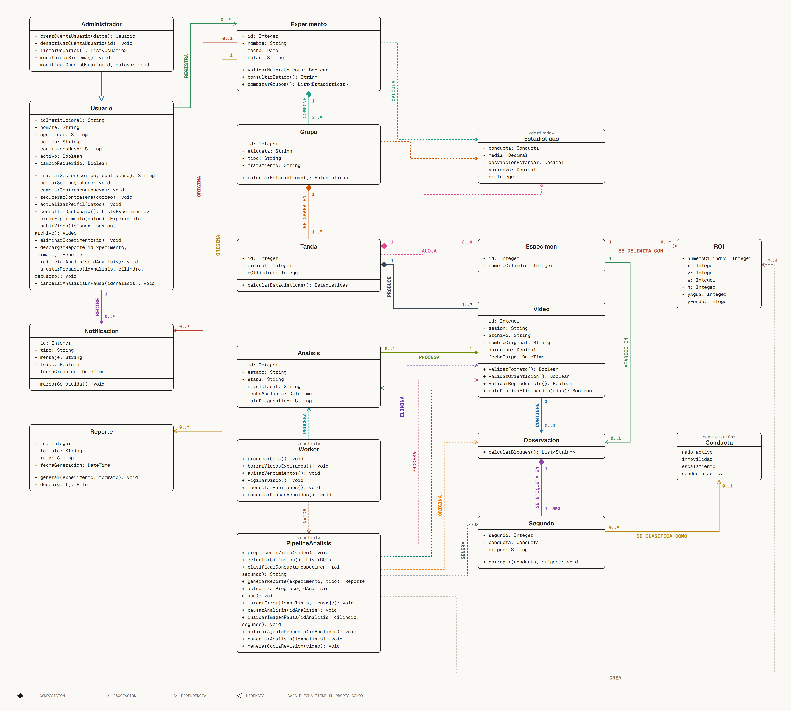

# Diagrama de clases completo (16 clases)



Archivo interactivo: [clases_completo.html](clases_completo.html) (ocupa toda la altura
de la pantalla y se desliza en horizontal).
Fuente de los datos: [`../clases.puml`](../clases.puml).

## Qué es esta prueba

Es una prueba de cómo se vería el diagrama de clases con el estilo de la skill
*diagram-design*, **rompiendo a propósito su regla de máximo 7 clases por diagrama**. La
skill recomienda partirlo por paquete; aquí están las 16 clases y las 23 relaciones en una
sola vista.

## Zonas del diagrama

| Zona | Clases |
|------|--------|
| Arriba a la izquierda (autenticación y usuarios) | `Administrador`, `Usuario`, `Notificacion`, `Reporte` |
| Arriba al centro y a la derecha (experimentos y video) | `Experimento`, `Grupo`, `Tanda`, `Especimen`, `Video` |
| Centro (pipeline de análisis) | `Analisis`, `Worker`, `PipelineAnalisis`, `ROI` |
| Derecha (resultados) | `Observacion`, `Conducta` (enumeración), `Segundo` |

## Relaciones

- **Herencia:** `Administrador` hereda de `Usuario` (no es un tipo aparte: es un usuario
  con permisos adicionales).
- **Composición (rombo lleno):** `Experimento` → `Grupo` → `Tanda` → `Especimen` y
  `Video`; `Observacion` → `Segundo`. Si el contenedor desaparece, sus
  partes también.
- **Asociación:** `Usuario` registra `Experimento` y recibe `Notificacion`; `Experimento`
  origina `Reporte` y `Notificacion`; `Analisis` procesa un `Video`; `Especimen` y `Video`
  aparecen en `Observacion`.
- **Dependencia (línea punteada):** el `Worker` invoca a `PipelineAnalisis` y procesa
  `Analisis`; el pipeline crea `ROI` y actualiza `Analisis`, y origina `Observacion` y genera
  los `Segundo`.
- **Sin clase asociativa:** desde D-52 (14-oct) no hay `Intervalo` ni `PRESENTA`; los segundos
  por conducta de cada minuto se calculan desde `Segundo`.
- **Estereotipo `«control»`:** `Worker` y `PipelineAnalisis` son clases de control, no de
  datos.

## Multiplicidades que conviene tener presentes

- Un experimento tiene al menos 3 grupos; un grupo, al menos 1 tanda.
- Una tanda aloja de 2 a 4 especímenes y produce 1 o 2 videos.
- Una observación se etiqueta en de 1 a 300 segundos (300 es un máximo, sin mínimo: se
  analizan los últimos 300 s del video).

## Qué se ve bien y qué no

**Bien:** letra legible, líneas rectas, sin cruces confusos, miembros completos y la
vista de conjunto en una pantalla.

**Mal:**

- Es demasiado ancho para una página de LaTeX; reducido a ancho de hoja, el texto de 9 px
  queda ilegible.
- La zona central (`Worker`, `PipelineAnalisis`, `Analisis`, `Video`) queda apretada, con
  seis flechas punteadas.
- La flecha «PROCESA» de `PipelineAnalisis` a `Analisis` no tiene etiqueta y las dos
  «ORIGINA» desde `Experimento` se parecen.

## Verificación contra el grafo relacional

Los atributos de las clases de datos coinciden con `grafo_relacional_3_vigente.puml`
(se comparó clase por clase; las llaves foráneas no aparecen como atributos, como es
normal en un diagrama de clases).

**`ROI` es una clase transitoria del pipeline.** Sus atributos (`numeroCilindro`, `x`, `y`,
`w`, `h`, `yAgua`, `yFondo`) no están en el grafo vigente a propósito: el grafo dice que la
región de cada cilindro se calcula en cada corrida y no se guarda (ver «Qué NO entra:
ROIS»). El diagrama lo indica con una nota: «Coordenadas del video ya estabilizado. No se
guarda en la base de datos.» Lo único que se guarda de ese recorte es la conducta de cada
segundo, que cuelga de `Observacion` y `Segundo`.

Cambios aplicados al `ROI` (8-oct, tras la revisión de quien construye el clasificador):

- Atributos nuevos: `numeroCilindro`, `yAgua` y `yFondo` (altura de la superficie y del
  fondo del tubo).
- Asociación `Especimen 1 — 0..* ROI` («se delimita con»), para saber de qué cilindro es
  cada recuadro. No identifica el video, y no hace falta: el video lo da `Observacion`.
- Multiplicidad `2..4` en «CREA» (de `PipelineAnalisis` a `ROI`).
- Firma nueva: `clasificarConducta(especimen, roi, segundo): String`. El clasificador
  decide cada segundo con una ventana de 4 s recortada con el `ROI`, no por fotograma.

**Lo que no se agregó, a propósito:** `confianza` en `Segundo` ni ningún otro dato que
entregue el modelo salvo la conducta (el modelo entrenado solo entrega la conducta de cada
segundo), ni `bloque` en `ROI` (solo haría falta si la web dibujara el recuadro sobre el
video original), ni los valores de `origen` `humano_ciego` y `sin_revisar`: D-80 dejó
`origen` con cuatro valores (del sistema, confirmada, corregida y dudosa).

**`Observacion` no tiene atributos, y es correcto:** en el grafo esa tabla solo tiene su
número y los enlaces al espécimen y al video. Representa «un espécimen en un video». Tiene
una sola función, `calcularBloques()`, que agrupa sus segundos en bloques de 5 s: la
conducta del bloque es la que ocupa más de sus cinco segundos, como en el muestreo por
intervalos de 5 s de Detke et al. (1995), descrito por Craft et al. (2010) (RN-15, RF-18). Los bloques se calculan al mostrarse y no se guardan en la
base de datos.

Los **métodos** no tienen contraparte en el grafo (es esquema de datos); se copiaron de
`clases.puml` sin verificarlos contra ningún otro documento.

## Cómo regenerarlo

```bash
python diagramas/diagram_design/generadores/gen_clases_hojas.py U diagramas/diagram_design/clases_completo.html
```

## Actualización del 12-oct (rama `decisiones-11oct`)

Se regeneró desde `clases.puml` con las decisiones del Día 1 (D-71): el video del Día 1 se
sube y se guarda, pero no se analiza. Por eso cambiaron tres multiplicidades:

- `Analisis` — `Video`: el análisis es `0..1` por video (antes `1`).
- `Especimen` — `Observacion`: `0..1` (antes `1..2`).
- `Video` — `Observacion`: `0..4` (antes `2..4`).

`Video` pasa de `validarFormatoMp4()` a `validarFormato()` y `validarOrientacion()`, y desde el
14-oct (D-52) ya no existen `Intervalo` ni `PRESENTA`, como en `clases.puml`.

## Métodos agregados el 12-oct

Se agregaron a `clases.puml` y a este diagrama los métodos que salen de las decisiones y
requisitos vigentes (no están en el grafo, que solo describe datos):

- `Usuario.reiniciarAnalisis(idAnalisis)`: el investigador puede reiniciar un análisis desde la
  revisión (D-60, D-68, RN-04).
- `Administrador.modificarCuentaUsuario(id, datos)`: incluye el rol (D-72, RF-05).
- `Worker.avisarVencimientos()` y `Worker.vigilarDisco()`: junto con `borrarVideosExpirados()`,
  las tareas diarias del worker (D-82, RF-24, RF-29).
- `PipelineAnalisis.pausarAnalisis()`, `cancelarAnalisis()` y `generarCopiaRevision(video)`: la pausa
  y la cancelación por espécimen que no se ve (RN-17) y la copia H.264 para revisión (D-58).

## Cambios de la segunda parte del 12-oct (D-84 a D-89)

Se agregaron los métodos que salen de las decisiones del worker y de la pausa, y se movieron
`Notificacion`, `Reporte` y `PipelineAnalisis` para que no se encimen con las clases que crecieron:

- `Usuario.ajustarRecuadro(idAnalisis, cilindro, recuadro)` y `Usuario.cancelarAnalisisEnPausa(idAnalisis)`
  (pantalla de pausa, D-89).
- `Worker.reencolarHuerfanos()` (D-84) y `Worker.cancelarPausasVencidas()` (D-89).
- `PipelineAnalisis.guardarImagenPausa(idAnalisis, cilindro, segundo)` y
  `PipelineAnalisis.aplicarAjusteRecuadro(idAnalisis)` (D-89).
- `PipelineAnalisis.actualizarProgreso(idAnalisis, etapa)`: ya no lleva `pct`; el backend calcula el
  porcentaje como un tercio por etapa.

## Actualización del 13-oct: una sola hoja carta horizontal

Se reacomodaron las clases para que el diagrama (2150 × 1619 px) quepa en una hoja carta
horizontal: se quitó la columna del Administrador (ahora va sobre Usuario), las clases del
análisis automático van en la misma columna que Experimento y las firmas largas se parten en
dos renglones. Cada flecha lleva su propio color, las palabras de las relaciones verticales van
giradas y se quitó la nota de las coordenadas del ROI.

Con los márgenes del documento, la letra de las clases queda en unos 3 pt en papel. La versión
en dos hojas se retiró el 14-oct.

**14-oct (D-102):** `Conducta` pasa a enumeración con sus cuatro valores (nado activo, inmovilidad,
escalamiento y conducta activa), porque en la base de datos deja de ser tabla y es el dominio
`tipo_conducta`. `Segundo.conducta` es de tipo `Conducta`.

El generador es `generadores/gen_clases_hojas.py` (opción `U`); ya no existe `gen_clases.py`.
Los PNG se sacan con Edge sin ventana, al doble de resolución.

## Actualización del 13-oct: estadísticas por grupo (RF-31)

Dos métodos nuevos, sin tablas ni columnas nuevas: las estadísticas se derivan de `SEGUNDO`,
no se guardan (`../../DISENO-BD.md`, sección 4).

- `Grupo.calcularEstadisticas(): Estadisticas`: media, desviación estándar y varianza del tiempo
  de cada conducta entre los espécimen del grupo.
- `Experimento.compararGrupos(): List<Estadisticas>`: las estadísticas de todos los grupos, para
  la comparación entre grupos (RF-21) y para el CSV y el XLSX.

`Estadisticas` es un valor que se calcula y se devuelve; no es una clase de la base de datos.
Falta pasar estos métodos a `../clases.puml`, que todavía no los tiene.
