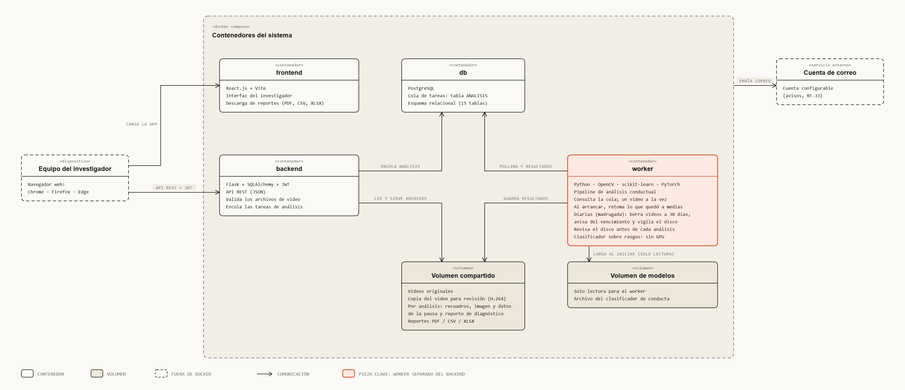

# Diagrama de contenedores



Archivo interactivo: [contenedores.html](contenedores.html) (se abre en el navegador y se
desliza en horizontal).

## Qué muestra

Cómo se empaqueta el sistema en contenedores Docker y cómo se comunican las piezas: qué hay
en el equipo del investigador, qué hay dentro de Docker Compose (cuatro contenedores y dos
volúmenes) y qué queda fuera. La vista de qué tecnología tiene cada capa está en
[arquitectura_capas.md](arquitectura_capas.md).

**No es un diagrama de despliegue, y no se inserta en el documento.** D-62 deja el despliegue
fuera del alcance y fuera del documento, y D-73 deja Docker solo como herramienta de
empaquetado, sin hablar de servidores ni de producción. Por eso este diagrama no dice dónde
corre el sistema ni en qué servidor. Antes se llamaba «despliegue» y decía «Servidor
institucional ESCOM»; se renombró el 12-oct.

## Los nodos

| Nodo | Qué contiene | Fuente |
|------|--------------|--------|
| Equipo del investigador | Navegador web: Chrome, Firefox o Edge, sin instalar nada | RNF-07 |
| Docker Compose | Cuatro contenedores y dos volúmenes | cap. 5 |
| Cuenta de correo | Servicio externo, configurable | RF-33 |

Dentro de Docker Compose:

- **frontend:** React.js + Vite.
- **backend:** Flask + SQLAlchemy + JWT. Valida los videos y encola los análisis.
- **worker:** pipeline de análisis (OpenCV, scikit-learn, PyTorch). Consulta la cola
  periódicamente y ejecuta las tareas diarias (borrado de videos a los 30 días, aviso de
  vencimiento y vigilancia del disco; D-82). El clasificador sobre rasgos corre en
  procesador, sin GPU.
- **db:** PostgreSQL. La cola de tareas es la tabla `ANALISIS`.
- **Volumen compartido:** videos originales, la copia del video para revisión (H.264),
  reportes y reportes de diagnóstico.
- **Volumen de modelos:** el archivo del clasificador; solo lectura para el worker.

## Cómo se comunican

El navegador carga la aplicación desde el frontend y habla con el backend por API REST
(JSON + JWT). Backend y worker no se hablan directamente: se coordinan a través de la
base de datos (el backend encola, el worker toma tareas por *polling*). Los dos usan el
volumen compartido; solo el worker carga el volumen de modelos.

## Almacenamiento

Alerta al administrador a 80 % de uso del disco y limpieza automática de los videos más
antiguos a 90 % (RNF-08 y RNF-09).

## Pendientes

- **Correo:** los diagramas de secuencia dicen que el worker envía el aviso cuando un
  análisis termina, falla, queda en pausa o se cancela (`seq_analisis_automatico`), y que el
  backend envía las credenciales al crear una cuenta (`seq_crear_cuenta`). Como son dos
  contenedores, la flecha sale del borde de Docker Compose.
- **HTTPS:** ningún capítulo del 1 al 5 lo menciona; no se dibujó.

## Cómo regenerarlo

```bash
python diagramas/diagram_design/generadores/gen_contenedores.py diagramas/diagram_design/contenedores.html
```

## Actualización del 12-oct (D-84 a D-89)

- **worker:** un video a la vez, retoma al arrancar lo que quedó a medias (D-84, D-85), hace las
  tareas diarias a una hora fija de la madrugada y revisa el disco antes de cada análisis (D-86).
- **Volumen compartido:** por análisis guarda también los recuadros, la imagen y los datos de la
  pausa y el reporte de diagnóstico (D-88, D-89).
