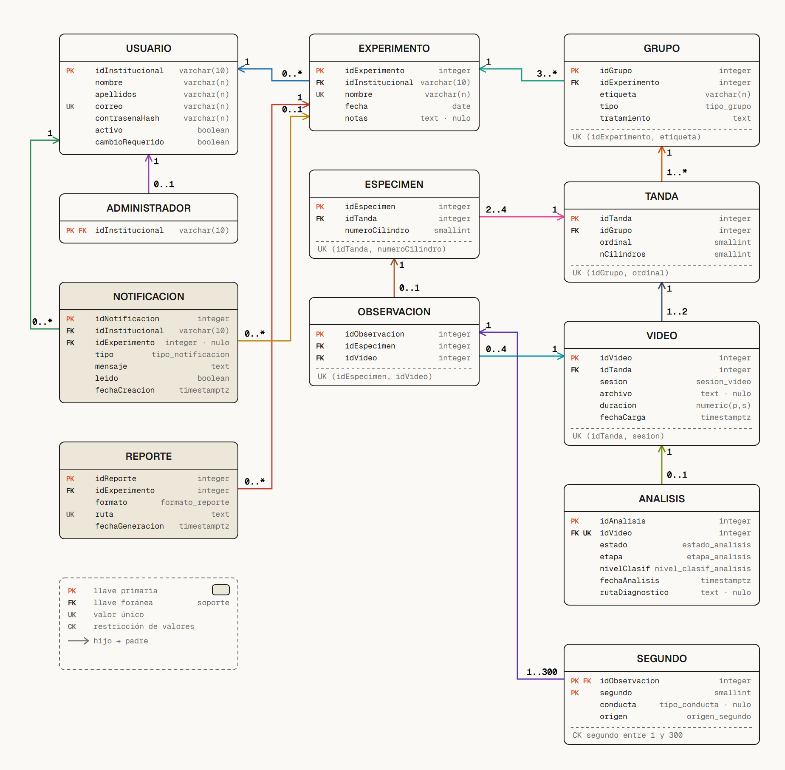

# Esquema de la base de datos



Archivo interactivo: [esquema_bd.html](esquema_bd.html) (se abre en el navegador y se desliza
en horizontal).
Versión en PlantUML: [`../esquema_fisico.puml`](../esquema_fisico.puml).

## Qué muestra

Las 12 tablas de PostgreSQL con sus columnas y tipos, y las 13 llaves foráneas con su
cardinalidad. Cada columna lleva su marca: **PK** (llave primaria), **FK** (foránea) o **UK**
(única). Las restricciones de varias columnas (`UK (...)`, `CK ...`) van debajo de cada tabla.
Abajo a la izquierda están los ocho dominios cerrados con sus valores.

## Cómo se lee

- Cada flecha va de la tabla hija (la que tiene la FK) a la tabla padre. El número junto al
  hijo es cuántas filas hijas puede tener un padre; el número junto al padre, cuántos padres
  admite cada hija (`0..1` = opcional).
- Las tablas de color más oscuro (`NOTIFICACION`, `REPORTE`) son soporte del sistema.
- `ANALISIS.idVideo` es única: un video tiene un solo análisis vigente (D-24). Solo existe
  para videos del Día 2 (D-71).
- Los totales por minuto no tienen tabla (D-52): se calculan desde `SEGUNDO`. `CONDUCTA` ya no es tabla (D-102): es el dominio `tipo_conducta` de `SEGUNDO.conducta`. El esquema tiene 12 tablas y 13 llaves foráneas.

## Fuente

`../esquema_fisico.puml` (figura 5.5 del cap. 5), que sigue `../grafo_relacional_3_vigente.puml`.
Si cambia el esquema, se cambian ese archivo y `generadores/gen_esquema.py`.

## Cómo regenerarlo

```bash
python diagramas/diagram_design/generadores/gen_esquema.py diagramas/diagram_design/esquema_bd.html
```
