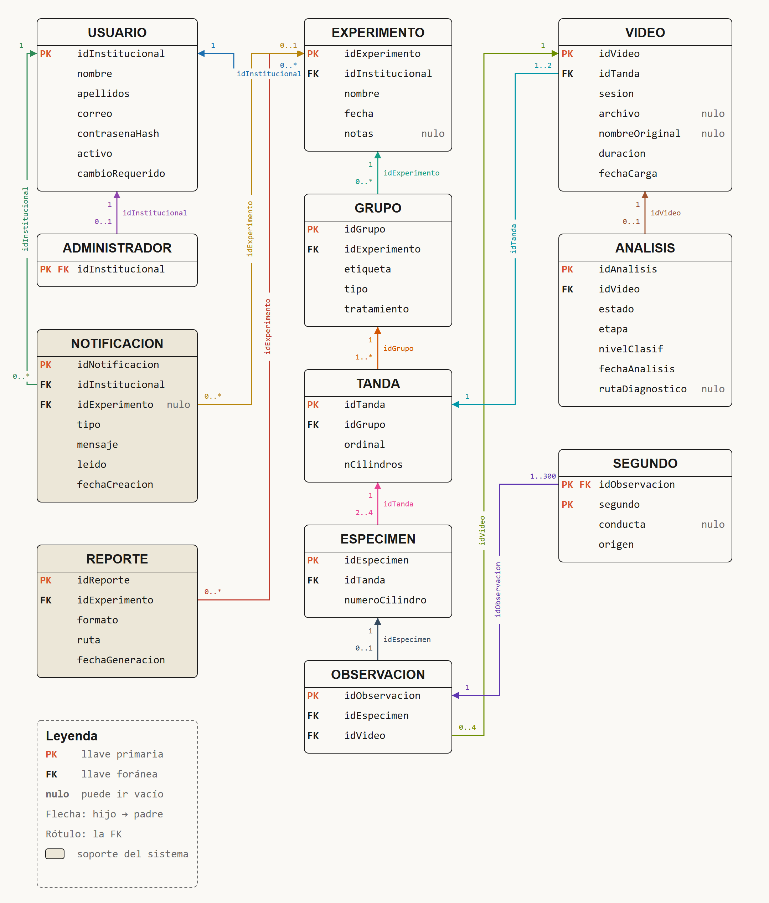

# Esquema lógico (grafo relacional)



Archivo interactivo: [esquema_logico.html](esquema_logico.html).
Versión en PlantUML: [`../grafo_relacional_3_vigente.puml`](../grafo_relacional_3_vigente.puml).

## Qué muestra

Las 12 relaciones del esquema lógico con sus atributos, sin tipos de dato: la llave primaria
(**PK**), las foráneas (**FK**) y los atributos que pueden quedar vacíos
(`nulo`). Cada flecha va de la relación hija a la padre; el rótulo es la llave foránea y los
números son la cardinalidad en cada extremo. Son 13 llaves foráneas.

## Diferencia con el esquema físico

Es el mismo contenido que [esquema_bd.html](esquema_bd.html) sin tipos de dato ni restricciones
de valores (`CK`): lo que el gestor decide queda para el físico.

## Cómo regenerarlo

```bash
python diagramas/diagram_design/generadores/gen_logico.py diagramas/diagram_design/esquema_logico.html
```
