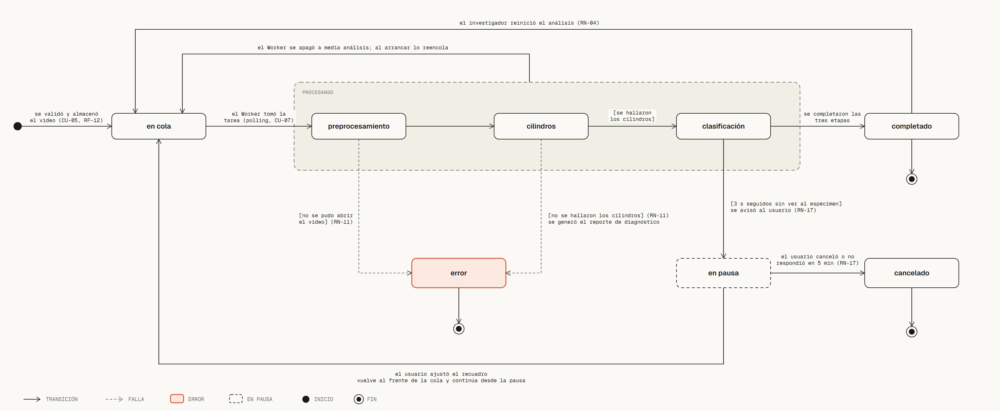
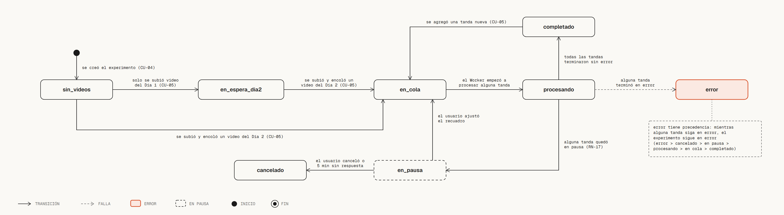

# Máquinas de estados: análisis y experimento





Archivos interactivos: [estados_analisis.html](estados_analisis.html) y
[estados_experimento.html](estados_experimento.html).
Versión en PlantUML del documento: [`../estados_analisis.puml`](../estados_analisis.puml) y
[`../estados_experimento.puml`](../estados_experimento.puml).

## Estados del análisis

Seis estados: en cola, procesando (con tres etapas: preprocesamiento, cilindros y
clasificación), en pausa, completado, error y cancelado.

- **Error** sale de dos puntos: no se pudo abrir el video (preprocesamiento) o no se hallaron
  los cilindros; en los dos casos se genera el reporte de diagnóstico (RN-11).
- **Pausa:** 3 s seguidos sin ver al espécimen. Si el usuario ajusta el recuadro, el análisis
  vuelve al frente de la cola y continúa desde la pausa; si cancela o no responde en 5 minutos,
  pasa a cancelado (RN-17, D-89).
- **Reencolado:** si el Worker se apaga a media análisis, al arrancar lo reencola (D-84).
- **Reinicio:** el investigador puede reiniciar un análisis completado (RN-04).

## Estados del experimento

Ocho estados: sin videos, en espera del Día 2, en cola, procesando, en pausa, completado, error
y cancelado. El estado del experimento sale del estado de sus tandas, y gana el más grave:
error > cancelado > en pausa > procesando > en cola > completado.

- **En espera del Día 2:** solo se subió el video del Día 1 (D-83).
- **Completado a en cola:** se agregó una tanda nueva.

## Fuente

`../estados_analisis.puml` y `../estados_experimento.puml`. Si cambian, se cambia
`generadores/gen_estados.py`: los estados y las transiciones están escritos en el generador.

## Cómo regenerarlos

```bash
python diagramas/diagram_design/generadores/gen_estados.py analisis diagramas/diagram_design/estados_analisis.html
python diagramas/diagram_design/generadores/gen_estados.py experimento diagramas/diagram_design/estados_experimento.html
```
