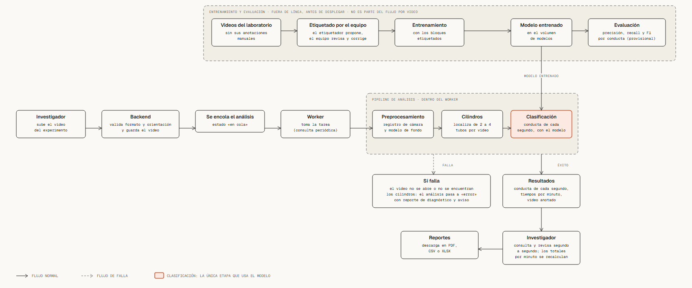

# Flujo general del sistema



Archivo interactivo: [flujo_sistema.html](flujo_sistema.html).
Versión en PlantUML del documento: [`../flujo_general.puml`](../flujo_general.puml).

## Qué muestra

El camino de un video desde que el investigador lo sube hasta que descarga los reportes
(abajo), y, aparte, cómo se entrena el modelo que usa la clasificación (arriba).

## Flujo por video (de izquierda a derecha)

1. **El investigador sube el video del experimento.**
2. **El backend** valida formato y orientación (`.mp4` o `.mov`, en horizontal) y guarda el
   video en el volumen compartido.
3. **Se encola el análisis:** se crea un registro con estado «en cola» en la tabla
   `ANALISIS`.
4. **El worker toma la tarea** consultando periódicamente esa tabla.
5. **Pipeline de análisis,** tres etapas:
   - *Preprocesamiento:* registro de cámara y modelo de fondo.
   - *Cilindros:* localiza de 2 a 4 tubos por video.
   - *Clasificación:* decide la conducta de cada segundo con el modelo entrenado. Es la
     única etapa que usa el modelo.
6. **Si todo sale bien** se guardan los resultados: conducta de cada segundo, tiempos por
   minuto y video anotado.
7. **Si falla** (el video no se abre o no se encuentran los cilindros), el análisis pasa a
   «error», se genera el reporte de diagnóstico y se avisa al investigador (RN-11).
8. **El investigador consulta y revisa** segundo a segundo; al guardar, los totales por
   minuto se recalculan (RN-14).
9. **Descarga los reportes** en PDF, CSV o XLSX.

## Entrenamiento y evaluación (fuera de línea)

Ocurre antes de desplegar y no forma parte del flujo por video: videos del laboratorio,
etiquetado por el equipo (el etiquetador propone la conducta y el equipo revisa y corrige),
entrenamiento, modelo entrenado (queda en el volumen de modelos) y evaluación con
precisión, *recall* y F1 por conducta. **Sin las anotaciones manuales del laboratorio**,
ni para entrenar ni para probar. La evaluación está marcada como provisional porque sigue
abierta la pregunta de si basta con F1 sobre un conjunto de prueba propio.

## Fuentes

Cap. 5: «Arquitectura general», «Diseño del pipeline de análisis conductual» (módulos 1 a
4, entrenamiento en bola de nieve) y «Ciclo de vida del análisis»; cap. 4: RN-11, RN-14.

## Diferencias con `flujo_general.puml` y con el texto

- El `.puml` agrupa todo en «Sistema web», «Análisis de conducta» y «Almacenamiento»; aquí
  se muestra el recorrido paso a paso, con el camino de falla.
- El `.puml` dice «Preprocesamiento (cuadros y limpieza)»; aquí dice lo que describe el
  cap. 5: registro de cámara y modelo de fondo.
- **El texto del cap. 5 (párrafo antes de la figura del flujo)** dice que el ciclo de
  entrenamiento es «anotación experta, dataset y entrenamiento». Eso contradice la
  estrategia vigente (se entrena sin las anotaciones del laboratorio) y este diagrama.
  No se modificó; conviene corregirlo si se usa esta figura.

## Cómo regenerarlo

```bash
python diagramas/diagram_design/generadores/gen_flujo.py diagramas/diagram_design/flujo_sistema.html
```
