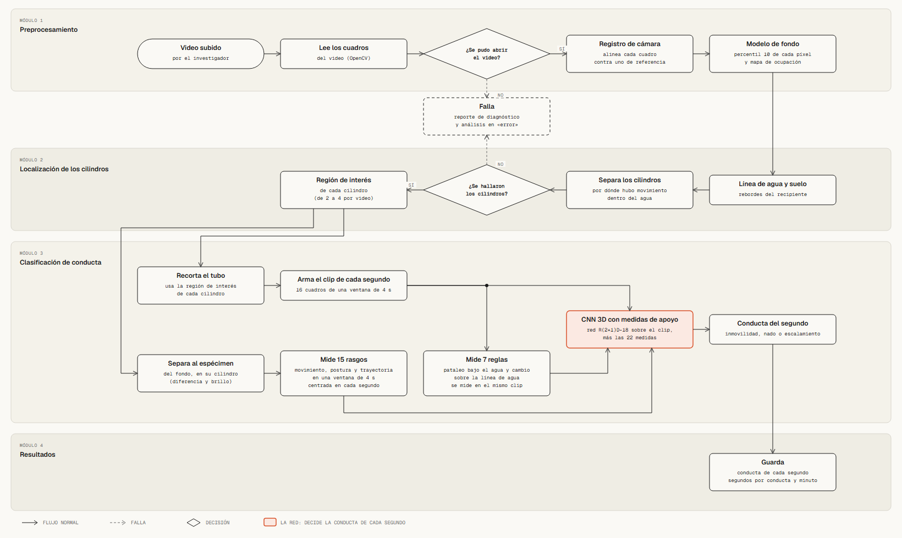

# Pipeline de análisis conductual



Archivo interactivo: [pipeline_analisis.html](pipeline_analisis.html).

## Qué muestra

Lo que hace el worker con un video, módulo por módulo, desde que lo recibe hasta que guarda
los resultados, incluidas las dos fallas posibles. Las flechas serpentean para que el final de
cada módulo quede junto al inicio del siguiente.

**Esta versión describe la CNN de fusión** (una sola red decide con el clip y las medidas). No
es lo que describe hoy el cap. 5; ver «Lo que no coincide con el documento» abajo.

## Los cuatro módulos

1. **Preprocesamiento.** Lee los cuadros (si el video no se abre, falla). Alinea cada cuadro
   contra uno de referencia (registro de cámara) y construye el modelo de fondo: el
   percentil 10 de cada píxel, más un mapa de ocupación que dice dónde hubo movimiento. No
   hay corrección de contraste.
2. **Localización de los cilindros.** Encuentra la línea de agua y el suelo, separa los
   cilindros por dónde hubo movimiento dentro del agua y calcula la región de interés de cada
   uno (de 2 a 4 por video). Si no los encuentra, falla.
3. **Clasificación de conducta, con la CNN de fusión.** Dos ramas que se juntan en la red:
   - *Rama de video:* «Recorta el tubo» (con la región de interés de cada cilindro, que viene
     del módulo 2) → «Arma el clip de cada segundo» (16 cuadros de una ventana de 4 s). Del
     clip salen **dos** cosas: va a la red y de él se miden las 7 reglas (pataleo bajo el agua
     y cambio sobre la línea de agua).
   - *Rama de medidas:* «Separa al espécimen» (recibe del módulo 2 la región de interés y el
     fondo, **no** del recorte: los rasgos se miden sobre el video estabilizado) → «Mide 15
     rasgos» de movimiento, postura y trayectoria, en una ventana de 4 s centrada en cada
     segundo.
   - *Unión:* «CNN 3D con medidas de apoyo» (red R(2+1)D-18 sobre el clip, más las 22
     medidas = 15 rasgos + 7 reglas). Recibe tres flechas: el clip, las 7 reglas y los 15
     rasgos. Decide la conducta del segundo: inmovilidad, nado o escalamiento.
4. **Resultados.** Guarda la conducta de cada segundo y los segundos por conducta de cada
   minuto.

## Las dos fallas

El video no se abre (módulo 1) o no se encuentran los cilindros (módulo 2). En ambos casos
el análisis pasa a «error», se genera el reporte de diagnóstico y se avisa al investigador
(RN-11).

## Lo que sale del modelo

Solo la conducta de cada segundo. El diagrama no muestra probabilidades, umbral, confianza ni
marca de duda, y tampoco «conducta activa». El recuadro de cada cilindro no se guarda.

## Lo que no está en este diagrama

- **Los 300 s.** El pipeline procesa el video completo, con todo y sus errores. El recorte a
  los últimos 300 s, si lo hace el sistema, ocurre fuera del pipeline y no se dibuja.
- **«Video anotado».** Se quitó de lo que guarda el módulo 4 porque el código no lo genera.
- **«Medidas por cuadro».** Se quitó: es un archivo interno del etiquetador, no una salida del
  modelo, y el sistema no lo usa (el contrato de la CNN solo convierte la conducta de cada
  segundo en filas de `SEGUNDO` y el resumen en `PRESENTA`; ver `DISENO-BD.md`).

## Lo que no coincide con el documento

Este diagrama sigue la descripción que se dio el 8-oct. El LaTeX todavía dice otra cosa en:

- **Cap. 5, módulo 3.** Describe como clasificador principal un modelo sobre rasgos con la
  regla de tres pasos (umbral de confianza, conducta activa, marca de duda) y a la red como
  candidata en evaluación; dice que hoy la red decide por bloques de 5 s y que llevarla al
  nivel de segundo y elegir entre las dos se hará en TT-II. Aquí la red es el flujo principal
  y decide cada segundo. Sí coincide la mención de que la versión más reciente fusiona la red
  con una rama de medidas (quince rasgos y siete reglas) y los clips de 16 cuadros.
- **RN-13 y RF-17.** Hablan de la conducta activa como cuarta conducta.
- **Cap. 5, módulo 4 («cuatro salidas»).** Lista «video anotado» y «medidas por cuadro».
- **`origen = dudosa`.** El documento marca los segundos dudosos con ese valor, que sale de la
  regla de umbral que aquí ya no existe.
- **Cap. 5, inicio de la sección del pipeline** dice que analiza solo los últimos 300 s.
- **`pipeline.puml`.** Sigue la versión anterior: rasgos con regla de tres pasos, la red como
  candidata y el recorte a 300 s dentro del módulo 4.

Ningún otro archivo se modificó.

## Cómo regenerarlo

```bash
python diagramas/diagram_design/generadores/gen_pipeline.py diagramas/diagram_design/pipeline_analisis.html
```
